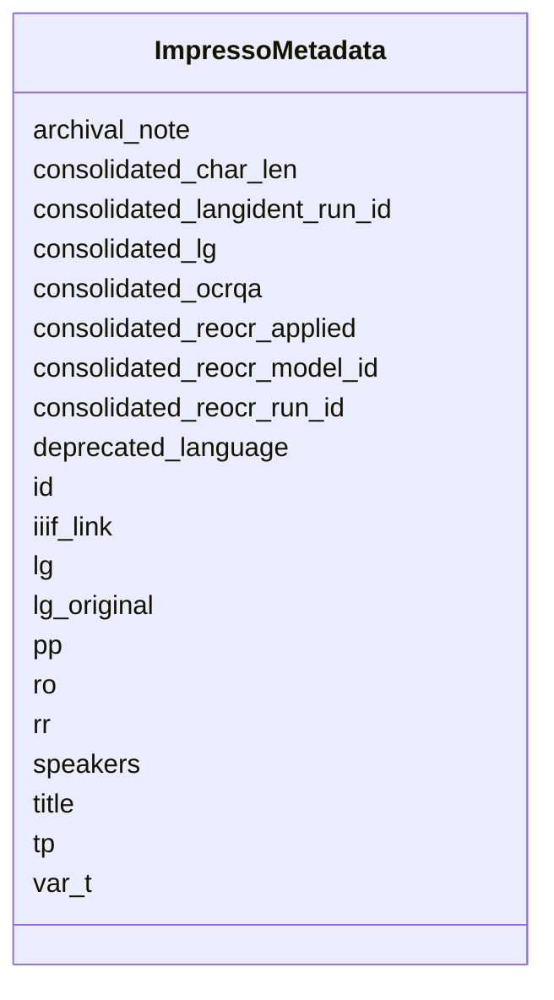

---
search:
  boost: 10.0
---

# Class: ImpressoMetadata 


_Metadata for an entry in the canonical issue, including its page or audio references._


<div data-search-exclude markdown="1">


URI: [pc:ImpressoMetadata](https://pruzhany.org/ns/sourced-entities#ImpressoMetadata)





<!-- no inheritance hierarchy -->

## Slots

| Name | Cardinality and Range | Description | Inheritance |
| ---  | --- | --- | --- |
| [id](id.md) | 1 <br/> [String](String.md) | Content item ID (e.g. `GDL-1900-01-02-a-i0001`). | direct |
| [lg](lg.md) | 1 <br/> [String](String.md) | Language of the content item. | direct |
| [deprecated_language](deprecated_language.md) | 0..1 <br/> [String](String.md) | Language of the content item (deprecated). | direct |
| [consolidated_reocr_applied](consolidated_reocr_applied.md) | 0..1 <br/> [Boolean](Boolean.md) | True if the CI's text went through the re-OCRisation process. Only defined if `consolidated==True`. | direct |
| [consolidated_reocr_run_id](consolidated_reocr_run_id.md) | 0..1 <br/> [String](String.md) | Run ID corresponding to the re-OCR process. Only defined if `consolidated==True` and `consolidated_re_ocr_applied==True`. | direct |
| [consolidated_reocr_model_id](consolidated_reocr_model_id.md) | 0..1 <br/> [String](String.md) | Model ID or name corresponding to the re-OCR process. Only defined if `consolidated==True` and `consolidated_re_ocr_applied==True`. | direct |
| [consolidated_ocrqa](consolidated_ocrqa.md) | 0..1 <br/> [Double](Double.md) | Estimated OCR quality, between 0 and 1. May be null if there is no text or not enough text to compute an estimate. Only defined if `consolidated==True`. | direct |
| [consolidated_char_len](consolidated_char_len.md) | 0..1 <br/> [Integer](Integer.md) | Character count of the consolidated text for the content item. May be null if there is no text. Only defined if `consolidated==True`. | direct |
| [lg_original](lg_original.md) | 0..1 <br/> [String](String.md) | Language of the content item in the original OCR/OLR. Only defined if `consolidated==True`. | direct |
| [consolidated_lg](consolidated_lg.md) | 0..1 <br/> [String](String.md) | Computed language of the content item. Only defined if `consolidated==True`. | direct |
| [consolidated_langident_run_id](consolidated_langident_run_id.md) | 0..1 <br/> [String](String.md) | Run ID corresponding to the lang ID process used to obtain the `consolidated_language` value. Only defined if `consolidated==True`. | direct |
| [pp](pp.md) | * <br/> [Integer](Integer.md) | Page numbers over which the content item spans, in the case `sm` is in [`print`, `typescript`]. | direct |
| [rr](rr.md) | * <br/> [Integer](Integer.md) | Record numbers over which the content item spans, in the case `sm` is `audio`. | direct |
| [title](title.md) | 0..1 <br/> [String](String.md) | Title of the content item. The field is present only when a meaningful title is available. | direct |
| [tp](tp.md) | 1 <br/> [String](String.md) | Type of the content item. | direct |
| [iiif_link](iiif_link.md) | 0..1 <br/> [String](String.md) | IIIF image link, depending on content item type (if `tp == image`). The field is present only when a meaningful link is available. It should follow the format: '{scheme}://{server}/{prefix}/{identifier}/info.json'. | direct |
| [ro](ro.md) | 0..1 <br/> [Integer](Integer.md) | Reading order index of the content item, for the table of contents view on the interface. If not defined, the CI number (after 'i' in the ID) should be used. | direct |
| [speakers](speakers.md) | * <br/> [String](String.md) | List of speakers (names or IDs based on availabilities) within boradcast. | direct |
| [var_t](var_t.md) | 0..1 <br/> [String](String.md) | Deprecated, replaced by `media_title_variant` at issue's top-level. Variant title of the media title this CI is from (only in the case of BL newspapers). The field is present only when a meaningful variant title is available. | direct |
| [archival_note](archival_note.md) | 0..1 <br/> [String](String.md) | Plaintext archival note or description concerning the content item. In case of audio radio broadcasts, this corresponds to the content summary provided with the metadata. The field is present only when a meaningful note is available. | direct |

<details>
<summary>Expressions & Logic</summary>
#### Exactly One Of

The class must satisfy exactly one of:
- AnonymousClassExpression({'slot_conditions': {'pp': SlotDefinition({'name': 'pp', 'required': True})}})
- AnonymousClassExpression({'slot_conditions': {'rr': SlotDefinition({'name': 'rr', 'required': True})}})

</details>


## Usages

| used by | used in | type | used |
| ---  | --- | --- | --- |
| [ImpressoIssueItem](ImpressoIssueItem.md) | [metadata](metadata.md) | range | [ImpressoMetadata](ImpressoMetadata.md) |


## Rules


### 

| Rule Applied | Preconditions | Postconditions | Elseconditions |
|--------------|---------------|----------------|----------------|
| slot_conditions |```{'consolidated_reocr_run_id': {'required': True}}``` |```{'consolidated_reocr_applied': {'required': True}, 'consolidated_ocrqa': {'required': True}, 'consolidated_char_len': {'required': True}}``` | |


### 

| Rule Applied | Preconditions | Postconditions | Elseconditions |
|--------------|---------------|----------------|----------------|
| slot_conditions |```{'consolidated_lg': {'required': True}}``` |```{'consolidated_langident_run_id': {'required': True}}``` | |


## Identifier and Mapping Information


### Annotations

| property | value |
| --- | --- |
| impresso | issue.$defs.metadata |


### Schema Source


* from schema: https://pruzhany.org/ns/impresso_issue


## Mappings

| Mapping Type | Mapped Value |
| ---  | ---  |
| self | pc:ImpressoMetadata |
| native | pc:ImpressoMetadata |


## LinkML Source

<!-- TODO: investigate https://stackoverflow.com/questions/37606292/how-to-create-tabbed-code-blocks-in-mkdocs-or-sphinx -->

### Direct

<details>
```yaml
name: ImpressoMetadata
annotations:
  impresso:
    tag: impresso
    value: issue.$defs.metadata
description: Metadata for an entry in the canonical issue, including its page or audio
  references.
from_schema: https://pruzhany.org/ns/impresso_issue
rank: 1000
attributes:
  id:
    name: id
    annotations:
      impresso:
        tag: impresso
        value: issue.$defs.metadata.id
    description: Content item ID (e.g. `GDL-1900-01-02-a-i0001`).
    from_schema: https://pruzhany.org/ns/impresso_issue
    domain_of:
    - ImpressoIssue
    - ImpressoMetadata
    - ImpressoLegacy
    - ImpressoStyle
    required: true
    pattern: ^[A-Za-z][A-Za-z0-9_]*-\d{4}-\d{2}-\d{2}-[a-z]{1,2}-i[0-9]{4}$
  lg:
    name: lg
    annotations:
      impresso:
        tag: impresso
        value: issue.$defs.metadata.lg
      nullable:
        tag: nullable
        value: true
    description: Language of the content item.
    from_schema: https://pruzhany.org/ns/impresso_issue
    rank: 1000
    domain_of:
    - ImpressoMetadata
    required: true
  deprecated_language:
    name: deprecated_language
    annotations:
      impresso:
        tag: impresso
        value: issue.$defs.metadata.l
    description: Language of the content item (deprecated).
    from_schema: https://pruzhany.org/ns/impresso_issue
    rank: 1000
    alias: l
    domain_of:
    - ImpressoMetadata
  consolidated_reocr_applied:
    name: consolidated_reocr_applied
    annotations:
      impresso:
        tag: impresso
        value: issue.$defs.metadata.consolidated_reocr_applied
    description: True if the CI's text went through the re-OCRisation process. Only
      defined if `consolidated==True`.
    from_schema: https://pruzhany.org/ns/impresso_issue
    rank: 1000
    domain_of:
    - ImpressoMetadata
    range: boolean
  consolidated_reocr_run_id:
    name: consolidated_reocr_run_id
    annotations:
      impresso:
        tag: impresso
        value: issue.$defs.metadata.consolidated_reocr_run_id
    description: Run ID corresponding to the re-OCR process. Only defined if `consolidated==True`
      and `consolidated_re_ocr_applied==True`.
    from_schema: https://pruzhany.org/ns/impresso_issue
    rank: 1000
    domain_of:
    - ImpressoMetadata
  consolidated_reocr_model_id:
    name: consolidated_reocr_model_id
    annotations:
      impresso:
        tag: impresso
        value: issue.$defs.metadata.consolidated_reocr_model_id
    description: Model ID or name corresponding to the re-OCR process. Only defined
      if `consolidated==True` and `consolidated_re_ocr_applied==True`.
    from_schema: https://pruzhany.org/ns/impresso_issue
    rank: 1000
    domain_of:
    - ImpressoMetadata
  consolidated_ocrqa:
    name: consolidated_ocrqa
    annotations:
      impresso:
        tag: impresso
        value: issue.$defs.metadata.consolidated_ocrqa
      nullable:
        tag: nullable
        value: true
    description: Estimated OCR quality, between 0 and 1. May be null if there is no
      text or not enough text to compute an estimate. Only defined if `consolidated==True`.
    from_schema: https://pruzhany.org/ns/impresso_issue
    rank: 1000
    domain_of:
    - ImpressoMetadata
    range: double
    minimum_value: 0
    maximum_value: 1
  consolidated_char_len:
    name: consolidated_char_len
    annotations:
      impresso:
        tag: impresso
        value: issue.$defs.metadata.consolidated_char_len
      nullable:
        tag: nullable
        value: true
    description: Character count of the consolidated text for the content item. May
      be null if there is no text. Only defined if `consolidated==True`.
    from_schema: https://pruzhany.org/ns/impresso_issue
    rank: 1000
    domain_of:
    - ImpressoMetadata
    range: integer
    minimum_value: 0
  lg_original:
    name: lg_original
    annotations:
      impresso:
        tag: impresso
        value: issue.$defs.metadata.lg_original
      nullable:
        tag: nullable
        value: true
    description: Language of the content item in the original OCR/OLR. Only defined
      if `consolidated==True`.
    from_schema: https://pruzhany.org/ns/impresso_issue
    rank: 1000
    domain_of:
    - ImpressoMetadata
  consolidated_lg:
    name: consolidated_lg
    annotations:
      impresso:
        tag: impresso
        value: issue.$defs.metadata.consolidated_lg
      nullable:
        tag: nullable
        value: true
    description: Computed language of the content item. Only defined if `consolidated==True`.
    from_schema: https://pruzhany.org/ns/impresso_issue
    rank: 1000
    domain_of:
    - ImpressoMetadata
    pattern: ^[a-z]{2,3}$
  consolidated_langident_run_id:
    name: consolidated_langident_run_id
    annotations:
      impresso:
        tag: impresso
        value: issue.$defs.metadata.consolidated_langident_run_id
    description: Run ID corresponding to the lang ID process used to obtain the `consolidated_language`
      value. Only defined if `consolidated==True`.
    from_schema: https://pruzhany.org/ns/impresso_issue
    rank: 1000
    domain_of:
    - ImpressoMetadata
  pp:
    name: pp
    annotations:
      impresso:
        tag: impresso
        value: issue.$defs.metadata.pp
    description: Page numbers over which the content item spans, in the case `sm`
      is in [`print`, `typescript`].
    from_schema: https://pruzhany.org/ns/impresso_issue
    domain_of:
    - ImpressoIssue
    - ImpressoMetadata
    range: integer
    multivalued: true
  rr:
    name: rr
    annotations:
      impresso:
        tag: impresso
        value: issue.$defs.metadata.rr
    description: Record numbers over which the content item spans, in the case `sm`
      is `audio`.
    from_schema: https://pruzhany.org/ns/impresso_issue
    domain_of:
    - ImpressoIssue
    - ImpressoMetadata
    range: integer
    multivalued: true
  title:
    name: title
    annotations:
      impresso:
        tag: impresso
        value: issue.$defs.metadata.t
      json_min_length:
        tag: json_min_length
        value: 1
    description: Title of the content item. The field is present only when a meaningful
      title is available.
    from_schema: https://pruzhany.org/ns/impresso_issue
    rank: 1000
    alias: t
    domain_of:
    - ImpressoMetadata
  tp:
    name: tp
    annotations:
      impresso:
        tag: impresso
        value: issue.$defs.metadata.tp
    description: Type of the content item.
    from_schema: https://pruzhany.org/ns/impresso_issue
    rank: 1000
    domain_of:
    - ImpressoMetadata
    required: true
    equals_string_in:
    - article
    - ad
    - image
    - table
    - death_notice
    - weather
    - page
    - radio_bulletin
    - radio_broadcast_episode
    - chronicle
    - chapter
    - discussion
    - entertainment
  iiif_link:
    name: iiif_link
    annotations:
      impresso:
        tag: impresso
        value: issue.$defs.metadata.iiif_link
      json_min_length:
        tag: json_min_length
        value: 1
    description: 'IIIF image link, depending on content item type (if `tp == image`).
      The field is present only when a meaningful link is available. It should follow
      the format: ''{scheme}://{server}/{prefix}/{identifier}/info.json''.'
    from_schema: https://pruzhany.org/ns/impresso_issue
    rank: 1000
    domain_of:
    - ImpressoMetadata
  ro:
    name: ro
    annotations:
      impresso:
        tag: impresso
        value: issue.$defs.metadata.ro
    description: Reading order index of the content item, for the table of contents
      view on the interface. If not defined, the CI number (after 'i' in the ID) should
      be used.
    from_schema: https://pruzhany.org/ns/impresso_issue
    rank: 1000
    domain_of:
    - ImpressoMetadata
    range: integer
  speakers:
    name: speakers
    annotations:
      impresso:
        tag: impresso
        value: issue.$defs.metadata.speakers
      json_item_types:
        tag: json_item_types
        value: object,string
    description: List of speakers (names or IDs based on availabilities) within boradcast.
    from_schema: https://pruzhany.org/ns/impresso_issue
    rank: 1000
    domain_of:
    - ImpressoMetadata
    multivalued: true
  var_t:
    name: var_t
    annotations:
      impresso:
        tag: impresso
        value: issue.$defs.metadata.var_t
      json_min_length:
        tag: json_min_length
        value: 1
    description: Deprecated, replaced by `media_title_variant` at issue's top-level.
      Variant title of the media title this CI is from (only in the case of BL newspapers).
      The field is present only when a meaningful variant title is available.
    from_schema: https://pruzhany.org/ns/impresso_issue
    rank: 1000
    domain_of:
    - ImpressoMetadata
  archival_note:
    name: archival_note
    annotations:
      impresso:
        tag: impresso
        value: issue.$defs.metadata.archival_note
      json_min_length:
        tag: json_min_length
        value: 1
    description: Plaintext archival note or description concerning the content item.
      In case of audio radio broadcasts, this corresponds to the content summary provided
      with the metadata. The field is present only when a meaningful note is available.
    from_schema: https://pruzhany.org/ns/impresso_issue
    rank: 1000
    domain_of:
    - ImpressoMetadata
rules:
- preconditions:
    slot_conditions:
      consolidated_reocr_run_id:
        name: consolidated_reocr_run_id
        required: true
  postconditions:
    slot_conditions:
      consolidated_reocr_applied:
        name: consolidated_reocr_applied
        required: true
      consolidated_ocrqa:
        name: consolidated_ocrqa
        required: true
      consolidated_char_len:
        name: consolidated_char_len
        required: true
- preconditions:
    slot_conditions:
      consolidated_lg:
        name: consolidated_lg
        required: true
  postconditions:
    slot_conditions:
      consolidated_langident_run_id:
        name: consolidated_langident_run_id
        required: true
extra_slots:
  allowed: true
exactly_one_of:
- slot_conditions:
    pp:
      name: pp
      required: true
- slot_conditions:
    rr:
      name: rr
      required: true

```
</details>

### Induced

<details>
```yaml
name: ImpressoMetadata
annotations:
  impresso:
    tag: impresso
    value: issue.$defs.metadata
description: Metadata for an entry in the canonical issue, including its page or audio
  references.
from_schema: https://pruzhany.org/ns/impresso_issue
rank: 1000
attributes:
  id:
    name: id
    annotations:
      impresso:
        tag: impresso
        value: issue.$defs.metadata.id
    description: Content item ID (e.g. `GDL-1900-01-02-a-i0001`).
    from_schema: https://pruzhany.org/ns/impresso_issue
    owner: ImpressoMetadata
    domain_of:
    - ImpressoIssue
    - ImpressoMetadata
    - ImpressoLegacy
    - ImpressoStyle
    range: string
    required: true
    pattern: ^[A-Za-z][A-Za-z0-9_]*-\d{4}-\d{2}-\d{2}-[a-z]{1,2}-i[0-9]{4}$
  lg:
    name: lg
    annotations:
      impresso:
        tag: impresso
        value: issue.$defs.metadata.lg
      nullable:
        tag: nullable
        value: true
    description: Language of the content item.
    from_schema: https://pruzhany.org/ns/impresso_issue
    rank: 1000
    owner: ImpressoMetadata
    domain_of:
    - ImpressoMetadata
    range: string
    required: true
  deprecated_language:
    name: deprecated_language
    annotations:
      impresso:
        tag: impresso
        value: issue.$defs.metadata.l
    description: Language of the content item (deprecated).
    from_schema: https://pruzhany.org/ns/impresso_issue
    rank: 1000
    alias: l
    owner: ImpressoMetadata
    domain_of:
    - ImpressoMetadata
    range: string
  consolidated_reocr_applied:
    name: consolidated_reocr_applied
    annotations:
      impresso:
        tag: impresso
        value: issue.$defs.metadata.consolidated_reocr_applied
    description: True if the CI's text went through the re-OCRisation process. Only
      defined if `consolidated==True`.
    from_schema: https://pruzhany.org/ns/impresso_issue
    rank: 1000
    owner: ImpressoMetadata
    domain_of:
    - ImpressoMetadata
    range: boolean
  consolidated_reocr_run_id:
    name: consolidated_reocr_run_id
    annotations:
      impresso:
        tag: impresso
        value: issue.$defs.metadata.consolidated_reocr_run_id
    description: Run ID corresponding to the re-OCR process. Only defined if `consolidated==True`
      and `consolidated_re_ocr_applied==True`.
    from_schema: https://pruzhany.org/ns/impresso_issue
    rank: 1000
    owner: ImpressoMetadata
    domain_of:
    - ImpressoMetadata
    range: string
  consolidated_reocr_model_id:
    name: consolidated_reocr_model_id
    annotations:
      impresso:
        tag: impresso
        value: issue.$defs.metadata.consolidated_reocr_model_id
    description: Model ID or name corresponding to the re-OCR process. Only defined
      if `consolidated==True` and `consolidated_re_ocr_applied==True`.
    from_schema: https://pruzhany.org/ns/impresso_issue
    rank: 1000
    owner: ImpressoMetadata
    domain_of:
    - ImpressoMetadata
    range: string
  consolidated_ocrqa:
    name: consolidated_ocrqa
    annotations:
      impresso:
        tag: impresso
        value: issue.$defs.metadata.consolidated_ocrqa
      nullable:
        tag: nullable
        value: true
    description: Estimated OCR quality, between 0 and 1. May be null if there is no
      text or not enough text to compute an estimate. Only defined if `consolidated==True`.
    from_schema: https://pruzhany.org/ns/impresso_issue
    rank: 1000
    owner: ImpressoMetadata
    domain_of:
    - ImpressoMetadata
    range: double
    minimum_value: 0
    maximum_value: 1
  consolidated_char_len:
    name: consolidated_char_len
    annotations:
      impresso:
        tag: impresso
        value: issue.$defs.metadata.consolidated_char_len
      nullable:
        tag: nullable
        value: true
    description: Character count of the consolidated text for the content item. May
      be null if there is no text. Only defined if `consolidated==True`.
    from_schema: https://pruzhany.org/ns/impresso_issue
    rank: 1000
    owner: ImpressoMetadata
    domain_of:
    - ImpressoMetadata
    range: integer
    minimum_value: 0
  lg_original:
    name: lg_original
    annotations:
      impresso:
        tag: impresso
        value: issue.$defs.metadata.lg_original
      nullable:
        tag: nullable
        value: true
    description: Language of the content item in the original OCR/OLR. Only defined
      if `consolidated==True`.
    from_schema: https://pruzhany.org/ns/impresso_issue
    rank: 1000
    owner: ImpressoMetadata
    domain_of:
    - ImpressoMetadata
    range: string
  consolidated_lg:
    name: consolidated_lg
    annotations:
      impresso:
        tag: impresso
        value: issue.$defs.metadata.consolidated_lg
      nullable:
        tag: nullable
        value: true
    description: Computed language of the content item. Only defined if `consolidated==True`.
    from_schema: https://pruzhany.org/ns/impresso_issue
    rank: 1000
    owner: ImpressoMetadata
    domain_of:
    - ImpressoMetadata
    range: string
    pattern: ^[a-z]{2,3}$
  consolidated_langident_run_id:
    name: consolidated_langident_run_id
    annotations:
      impresso:
        tag: impresso
        value: issue.$defs.metadata.consolidated_langident_run_id
    description: Run ID corresponding to the lang ID process used to obtain the `consolidated_language`
      value. Only defined if `consolidated==True`.
    from_schema: https://pruzhany.org/ns/impresso_issue
    rank: 1000
    owner: ImpressoMetadata
    domain_of:
    - ImpressoMetadata
    range: string
  pp:
    name: pp
    annotations:
      impresso:
        tag: impresso
        value: issue.$defs.metadata.pp
    description: Page numbers over which the content item spans, in the case `sm`
      is in [`print`, `typescript`].
    from_schema: https://pruzhany.org/ns/impresso_issue
    owner: ImpressoMetadata
    domain_of:
    - ImpressoIssue
    - ImpressoMetadata
    range: integer
    multivalued: true
  rr:
    name: rr
    annotations:
      impresso:
        tag: impresso
        value: issue.$defs.metadata.rr
    description: Record numbers over which the content item spans, in the case `sm`
      is `audio`.
    from_schema: https://pruzhany.org/ns/impresso_issue
    owner: ImpressoMetadata
    domain_of:
    - ImpressoIssue
    - ImpressoMetadata
    range: integer
    multivalued: true
  title:
    name: title
    annotations:
      impresso:
        tag: impresso
        value: issue.$defs.metadata.t
      json_min_length:
        tag: json_min_length
        value: 1
    description: Title of the content item. The field is present only when a meaningful
      title is available.
    from_schema: https://pruzhany.org/ns/impresso_issue
    rank: 1000
    alias: t
    owner: ImpressoMetadata
    domain_of:
    - ImpressoMetadata
    range: string
  tp:
    name: tp
    annotations:
      impresso:
        tag: impresso
        value: issue.$defs.metadata.tp
    description: Type of the content item.
    from_schema: https://pruzhany.org/ns/impresso_issue
    rank: 1000
    owner: ImpressoMetadata
    domain_of:
    - ImpressoMetadata
    range: string
    required: true
    equals_string_in:
    - article
    - ad
    - image
    - table
    - death_notice
    - weather
    - page
    - radio_bulletin
    - radio_broadcast_episode
    - chronicle
    - chapter
    - discussion
    - entertainment
  iiif_link:
    name: iiif_link
    annotations:
      impresso:
        tag: impresso
        value: issue.$defs.metadata.iiif_link
      json_min_length:
        tag: json_min_length
        value: 1
    description: 'IIIF image link, depending on content item type (if `tp == image`).
      The field is present only when a meaningful link is available. It should follow
      the format: ''{scheme}://{server}/{prefix}/{identifier}/info.json''.'
    from_schema: https://pruzhany.org/ns/impresso_issue
    rank: 1000
    owner: ImpressoMetadata
    domain_of:
    - ImpressoMetadata
    range: string
  ro:
    name: ro
    annotations:
      impresso:
        tag: impresso
        value: issue.$defs.metadata.ro
    description: Reading order index of the content item, for the table of contents
      view on the interface. If not defined, the CI number (after 'i' in the ID) should
      be used.
    from_schema: https://pruzhany.org/ns/impresso_issue
    rank: 1000
    owner: ImpressoMetadata
    domain_of:
    - ImpressoMetadata
    range: integer
  speakers:
    name: speakers
    annotations:
      impresso:
        tag: impresso
        value: issue.$defs.metadata.speakers
      json_item_types:
        tag: json_item_types
        value: object,string
    description: List of speakers (names or IDs based on availabilities) within boradcast.
    from_schema: https://pruzhany.org/ns/impresso_issue
    rank: 1000
    owner: ImpressoMetadata
    domain_of:
    - ImpressoMetadata
    range: string
    multivalued: true
  var_t:
    name: var_t
    annotations:
      impresso:
        tag: impresso
        value: issue.$defs.metadata.var_t
      json_min_length:
        tag: json_min_length
        value: 1
    description: Deprecated, replaced by `media_title_variant` at issue's top-level.
      Variant title of the media title this CI is from (only in the case of BL newspapers).
      The field is present only when a meaningful variant title is available.
    from_schema: https://pruzhany.org/ns/impresso_issue
    rank: 1000
    owner: ImpressoMetadata
    domain_of:
    - ImpressoMetadata
    range: string
  archival_note:
    name: archival_note
    annotations:
      impresso:
        tag: impresso
        value: issue.$defs.metadata.archival_note
      json_min_length:
        tag: json_min_length
        value: 1
    description: Plaintext archival note or description concerning the content item.
      In case of audio radio broadcasts, this corresponds to the content summary provided
      with the metadata. The field is present only when a meaningful note is available.
    from_schema: https://pruzhany.org/ns/impresso_issue
    rank: 1000
    owner: ImpressoMetadata
    domain_of:
    - ImpressoMetadata
    range: string
rules:
- preconditions:
    slot_conditions:
      consolidated_reocr_run_id:
        name: consolidated_reocr_run_id
        required: true
  postconditions:
    slot_conditions:
      consolidated_reocr_applied:
        name: consolidated_reocr_applied
        required: true
      consolidated_ocrqa:
        name: consolidated_ocrqa
        required: true
      consolidated_char_len:
        name: consolidated_char_len
        required: true
- preconditions:
    slot_conditions:
      consolidated_lg:
        name: consolidated_lg
        required: true
  postconditions:
    slot_conditions:
      consolidated_langident_run_id:
        name: consolidated_langident_run_id
        required: true
extra_slots:
  allowed: true
exactly_one_of:
- slot_conditions:
    pp:
      name: pp
      required: true
- slot_conditions:
    rr:
      name: rr
      required: true

```
</details></div>
