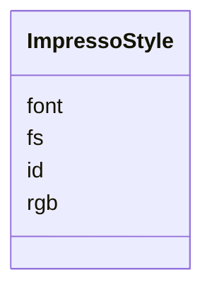

---
search:
  boost: 10.0
---

# Class: ImpressoStyle 


_One text style from the original OCR, identified locally within the issue._


<div data-search-exclude markdown="1">


URI: [pc:ImpressoStyle](https://pruzhany.org/ns/sourced-entities#ImpressoStyle)





<!-- no inheritance hierarchy -->

## Slots

| Name | Cardinality and Range | Description | Inheritance |
| ---  | --- | --- | --- |
| [rgb](rgb.md) | 3..* <br/> [Integer](Integer.md) | Color of the text (in RGB). | direct |
| [font](font.md) | 0..1 <br/> [String](String.md) | Font name | direct |
| [fs](fs.md) | 0..1 <br/> [Double](Double.md) | Font size | direct |
| [id](id.md) | 1 <br/> [Integer](Integer.md) | Local ID of the style | direct |


## Usages

| used by | used in | type | used |
| ---  | --- | --- | --- |
| [ImpressoIssue](ImpressoIssue.md) | [styles](styles.md) | range | [ImpressoStyle](ImpressoStyle.md) |


## Identifier and Mapping Information


### Annotations

| property | value |
| --- | --- |
| impresso | issue.s[] |


### Schema Source


* from schema: https://pruzhany.org/ns/impresso_issue


## Mappings

| Mapping Type | Mapped Value |
| ---  | ---  |
| self | pc:ImpressoStyle |
| native | pc:ImpressoStyle |


## LinkML Source

<!-- TODO: investigate https://stackoverflow.com/questions/37606292/how-to-create-tabbed-code-blocks-in-mkdocs-or-sphinx -->

### Direct

<details>
```yaml
name: ImpressoStyle
annotations:
  impresso:
    tag: impresso
    value: issue.s[]
description: One text style from the original OCR, identified locally within the issue.
from_schema: https://pruzhany.org/ns/impresso_issue
rank: 1000
attributes:
  rgb:
    name: rgb
    annotations:
      impresso:
        tag: impresso
        value: issue.s[].rgb
    description: Color of the text (in RGB).
    from_schema: https://pruzhany.org/ns/impresso_issue
    rank: 1000
    domain_of:
    - ImpressoStyle
    range: integer
    multivalued: true
    minimum_cardinality: 3
  font:
    name: font
    annotations:
      impresso:
        tag: impresso
        value: issue.s[].f
    description: Font name
    from_schema: https://pruzhany.org/ns/impresso_issue
    rank: 1000
    alias: f
    domain_of:
    - ImpressoStyle
  fs:
    name: fs
    annotations:
      impresso:
        tag: impresso
        value: issue.s[].fs
    description: Font size
    from_schema: https://pruzhany.org/ns/impresso_issue
    rank: 1000
    domain_of:
    - ImpressoStyle
    range: double
  id:
    name: id
    annotations:
      impresso:
        tag: impresso
        value: issue.s[].id
    description: Local ID of the style
    from_schema: https://pruzhany.org/ns/impresso_issue
    domain_of:
    - ImpressoIssue
    - ImpressoMetadata
    - ImpressoLegacy
    - ImpressoStyle
    range: integer
    required: true
extra_slots:
  allowed: true

```
</details>

### Induced

<details>
```yaml
name: ImpressoStyle
annotations:
  impresso:
    tag: impresso
    value: issue.s[]
description: One text style from the original OCR, identified locally within the issue.
from_schema: https://pruzhany.org/ns/impresso_issue
rank: 1000
attributes:
  rgb:
    name: rgb
    annotations:
      impresso:
        tag: impresso
        value: issue.s[].rgb
    description: Color of the text (in RGB).
    from_schema: https://pruzhany.org/ns/impresso_issue
    rank: 1000
    owner: ImpressoStyle
    domain_of:
    - ImpressoStyle
    range: integer
    multivalued: true
    minimum_cardinality: 3
  font:
    name: font
    annotations:
      impresso:
        tag: impresso
        value: issue.s[].f
    description: Font name
    from_schema: https://pruzhany.org/ns/impresso_issue
    rank: 1000
    alias: f
    owner: ImpressoStyle
    domain_of:
    - ImpressoStyle
    range: string
  fs:
    name: fs
    annotations:
      impresso:
        tag: impresso
        value: issue.s[].fs
    description: Font size
    from_schema: https://pruzhany.org/ns/impresso_issue
    rank: 1000
    owner: ImpressoStyle
    domain_of:
    - ImpressoStyle
    range: double
  id:
    name: id
    annotations:
      impresso:
        tag: impresso
        value: issue.s[].id
    description: Local ID of the style
    from_schema: https://pruzhany.org/ns/impresso_issue
    owner: ImpressoStyle
    domain_of:
    - ImpressoIssue
    - ImpressoMetadata
    - ImpressoLegacy
    - ImpressoStyle
    range: integer
    required: true
extra_slots:
  allowed: true

```
</details></div>
