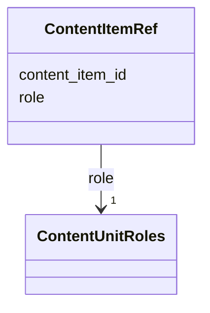

---
search:
  boost: 10.0
---

# Class: ContentItemRef 


_A content item that prints a life event, and the part it plays: the announcement itself, a greeting, a condolence, a mention or an advertisement._


<div data-search-exclude markdown="1">


URI: [pc:ContentItemRef](https://pruzhany.org/ns/sourced-entities#ContentItemRef)





<!-- no inheritance hierarchy -->

## Slots

| Name | Cardinality and Range | Description | Inheritance |
| ---  | --- | --- | --- |
| [content_item_id](content_item_id.md) | 1 <br/> [NonBlankText](NonBlankText.md) | The content item, by its id in the content items document. | direct |
| [role](role.md) | 1 <br/> [ContentUnitRoles](ContentUnitRoles.md) | The part the content item plays for the event, not any person's role. | direct |


## Usages

| used by | used in | type | used |
| ---  | --- | --- | --- |
| [IssueLifeEvent](IssueLifeEvent.md) | [content_items](content_items.md) | range | [ContentItemRef](ContentItemRef.md) |


## Identifier and Mapping Information


### Schema Source


* from schema: https://pruzhany.org/ns/life_events


## Mappings

| Mapping Type | Mapped Value |
| ---  | ---  |
| self | pc:ContentItemRef |
| native | pc:ContentItemRef |


## LinkML Source

<!-- TODO: investigate https://stackoverflow.com/questions/37606292/how-to-create-tabbed-code-blocks-in-mkdocs-or-sphinx -->

### Direct

<details>
```yaml
name: ContentItemRef
description: 'A content item that prints a life event, and the part it plays: the
  announcement itself, a greeting, a condolence, a mention or an advertisement.'
from_schema: https://pruzhany.org/ns/life_events
rank: 1000
attributes:
  content_item_id:
    name: content_item_id
    description: The content item, by its id in the content items document.
    from_schema: https://pruzhany.org/ns/life_events
    rank: 1000
    domain_of:
    - ContentItemRef
    range: NonBlankText
    required: true
  role:
    name: role
    description: The part the content item plays for the event, not any person's role.
    from_schema: https://pruzhany.org/ns/life_events
    rank: 1000
    domain_of:
    - ContentItemRef
    range: ContentUnitRoles
    required: true

```
</details>

### Induced

<details>
```yaml
name: ContentItemRef
description: 'A content item that prints a life event, and the part it plays: the
  announcement itself, a greeting, a condolence, a mention or an advertisement.'
from_schema: https://pruzhany.org/ns/life_events
rank: 1000
attributes:
  content_item_id:
    name: content_item_id
    description: The content item, by its id in the content items document.
    from_schema: https://pruzhany.org/ns/life_events
    rank: 1000
    owner: ContentItemRef
    domain_of:
    - ContentItemRef
    range: NonBlankText
    required: true
  role:
    name: role
    description: The part the content item plays for the event, not any person's role.
    from_schema: https://pruzhany.org/ns/life_events
    rank: 1000
    owner: ContentItemRef
    domain_of:
    - ContentItemRef
    range: ContentUnitRoles
    required: true

```
</details></div>
