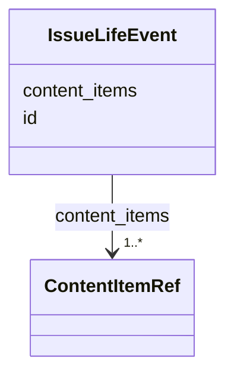

---
search:
  boost: 10.0
---

# Class: IssueLifeEvent 


_A life event of the shared record as this issue prints it: the content items that print it, each with its part._


<div data-search-exclude markdown="1">


URI: [rico:Event](https://www.ica.org/standards/RiC/ontology#Event)





<!-- no inheritance hierarchy -->

## Class Properties

| Property | Value |
| --- | --- |
| Class URI | [rico:Event](https://www.ica.org/standards/RiC/ontology#Event) |


## Slots

| Name | Cardinality and Range | Description | Inheritance |
| ---  | --- | --- | --- |
| [id](id.md) | 1 <br/> [NonBlankText](NonBlankText.md) | The life event, by its id in the shared record. | direct |
| [content_items](content_items.md) | 1..* <br/> [ContentItemRef](ContentItemRef.md) | The content items of the issue that print the event. | direct |


## Usages

| used by | used in | type | used |
| ---  | --- | --- | --- |
| [IssueLifeEventsData](IssueLifeEventsData.md) | [life_events](life_events.md) | range | [IssueLifeEvent](IssueLifeEvent.md) |


## Identifier and Mapping Information


### Schema Source


* from schema: https://pruzhany.org/ns/life_events


## Mappings

| Mapping Type | Mapped Value |
| ---  | ---  |
| self | rico:Event |
| native | pc:IssueLifeEvent |


## LinkML Source

<!-- TODO: investigate https://stackoverflow.com/questions/37606292/how-to-create-tabbed-code-blocks-in-mkdocs-or-sphinx -->

### Direct

<details>
```yaml
name: IssueLifeEvent
description: 'A life event of the shared record as this issue prints it: the content
  items that print it, each with its part.'
from_schema: https://pruzhany.org/ns/life_events
rank: 1000
attributes:
  id:
    name: id
    description: The life event, by its id in the shared record.
    from_schema: https://pruzhany.org/ns/life_events
    rank: 1000
    domain_of:
    - IssueLifeEvent
    range: NonBlankText
    required: true
  content_items:
    name: content_items
    description: The content items of the issue that print the event.
    from_schema: https://pruzhany.org/ns/life_events
    rank: 1000
    domain_of:
    - IssueLifeEvent
    range: ContentItemRef
    required: true
    multivalued: true
    inlined_as_list: true
    minimum_cardinality: 1
class_uri: rico:Event

```
</details>

### Induced

<details>
```yaml
name: IssueLifeEvent
description: 'A life event of the shared record as this issue prints it: the content
  items that print it, each with its part.'
from_schema: https://pruzhany.org/ns/life_events
rank: 1000
attributes:
  id:
    name: id
    description: The life event, by its id in the shared record.
    from_schema: https://pruzhany.org/ns/life_events
    rank: 1000
    owner: IssueLifeEvent
    domain_of:
    - IssueLifeEvent
    range: NonBlankText
    required: true
  content_items:
    name: content_items
    description: The content items of the issue that print the event.
    from_schema: https://pruzhany.org/ns/life_events
    rank: 1000
    owner: IssueLifeEvent
    domain_of:
    - IssueLifeEvent
    range: ContentItemRef
    required: true
    multivalued: true
    inlined: true
    inlined_as_list: true
    minimum_cardinality: 1
class_uri: rico:Event

```
</details></div>
