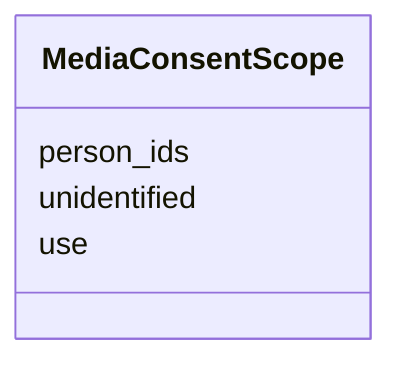

---
search:
  boost: 10.0
---

# Class: MediaConsentScope 


_What a permission covers: the use, the people shown, and whether people not identified are covered._


<div data-search-exclude markdown="1">


URI: [pc:MediaConsentScope](https://pruzhany.org/ns/sourced-entities#MediaConsentScope)





<!-- no inheritance hierarchy -->

## Slots

| Name | Cardinality and Range | Description | Inheritance |
| ---  | --- | --- | --- |
| [use](use.md) | 1 <br/> [String](String.md) | The use allowed: shown on the site, or shown and downloaded. | direct |
| [person_ids](person_ids.md) | 1..* <br/> [NonBlankText](NonBlankText.md) | The people the permission covers, by their ids; each must be shown in the medium. | direct |
| [unidentified](unidentified.md) | 1 <br/> [Boolean](Boolean.md) | True when the permission also covers people shown and not identified. | direct |


## Usages

| used by | used in | type | used |
| ---  | --- | --- | --- |
| [MediaConsent](MediaConsent.md) | [scope](scope.md) | range | [MediaConsentScope](MediaConsentScope.md) |


## Identifier and Mapping Information


### Schema Source


* from schema: https://pruzhany.org/ns/media


## Mappings

| Mapping Type | Mapped Value |
| ---  | ---  |
| self | pc:MediaConsentScope |
| native | pc:MediaConsentScope |


## LinkML Source

<!-- TODO: investigate https://stackoverflow.com/questions/37606292/how-to-create-tabbed-code-blocks-in-mkdocs-or-sphinx -->

### Direct

<details>
```yaml
name: MediaConsentScope
description: 'What a permission covers: the use, the people shown, and whether people
  not identified are covered.'
from_schema: https://pruzhany.org/ns/media
rank: 1000
attributes:
  use:
    name: use
    description: 'The use allowed: shown on the site, or shown and downloaded.'
    from_schema: https://pruzhany.org/ns/media
    rank: 1000
    domain_of:
    - MediaConsentScope
    range: string
    required: true
    equals_string_in:
    - site
    - site+download
  person_ids:
    name: person_ids
    description: The people the permission covers, by their ids; each must be shown
      in the medium.
    from_schema: https://pruzhany.org/ns/media
    rank: 1000
    domain_of:
    - MediaConsentScope
    range: NonBlankText
    required: true
    multivalued: true
  unidentified:
    name: unidentified
    description: True when the permission also covers people shown and not identified.
    from_schema: https://pruzhany.org/ns/media
    rank: 1000
    domain_of:
    - MediaConsentScope
    range: boolean
    required: true

```
</details>

### Induced

<details>
```yaml
name: MediaConsentScope
description: 'What a permission covers: the use, the people shown, and whether people
  not identified are covered.'
from_schema: https://pruzhany.org/ns/media
rank: 1000
attributes:
  use:
    name: use
    description: 'The use allowed: shown on the site, or shown and downloaded.'
    from_schema: https://pruzhany.org/ns/media
    rank: 1000
    owner: MediaConsentScope
    domain_of:
    - MediaConsentScope
    range: string
    required: true
    equals_string_in:
    - site
    - site+download
  person_ids:
    name: person_ids
    description: The people the permission covers, by their ids; each must be shown
      in the medium.
    from_schema: https://pruzhany.org/ns/media
    rank: 1000
    owner: MediaConsentScope
    domain_of:
    - MediaConsentScope
    range: NonBlankText
    required: true
    multivalued: true
  unidentified:
    name: unidentified
    description: True when the permission also covers people shown and not identified.
    from_schema: https://pruzhany.org/ns/media
    rank: 1000
    owner: MediaConsentScope
    domain_of:
    - MediaConsentScope
    range: boolean
    required: true

```
</details></div>
