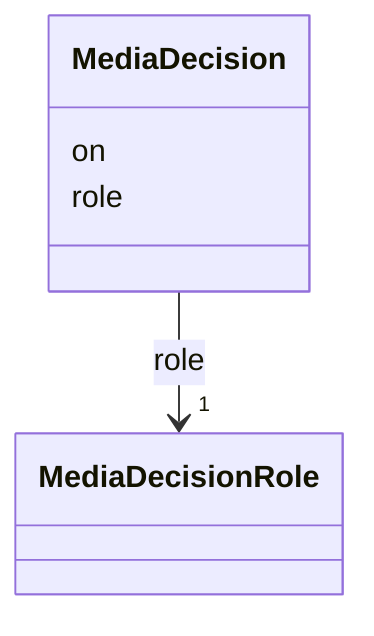

---
search:
  boost: 10.0
---

# Class: MediaDecision 


_A review or a clearance: whose role made it (the owner or the project) and on what day._


<div data-search-exclude markdown="1">


URI: [pc:MediaDecision](https://pruzhany.org/ns/sourced-entities#MediaDecision)





<!-- no inheritance hierarchy -->

## Slots

| Name | Cardinality and Range | Description | Inheritance |
| ---  | --- | --- | --- |
| [role](role.md) | 1 <br/> [MediaDecisionRole](MediaDecisionRole.md) | Who decided, by role: the owner or the project; never a person's name. | direct |
| [on](on.md) | 1 <br/> [IsoDay](IsoDay.md) | The day of the decision. | direct |


## Usages

| used by | used in | type | used |
| ---  | --- | --- | --- |
| [MediaText](MediaText.md) | [reviewed](reviewed.md) | range | [MediaDecision](MediaDecision.md) |
| [MediaPortrait](MediaPortrait.md) | [reviewed](reviewed.md) | range | [MediaDecision](MediaDecision.md) |
| [PublicMedia](PublicMedia.md) | [cleared](cleared.md) | range | [MediaDecision](MediaDecision.md) |
| [Media](Media.md) | [cleared](cleared.md) | range | [MediaDecision](MediaDecision.md) |


## Identifier and Mapping Information


### Schema Source


* from schema: https://pruzhany.org/ns/media


## Mappings

| Mapping Type | Mapped Value |
| ---  | ---  |
| self | pc:MediaDecision |
| native | pc:MediaDecision |


## LinkML Source

<!-- TODO: investigate https://stackoverflow.com/questions/37606292/how-to-create-tabbed-code-blocks-in-mkdocs-or-sphinx -->

### Direct

<details>
```yaml
name: MediaDecision
description: 'A review or a clearance: whose role made it (the owner or the project)
  and on what day.'
from_schema: https://pruzhany.org/ns/media
rank: 1000
attributes:
  role:
    name: role
    description: 'Who decided, by role: the owner or the project; never a person''s
      name.'
    from_schema: https://pruzhany.org/ns/media
    rank: 1000
    domain_of:
    - MediaDecision
    range: MediaDecisionRole
    required: true
  'on':
    name: 'on'
    description: The day of the decision.
    from_schema: https://pruzhany.org/ns/media
    rank: 1000
    domain_of:
    - MediaDecision
    - MediaWithdrawal
    - MediaFixity
    - Attribution
    range: IsoDay
    required: true

```
</details>

### Induced

<details>
```yaml
name: MediaDecision
description: 'A review or a clearance: whose role made it (the owner or the project)
  and on what day.'
from_schema: https://pruzhany.org/ns/media
rank: 1000
attributes:
  role:
    name: role
    description: 'Who decided, by role: the owner or the project; never a person''s
      name.'
    from_schema: https://pruzhany.org/ns/media
    rank: 1000
    owner: MediaDecision
    domain_of:
    - MediaDecision
    range: MediaDecisionRole
    required: true
  'on':
    name: 'on'
    description: The day of the decision.
    from_schema: https://pruzhany.org/ns/media
    rank: 1000
    owner: MediaDecision
    domain_of:
    - MediaDecision
    - MediaWithdrawal
    - MediaFixity
    - Attribution
    range: IsoDay
    required: true

```
</details></div>
