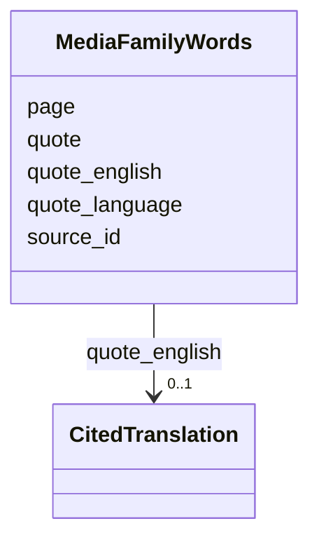

---
search:
  boost: 10.0
---

# Class: MediaFamilyWords 


_The family's own words about a medium, quoted from a registered source with the page or part they are on: a public part of a citation, with no private note._


<div data-search-exclude markdown="1">


URI: [pc:MediaFamilyWords](https://pruzhany.org/ns/sourced-entities#MediaFamilyWords)





<!-- no inheritance hierarchy -->

## Slots

| Name | Cardinality and Range | Description | Inheritance |
| ---  | --- | --- | --- |
| [source_id](source_id.md) | 1 <br/> [NonBlankText](NonBlankText.md) | The source the words are quoted from, by its id in the record's sources. | direct |
| [page](page.md) | 1 <br/> [NonBlankText](NonBlankText.md) | The page or recorded part the words are on. | direct |
| [quote](quote.md) | 1 <br/> [NonBlankText](NonBlankText.md) | The words, exactly. | direct |
| [quote_language](quote_language.md) | 1 <br/> [LanguageTag](LanguageTag.md) | Their language, as a BCP 47 tag. | direct |
| [quote_english](quote_english.md) | 0..1 <br/> [CitedTranslation](CitedTranslation.md) | English of exactly quote, with based_on.source_text equal to that field's exact bytes and attribution naming the kept English or its person or model. | direct |


## Usages

| used by | used in | type | used |
| ---  | --- | --- | --- |
| [PublicMedia](PublicMedia.md) | [family_words](family_words.md) | range | [MediaFamilyWords](MediaFamilyWords.md) |
| [Media](Media.md) | [family_words](family_words.md) | range | [MediaFamilyWords](MediaFamilyWords.md) |


## Identifier and Mapping Information


### Schema Source


* from schema: https://pruzhany.org/ns/media


## Mappings

| Mapping Type | Mapped Value |
| ---  | ---  |
| self | pc:MediaFamilyWords |
| native | pc:MediaFamilyWords |


## LinkML Source

<!-- TODO: investigate https://stackoverflow.com/questions/37606292/how-to-create-tabbed-code-blocks-in-mkdocs-or-sphinx -->

### Direct

<details>
```yaml
name: MediaFamilyWords
description: 'The family''s own words about a medium, quoted from a registered source
  with the page or part they are on: a public part of a citation, with no private
  note.'
from_schema: https://pruzhany.org/ns/media
rank: 1000
attributes:
  source_id:
    name: source_id
    description: The source the words are quoted from, by its id in the record's sources.
    from_schema: https://pruzhany.org/ns/media
    rank: 1000
    domain_of:
    - MediaFamilyWords
    - PublicMedia
    range: NonBlankText
    required: true
  page:
    name: page
    description: The page or recorded part the words are on.
    from_schema: https://pruzhany.org/ns/media
    rank: 1000
    domain_of:
    - MediaFamilyWords
    range: NonBlankText
    required: true
  quote:
    name: quote
    description: The words, exactly.
    from_schema: https://pruzhany.org/ns/media
    rank: 1000
    domain_of:
    - MediaFamilyWords
    range: NonBlankText
    required: true
  quote_language:
    name: quote_language
    description: Their language, as a BCP 47 tag.
    from_schema: https://pruzhany.org/ns/media
    rank: 1000
    domain_of:
    - MediaFamilyWords
    range: LanguageTag
    required: true
  quote_english:
    name: quote_english
    annotations:
      english_of:
        tag: english_of
        value: quote
    description: English of exactly quote, with based_on.source_text equal to that
      field's exact bytes and attribution naming the kept English or its person or
      model.
    from_schema: https://pruzhany.org/ns/media
    exact_mappings:
    - pc:site_translation
    rank: 1000
    domain_of:
    - MediaFamilyWords
    range: CitedTranslation
    inlined: true

```
</details>

### Induced

<details>
```yaml
name: MediaFamilyWords
description: 'The family''s own words about a medium, quoted from a registered source
  with the page or part they are on: a public part of a citation, with no private
  note.'
from_schema: https://pruzhany.org/ns/media
rank: 1000
attributes:
  source_id:
    name: source_id
    description: The source the words are quoted from, by its id in the record's sources.
    from_schema: https://pruzhany.org/ns/media
    rank: 1000
    owner: MediaFamilyWords
    domain_of:
    - MediaFamilyWords
    - PublicMedia
    range: NonBlankText
    required: true
  page:
    name: page
    description: The page or recorded part the words are on.
    from_schema: https://pruzhany.org/ns/media
    rank: 1000
    owner: MediaFamilyWords
    domain_of:
    - MediaFamilyWords
    range: NonBlankText
    required: true
  quote:
    name: quote
    description: The words, exactly.
    from_schema: https://pruzhany.org/ns/media
    rank: 1000
    owner: MediaFamilyWords
    domain_of:
    - MediaFamilyWords
    range: NonBlankText
    required: true
  quote_language:
    name: quote_language
    description: Their language, as a BCP 47 tag.
    from_schema: https://pruzhany.org/ns/media
    rank: 1000
    owner: MediaFamilyWords
    domain_of:
    - MediaFamilyWords
    range: LanguageTag
    required: true
  quote_english:
    name: quote_english
    annotations:
      english_of:
        tag: english_of
        value: quote
    description: English of exactly quote, with based_on.source_text equal to that
      field's exact bytes and attribution naming the kept English or its person or
      model.
    from_schema: https://pruzhany.org/ns/media
    exact_mappings:
    - pc:site_translation
    rank: 1000
    owner: MediaFamilyWords
    domain_of:
    - MediaFamilyWords
    range: CitedTranslation
    inlined: true

```
</details></div>
