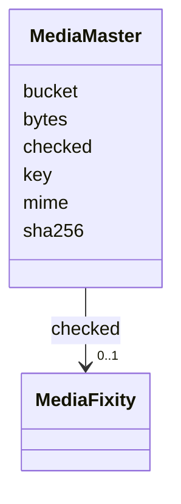

---
search:
  boost: 10.0
---

# Class: MediaMaster 


_Where a medium's private master file is kept: its bucket, its key named by its digest, its digest, its type, its size and its last check. Never public._


<div data-search-exclude markdown="1">


URI: [pc:MediaMaster](https://pruzhany.org/ns/sourced-entities#MediaMaster)





<!-- no inheritance hierarchy -->

## Slots

| Name | Cardinality and Range | Description | Inheritance |
| ---  | --- | --- | --- |
| [bucket](bucket.md) | 1 <br/> [String](String.md) | The private storage bucket, apart from the page pictures' bucket. | direct |
| [key](key.md) | 1 <br/> [String](String.md) | The file's key in the bucket, whose last part is its SHA-256 digest. | direct |
| [sha256](sha256.md) | 1 <br/> [Sha256Hex](Sha256Hex.md) | The SHA-256 digest of the file. | direct |
| [mime](mime.md) | 1 <br/> [String](String.md) | The file's media type, such as image/tiff. | direct |
| [bytes](bytes.md) | 1 <br/> [PositiveInteger](PositiveInteger.md) | The file's size in bytes. | direct |
| [checked](checked.md) | 0..1 <br/> [MediaFixity](MediaFixity.md) | The last dated check of the file's digest. | direct |

<details>
<summary>Expressions & Logic</summary>
#### None Of

The class must not satisfy any of:
- AnonymousClassExpression({
  'description': "A master is not kept in the page pictures' bucket.",
  'slot_conditions': {'bucket': SlotDefinition({'name': 'bucket', 'equals_string': 'pruzhany-page-pictures'})}
})

</details>


## Usages

| used by | used in | type | used |
| ---  | --- | --- | --- |
| [Media](Media.md) | [master](master.md) | range | [MediaMaster](MediaMaster.md) |


## Identifier and Mapping Information


### Schema Source


* from schema: https://pruzhany.org/ns/media


## Mappings

| Mapping Type | Mapped Value |
| ---  | ---  |
| self | pc:MediaMaster |
| native | pc:MediaMaster |


## LinkML Source

<!-- TODO: investigate https://stackoverflow.com/questions/37606292/how-to-create-tabbed-code-blocks-in-mkdocs-or-sphinx -->

### Direct

<details>
```yaml
name: MediaMaster
description: 'Where a medium''s private master file is kept: its bucket, its key named
  by its digest, its digest, its type, its size and its last check. Never public.'
from_schema: https://pruzhany.org/ns/media
rank: 1000
attributes:
  bucket:
    name: bucket
    description: The private storage bucket, apart from the page pictures' bucket.
    from_schema: https://pruzhany.org/ns/media
    rank: 1000
    domain_of:
    - MediaMaster
    range: string
    required: true
    pattern: ^[a-z0-9][a-z0-9-]{1,61}[a-z0-9]$(?![\s\S])
  key:
    name: key
    description: The file's key in the bucket, whose last part is its SHA-256 digest.
    from_schema: https://pruzhany.org/ns/media
    rank: 1000
    domain_of:
    - MediaMaster
    range: string
    required: true
    pattern: ^(?:[a-z0-9_-]+/)*[0-9a-f]{64}$(?![\s\S])
  sha256:
    name: sha256
    description: The SHA-256 digest of the file.
    from_schema: https://pruzhany.org/ns/media
    domain_of:
    - MediaFixity
    - MediaMaster
    range: Sha256Hex
    required: true
  mime:
    name: mime
    description: The file's media type, such as image/tiff.
    from_schema: https://pruzhany.org/ns/media
    rank: 1000
    domain_of:
    - MediaMaster
    range: string
    required: true
    pattern: ^(?:image|audio|video|application)/[a-z0-9][a-z0-9.+-]*$(?![\s\S])
  bytes:
    name: bytes
    description: The file's size in bytes.
    from_schema: https://pruzhany.org/ns/media
    rank: 1000
    domain_of:
    - MediaMaster
    range: PositiveInteger
    required: true
  checked:
    name: checked
    description: The last dated check of the file's digest.
    from_schema: https://pruzhany.org/ns/media
    rank: 1000
    domain_of:
    - MediaMaster
    range: MediaFixity
    inlined: true
none_of:
- description: A master is not kept in the page pictures' bucket.
  slot_conditions:
    bucket:
      name: bucket
      equals_string: pruzhany-page-pictures

```
</details>

### Induced

<details>
```yaml
name: MediaMaster
description: 'Where a medium''s private master file is kept: its bucket, its key named
  by its digest, its digest, its type, its size and its last check. Never public.'
from_schema: https://pruzhany.org/ns/media
rank: 1000
attributes:
  bucket:
    name: bucket
    description: The private storage bucket, apart from the page pictures' bucket.
    from_schema: https://pruzhany.org/ns/media
    rank: 1000
    owner: MediaMaster
    domain_of:
    - MediaMaster
    range: string
    required: true
    pattern: ^[a-z0-9][a-z0-9-]{1,61}[a-z0-9]$(?![\s\S])
  key:
    name: key
    description: The file's key in the bucket, whose last part is its SHA-256 digest.
    from_schema: https://pruzhany.org/ns/media
    rank: 1000
    owner: MediaMaster
    domain_of:
    - MediaMaster
    range: string
    required: true
    pattern: ^(?:[a-z0-9_-]+/)*[0-9a-f]{64}$(?![\s\S])
  sha256:
    name: sha256
    description: The SHA-256 digest of the file.
    from_schema: https://pruzhany.org/ns/media
    owner: MediaMaster
    domain_of:
    - MediaFixity
    - MediaMaster
    range: Sha256Hex
    required: true
  mime:
    name: mime
    description: The file's media type, such as image/tiff.
    from_schema: https://pruzhany.org/ns/media
    rank: 1000
    owner: MediaMaster
    domain_of:
    - MediaMaster
    range: string
    required: true
    pattern: ^(?:image|audio|video|application)/[a-z0-9][a-z0-9.+-]*$(?![\s\S])
  bytes:
    name: bytes
    description: The file's size in bytes.
    from_schema: https://pruzhany.org/ns/media
    rank: 1000
    owner: MediaMaster
    domain_of:
    - MediaMaster
    range: PositiveInteger
    required: true
  checked:
    name: checked
    description: The last dated check of the file's digest.
    from_schema: https://pruzhany.org/ns/media
    rank: 1000
    owner: MediaMaster
    domain_of:
    - MediaMaster
    range: MediaFixity
    inlined: true
none_of:
- description: A master is not kept in the page pictures' bucket.
  slot_conditions:
    bucket:
      name: bucket
      equals_string: pruzhany-page-pictures

```
</details></div>
