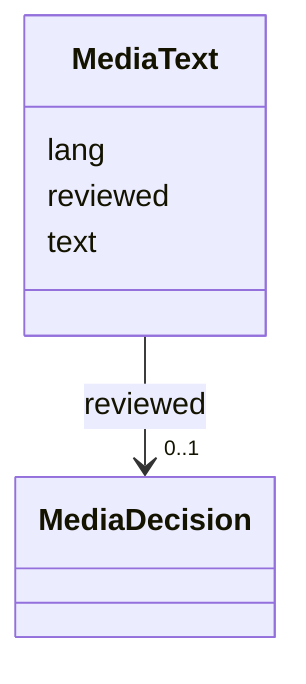

---
search:
  boost: 10.0
---

# Class: MediaText 


_Words about or on a medium (a caption, a description for screen readers, an inscription, a transcript), their language and their review._


<div data-search-exclude markdown="1">


URI: [pc:MediaText](https://pruzhany.org/ns/sourced-entities#MediaText)





<!-- no inheritance hierarchy -->

## Slots

| Name | Cardinality and Range | Description | Inheritance |
| ---  | --- | --- | --- |
| [text](text.md) | 1 <br/> [NonBlankText](NonBlankText.md) | The words. | direct |
| [lang](lang.md) | 1 <br/> [LanguageTag](LanguageTag.md) | Their language, as a BCP 47 tag. | direct |
| [reviewed](reviewed.md) | 0..1 <br/> [MediaDecision](MediaDecision.md) | Who reviewed the words, by role, and on what day. | direct |


## Usages

| used by | used in | type | used |
| ---  | --- | --- | --- |
| [PublicMedia](PublicMedia.md) | [caption](caption.md) | range | [MediaText](MediaText.md) |
| [PublicMedia](PublicMedia.md) | [alt](alt.md) | range | [MediaText](MediaText.md) |
| [PublicMedia](PublicMedia.md) | [inscription](inscription.md) | range | [MediaText](MediaText.md) |
| [PublicMedia](PublicMedia.md) | [transcript](transcript.md) | range | [MediaText](MediaText.md) |
| [Media](Media.md) | [caption](caption.md) | range | [MediaText](MediaText.md) |
| [Media](Media.md) | [alt](alt.md) | range | [MediaText](MediaText.md) |
| [Media](Media.md) | [inscription](inscription.md) | range | [MediaText](MediaText.md) |
| [Media](Media.md) | [transcript](transcript.md) | range | [MediaText](MediaText.md) |


## Identifier and Mapping Information


### Schema Source


* from schema: https://pruzhany.org/ns/media


## Mappings

| Mapping Type | Mapped Value |
| ---  | ---  |
| self | pc:MediaText |
| native | pc:MediaText |


## LinkML Source

<!-- TODO: investigate https://stackoverflow.com/questions/37606292/how-to-create-tabbed-code-blocks-in-mkdocs-or-sphinx -->

### Direct

<details>
```yaml
name: MediaText
description: Words about or on a medium (a caption, a description for screen readers,
  an inscription, a transcript), their language and their review.
from_schema: https://pruzhany.org/ns/media
rank: 1000
attributes:
  text:
    name: text
    description: The words.
    from_schema: https://pruzhany.org/ns/media
    rank: 1000
    domain_of:
    - MediaText
    range: NonBlankText
    required: true
  lang:
    name: lang
    description: Their language, as a BCP 47 tag.
    from_schema: https://pruzhany.org/ns/media
    rank: 1000
    domain_of:
    - MediaText
    range: LanguageTag
    required: true
  reviewed:
    name: reviewed
    description: Who reviewed the words, by role, and on what day.
    from_schema: https://pruzhany.org/ns/media
    rank: 1000
    domain_of:
    - MediaText
    - MediaPortrait
    range: MediaDecision
    inlined: true

```
</details>

### Induced

<details>
```yaml
name: MediaText
description: Words about or on a medium (a caption, a description for screen readers,
  an inscription, a transcript), their language and their review.
from_schema: https://pruzhany.org/ns/media
rank: 1000
attributes:
  text:
    name: text
    description: The words.
    from_schema: https://pruzhany.org/ns/media
    rank: 1000
    owner: MediaText
    domain_of:
    - MediaText
    range: NonBlankText
    required: true
  lang:
    name: lang
    description: Their language, as a BCP 47 tag.
    from_schema: https://pruzhany.org/ns/media
    rank: 1000
    owner: MediaText
    domain_of:
    - MediaText
    range: LanguageTag
    required: true
  reviewed:
    name: reviewed
    description: Who reviewed the words, by role, and on what day.
    from_schema: https://pruzhany.org/ns/media
    rank: 1000
    owner: MediaText
    domain_of:
    - MediaText
    - MediaPortrait
    range: MediaDecision
    inlined: true

```
</details></div>
