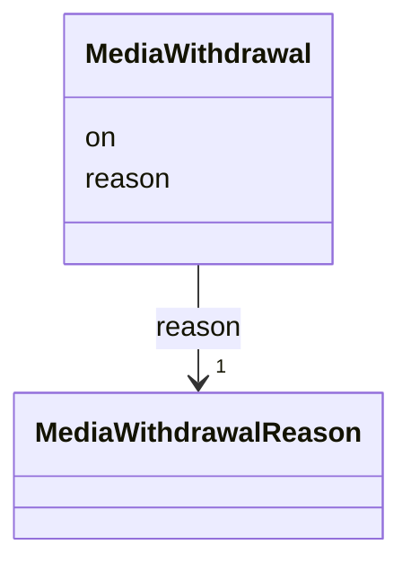

---
search:
  boost: 10.0
---

# Class: MediaWithdrawal 


_That a medium was withdrawn from the site, on what day and why; its record stays._


<div data-search-exclude markdown="1">


URI: [pc:MediaWithdrawal](https://pruzhany.org/ns/sourced-entities#MediaWithdrawal)





<!-- no inheritance hierarchy -->

## Slots

| Name | Cardinality and Range | Description | Inheritance |
| ---  | --- | --- | --- |
| [on](on.md) | 1 <br/> [IsoDay](IsoDay.md) | The day it was withdrawn. | direct |
| [reason](reason.md) | 1 <br/> [MediaWithdrawalReason](MediaWithdrawalReason.md) | Why: at the family's or the holder's request, or for an error. | direct |


## Usages

| used by | used in | type | used |
| ---  | --- | --- | --- |
| [PublicMedia](PublicMedia.md) | [withdrawn](withdrawn.md) | range | [MediaWithdrawal](MediaWithdrawal.md) |
| [Media](Media.md) | [withdrawn](withdrawn.md) | range | [MediaWithdrawal](MediaWithdrawal.md) |


## Identifier and Mapping Information


### Schema Source


* from schema: https://pruzhany.org/ns/media


## Mappings

| Mapping Type | Mapped Value |
| ---  | ---  |
| self | pc:MediaWithdrawal |
| native | pc:MediaWithdrawal |


## LinkML Source

<!-- TODO: investigate https://stackoverflow.com/questions/37606292/how-to-create-tabbed-code-blocks-in-mkdocs-or-sphinx -->

### Direct

<details>
```yaml
name: MediaWithdrawal
description: That a medium was withdrawn from the site, on what day and why; its record
  stays.
from_schema: https://pruzhany.org/ns/media
rank: 1000
attributes:
  'on':
    name: 'on'
    description: The day it was withdrawn.
    from_schema: https://pruzhany.org/ns/media
    domain_of:
    - MediaDecision
    - MediaWithdrawal
    - MediaFixity
    range: IsoDay
    required: true
  reason:
    name: reason
    description: 'Why: at the family''s or the holder''s request, or for an error.'
    from_schema: https://pruzhany.org/ns/media
    rank: 1000
    domain_of:
    - MediaWithdrawal
    range: MediaWithdrawalReason
    required: true

```
</details>

### Induced

<details>
```yaml
name: MediaWithdrawal
description: That a medium was withdrawn from the site, on what day and why; its record
  stays.
from_schema: https://pruzhany.org/ns/media
rank: 1000
attributes:
  'on':
    name: 'on'
    description: The day it was withdrawn.
    from_schema: https://pruzhany.org/ns/media
    owner: MediaWithdrawal
    domain_of:
    - MediaDecision
    - MediaWithdrawal
    - MediaFixity
    range: IsoDay
    required: true
  reason:
    name: reason
    description: 'Why: at the family''s or the holder''s request, or for an error.'
    from_schema: https://pruzhany.org/ns/media
    rank: 1000
    owner: MediaWithdrawal
    domain_of:
    - MediaWithdrawal
    range: MediaWithdrawalReason
    required: true

```
</details></div>
