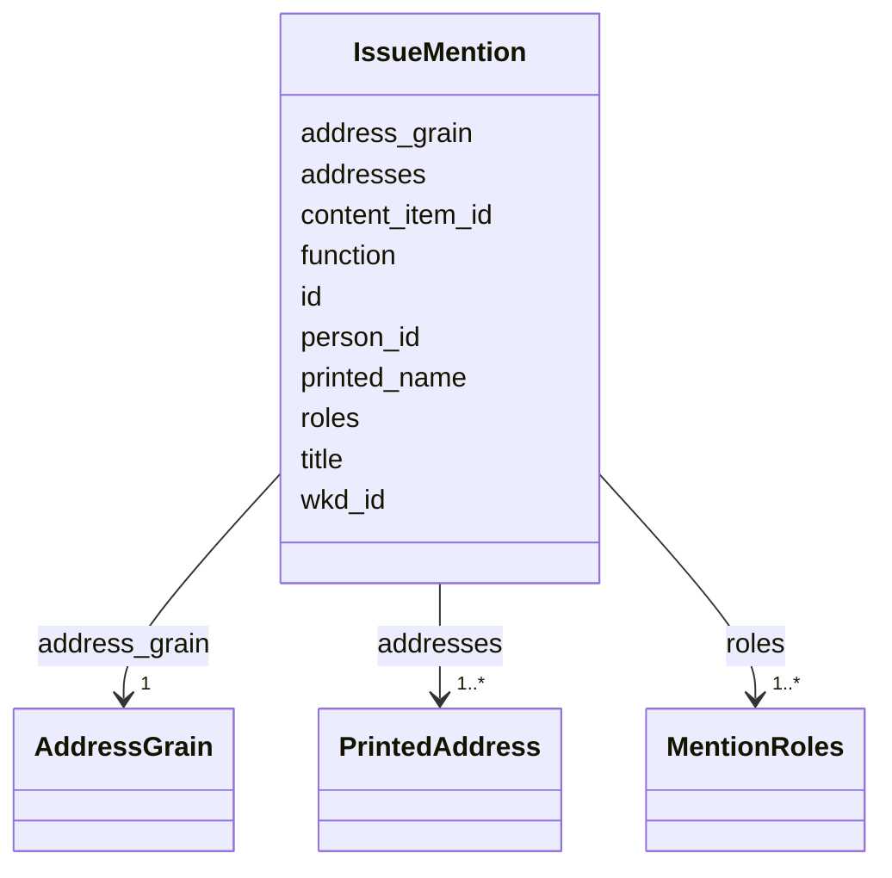

---
search:
  boost: 10.0
---

# Class: IssueMention 


_A person of the shared record named in a content item, pinned to the printed words of the name or to whole regions, with the person's roles there. A mention alone does not say the content item is about the person._


<div data-search-exclude markdown="1">


URI: [pc:IssueMention](https://pruzhany.org/ns/sourced-entities#IssueMention)





<!-- no inheritance hierarchy -->

## Slots

| Name | Cardinality and Range | Description | Inheritance |
| ---  | --- | --- | --- |
| [id](id.md) | 1 <br/> [NonBlankText](NonBlankText.md) | The mention's id within the issue. | direct |
| [person_id](person_id.md) | 1 <br/> [NonBlankText](NonBlankText.md) | The person named, by their id in the shared record. | direct |
| [content_item_id](content_item_id.md) | 1 <br/> [NonBlankText](NonBlankText.md) | The content item the name stands in, by its id in the content items document. | direct |
| [address_grain](address_grain.md) | 1 <br/> [AddressGrain](AddressGrain.md) | Whether the mention is pinned to the name's words or only to whole regions. | direct |
| [printed_name](printed_name.md) | 0..1 <br/> [NonBlankText](NonBlankText.md) | The name as printed, found at the mention's addresses; null when the mention is pinned only to whole regions. | direct |
| [roles](roles.md) | 1..* <br/> [MentionRoles](MentionRoles.md) | The person's roles in the content item, such as the deceased or a mourner. | direct |
| [addresses](addresses.md) | 1..* <br/> [PrintedAddress](PrintedAddress.md) | Where the name stands: the words of the name, or the whole regions it is in. | direct |
| [title](title.md) | 0..1 <br/> [String](String.md) | An honorific printed with the name, such as Rabbi or Dr., where one is kept. | direct |
| [function](function.md) | 0..1 <br/> [String](String.md) | The person's occupation or part in the content item, in a few words, such as bride, mourner or well-wisher. | direct |
| [wkd_id](wkd_id.md) | 0..1 <br/> [String](String.md) | The person's Wikidata id, where one is known. | direct |


## Usages

| used by | used in | type | used |
| ---  | --- | --- | --- |
| [IssueMentionsData](IssueMentionsData.md) | [mentions](mentions.md) | range | [IssueMention](IssueMention.md) |


## Rules


### 

| Rule Applied | Preconditions | Postconditions | Elseconditions |
|--------------|---------------|----------------|----------------|
| slot_conditions |```{'address_grain': {'equals_string': 'words'}}``` |```{'printed_name': {'required': True}}``` | |


### 

| Rule Applied | Preconditions | Postconditions | Elseconditions |
|--------------|---------------|----------------|----------------|
| slot_conditions |```{'address_grain': {'equals_string': 'regions'}}``` |```{'printed_name': {'required': False, 'pattern': '^$'}}``` | |


## Identifier and Mapping Information


### Schema Source


* from schema: https://pruzhany.org/ns/mentions


## Mappings

| Mapping Type | Mapped Value |
| ---  | ---  |
| self | pc:IssueMention |
| native | pc:IssueMention |
| exact | pc:site_mention |


## LinkML Source

<!-- TODO: investigate https://stackoverflow.com/questions/37606292/how-to-create-tabbed-code-blocks-in-mkdocs-or-sphinx -->

### Direct

<details>
```yaml
name: IssueMention
description: A person of the shared record named in a content item, pinned to the
  printed words of the name or to whole regions, with the person's roles there. A
  mention alone does not say the content item is about the person.
from_schema: https://pruzhany.org/ns/mentions
exact_mappings:
- pc:site_mention
rank: 1000
attributes:
  id:
    name: id
    description: The mention's id within the issue.
    from_schema: https://pruzhany.org/ns/mentions
    rank: 1000
    domain_of:
    - IssueMention
    - Source
    - Fact
    - Mention
    range: NonBlankText
    required: true
  person_id:
    name: person_id
    annotations:
      references:
        tag: references
        value: SharedPerson.id
    description: The person named, by their id in the shared record.
    from_schema: https://pruzhany.org/ns/mentions
    rank: 1000
    domain_of:
    - IssueMention
    - Mention
    range: NonBlankText
    required: true
  content_item_id:
    name: content_item_id
    annotations:
      references:
        tag: references
        value: ContentItem.id
    description: The content item the name stands in, by its id in the content items
      document.
    from_schema: https://pruzhany.org/ns/mentions
    rank: 1000
    domain_of:
    - IssueMention
    range: NonBlankText
    required: true
  address_grain:
    name: address_grain
    description: Whether the mention is pinned to the name's words or only to whole
      regions.
    from_schema: https://pruzhany.org/ns/mentions
    rank: 1000
    slot_uri: pc:site_mention_address_grain
    domain_of:
    - IssueMention
    range: AddressGrain
    required: true
  printed_name:
    name: printed_name
    description: The name as printed, found at the mention's addresses; null when
      the mention is pinned only to whole regions.
    from_schema: https://pruzhany.org/ns/mentions
    rank: 1000
    domain_of:
    - IssueMention
    - Mention
    range: NonBlankText
  roles:
    name: roles
    description: The person's roles in the content item, such as the deceased or a
      mourner.
    from_schema: https://pruzhany.org/ns/mentions
    rank: 1000
    domain_of:
    - IssueMention
    range: MentionRoles
    required: true
    multivalued: true
    minimum_cardinality: 1
  addresses:
    name: addresses
    description: 'Where the name stands: the words of the name, or the whole regions
      it is in.'
    from_schema: https://pruzhany.org/ns/mentions
    rank: 1000
    domain_of:
    - IssueMention
    - TextBasis
    - PrintedTitle
    range: PrintedAddress
    required: true
    multivalued: true
    inlined_as_list: true
    minimum_cardinality: 1
  title:
    name: title
    description: An honorific printed with the name, such as Rabbi or Dr., where one
      is kept.
    from_schema: https://pruzhany.org/ns/mentions
    rank: 1000
    domain_of:
    - IssueMention
    - Source
    - Mention
  function:
    name: function
    description: The person's occupation or part in the content item, in a few words,
      such as bride, mourner or well-wisher.
    from_schema: https://pruzhany.org/ns/mentions
    rank: 1000
    domain_of:
    - IssueMention
    - Mention
  wkd_id:
    name: wkd_id
    annotations:
      impresso:
        tag: impresso
        value: The Wikidata id of a linked entity mention (wkd_id) in Impresso's entity
          linking, which Impresso-2 names wkdata_qid (docs/design/2026-10-23-standards-foundation-vetting.md).
    description: The person's Wikidata id, where one is known.
    from_schema: https://pruzhany.org/ns/mentions
    rank: 1000
    domain_of:
    - IssueMention
    - Mention
rules:
- preconditions:
    slot_conditions:
      address_grain:
        name: address_grain
        equals_string: words
  postconditions:
    slot_conditions:
      printed_name:
        name: printed_name
        required: true
  description: A mention pinned to the name's words has its printed name.
- preconditions:
    slot_conditions:
      address_grain:
        name: address_grain
        equals_string: regions
  postconditions:
    slot_conditions:
      printed_name:
        name: printed_name
        required: false
        pattern: ^$
  description: 'A mention pinned only to whole regions has no printed name: its printed
    name, if given, would have to be empty, which a name never is.'

```
</details>

### Induced

<details>
```yaml
name: IssueMention
description: A person of the shared record named in a content item, pinned to the
  printed words of the name or to whole regions, with the person's roles there. A
  mention alone does not say the content item is about the person.
from_schema: https://pruzhany.org/ns/mentions
exact_mappings:
- pc:site_mention
rank: 1000
attributes:
  id:
    name: id
    description: The mention's id within the issue.
    from_schema: https://pruzhany.org/ns/mentions
    rank: 1000
    owner: IssueMention
    domain_of:
    - IssueMention
    - Source
    - Fact
    - Mention
    range: NonBlankText
    required: true
  person_id:
    name: person_id
    annotations:
      references:
        tag: references
        value: SharedPerson.id
    description: The person named, by their id in the shared record.
    from_schema: https://pruzhany.org/ns/mentions
    rank: 1000
    owner: IssueMention
    domain_of:
    - IssueMention
    - Mention
    range: NonBlankText
    required: true
  content_item_id:
    name: content_item_id
    annotations:
      references:
        tag: references
        value: ContentItem.id
    description: The content item the name stands in, by its id in the content items
      document.
    from_schema: https://pruzhany.org/ns/mentions
    rank: 1000
    owner: IssueMention
    domain_of:
    - IssueMention
    range: NonBlankText
    required: true
  address_grain:
    name: address_grain
    description: Whether the mention is pinned to the name's words or only to whole
      regions.
    from_schema: https://pruzhany.org/ns/mentions
    rank: 1000
    slot_uri: pc:site_mention_address_grain
    owner: IssueMention
    domain_of:
    - IssueMention
    range: AddressGrain
    required: true
  printed_name:
    name: printed_name
    description: The name as printed, found at the mention's addresses; null when
      the mention is pinned only to whole regions.
    from_schema: https://pruzhany.org/ns/mentions
    rank: 1000
    owner: IssueMention
    domain_of:
    - IssueMention
    - Mention
    range: NonBlankText
  roles:
    name: roles
    description: The person's roles in the content item, such as the deceased or a
      mourner.
    from_schema: https://pruzhany.org/ns/mentions
    rank: 1000
    owner: IssueMention
    domain_of:
    - IssueMention
    range: MentionRoles
    required: true
    multivalued: true
    minimum_cardinality: 1
  addresses:
    name: addresses
    description: 'Where the name stands: the words of the name, or the whole regions
      it is in.'
    from_schema: https://pruzhany.org/ns/mentions
    rank: 1000
    owner: IssueMention
    domain_of:
    - IssueMention
    - TextBasis
    - PrintedTitle
    range: PrintedAddress
    required: true
    multivalued: true
    inlined: true
    inlined_as_list: true
    minimum_cardinality: 1
  title:
    name: title
    description: An honorific printed with the name, such as Rabbi or Dr., where one
      is kept.
    from_schema: https://pruzhany.org/ns/mentions
    rank: 1000
    owner: IssueMention
    domain_of:
    - IssueMention
    - Source
    - Mention
    range: string
  function:
    name: function
    description: The person's occupation or part in the content item, in a few words,
      such as bride, mourner or well-wisher.
    from_schema: https://pruzhany.org/ns/mentions
    rank: 1000
    owner: IssueMention
    domain_of:
    - IssueMention
    - Mention
    range: string
  wkd_id:
    name: wkd_id
    annotations:
      impresso:
        tag: impresso
        value: The Wikidata id of a linked entity mention (wkd_id) in Impresso's entity
          linking, which Impresso-2 names wkdata_qid (docs/design/2026-10-23-standards-foundation-vetting.md).
    description: The person's Wikidata id, where one is known.
    from_schema: https://pruzhany.org/ns/mentions
    rank: 1000
    owner: IssueMention
    domain_of:
    - IssueMention
    - Mention
    range: string
rules:
- preconditions:
    slot_conditions:
      address_grain:
        name: address_grain
        equals_string: words
  postconditions:
    slot_conditions:
      printed_name:
        name: printed_name
        required: true
  description: A mention pinned to the name's words has its printed name.
- preconditions:
    slot_conditions:
      address_grain:
        name: address_grain
        equals_string: regions
  postconditions:
    slot_conditions:
      printed_name:
        name: printed_name
        required: false
        pattern: ^$
  description: 'A mention pinned only to whole regions has no printed name: its printed
    name, if given, would have to be empty, which a name never is.'

```
</details></div>
