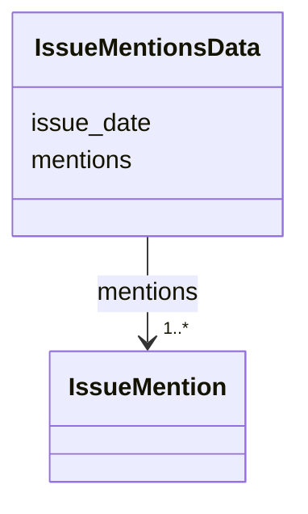

---
search:
  boost: 10.0
---

# Class: IssueMentionsData 


_One issue's mentions document: the issue's date and its mentions._


<div data-search-exclude markdown="1">


URI: [pc:IssueMentionsData](https://pruzhany.org/ns/sourced-entities#IssueMentionsData)





<!-- no inheritance hierarchy -->

## Class Properties

| Property | Value |
| --- | --- |
| Tree Root | Yes |


## Slots

| Name | Cardinality and Range | Description | Inheritance |
| ---  | --- | --- | --- |
| [issue_date](issue_date.md) | 1 <br/> [IsoDay](IsoDay.md) | The issue's date, written YYYY-MM-DD. | direct |
| [mentions](mentions.md) | 1..* <br/> [IssueMention](IssueMention.md) | The issue's mentions. | direct |


## Identifier and Mapping Information


### Schema Source


* from schema: https://pruzhany.org/ns/mentions


## Mappings

| Mapping Type | Mapped Value |
| ---  | ---  |
| self | pc:IssueMentionsData |
| native | pc:IssueMentionsData |


## LinkML Source

<!-- TODO: investigate https://stackoverflow.com/questions/37606292/how-to-create-tabbed-code-blocks-in-mkdocs-or-sphinx -->

### Direct

<details>
```yaml
name: IssueMentionsData
description: 'One issue''s mentions document: the issue''s date and its mentions.'
from_schema: https://pruzhany.org/ns/mentions
rank: 1000
attributes:
  issue_date:
    name: issue_date
    description: The issue's date, written YYYY-MM-DD.
    from_schema: https://pruzhany.org/ns/mentions
    rank: 1000
    domain_of:
    - IssueMentionsData
    range: IsoDay
    required: true
  mentions:
    name: mentions
    description: The issue's mentions.
    from_schema: https://pruzhany.org/ns/mentions
    rank: 1000
    domain_of:
    - IssueMentionsData
    range: IssueMention
    required: true
    multivalued: true
    inlined_as_list: true
tree_root: true

```
</details>

### Induced

<details>
```yaml
name: IssueMentionsData
description: 'One issue''s mentions document: the issue''s date and its mentions.'
from_schema: https://pruzhany.org/ns/mentions
rank: 1000
attributes:
  issue_date:
    name: issue_date
    description: The issue's date, written YYYY-MM-DD.
    from_schema: https://pruzhany.org/ns/mentions
    rank: 1000
    owner: IssueMentionsData
    domain_of:
    - IssueMentionsData
    range: IsoDay
    required: true
  mentions:
    name: mentions
    description: The issue's mentions.
    from_schema: https://pruzhany.org/ns/mentions
    rank: 1000
    owner: IssueMentionsData
    domain_of:
    - IssueMentionsData
    range: IssueMention
    required: true
    multivalued: true
    inlined: true
    inlined_as_list: true
tree_root: true

```
</details></div>
