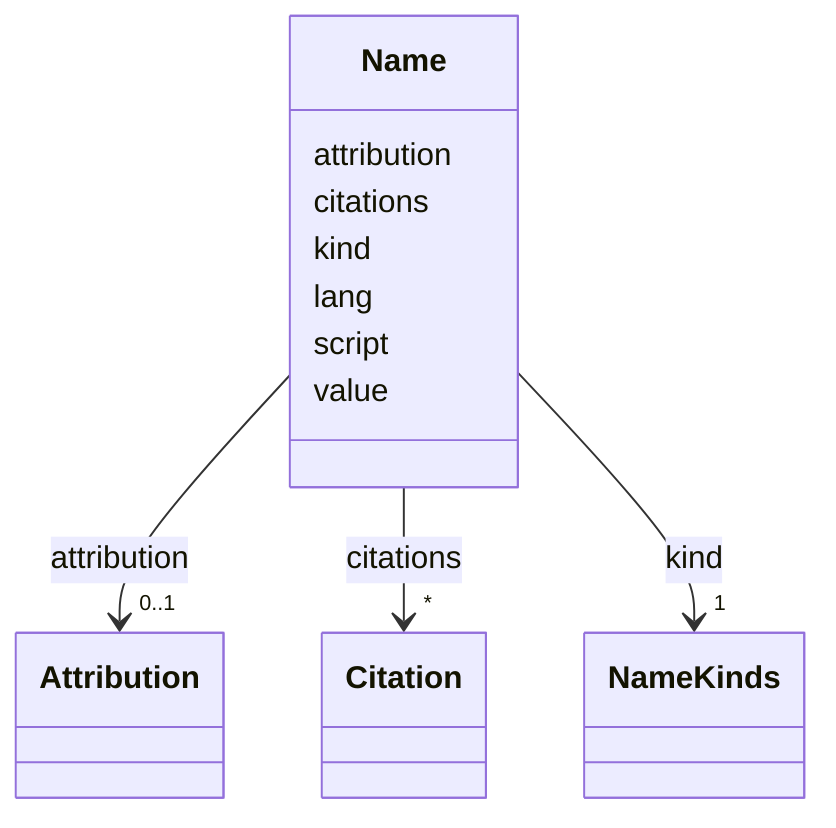

---
search:
  boost: 10.0
---

# Class: Name 


_One name of a person, a family, an organisation or a place, of one kind (printed, birth, married, supplied and so on), in one script. A person's, a family's and an organisation's names are agent names and a place's are place names (vocabulary/ site-content.json, bindings agent_name and place_name), so the class itself names no single term._


<div data-search-exclude markdown="1">


URI: [pc:Name](https://pruzhany.org/ns/sourced-entities#Name)





<!-- no inheritance hierarchy -->

## Slots

| Name | Cardinality and Range | Description | Inheritance |
| ---  | --- | --- | --- |
| [value](value.md) | 1 <br/> [NonBlankText](NonBlankText.md) | The name, as written. | direct |
| [kind](kind.md) | 1 <br/> [NameKinds](NameKinds.md) | What kind of name it is: printed, birth, married, supplied and so on. | direct |
| [script](script.md) | 1 <br/> [ScriptCode](ScriptCode.md) | The script it is written in, as a four-letter ISO 15924 code such as Hebr or Latn. | direct |
| [lang](lang.md) | 0..1 <br/> [SimpleLanguageTag](SimpleLanguageTag.md) | Its language, as a language tag such as yi or en. | direct |
| [citations](citations.md) | * <br/> [Citation](Citation.md) | Where the name is found. | direct |
| [attribution](attribution.md) | 0..1 <br/> [Attribution](Attribution.md) | For a supplied name only: who wrote the description, and on what day. | direct |


## Rules


### 

| Rule Applied | Preconditions | Postconditions | Elseconditions |
|--------------|---------------|----------------|----------------|
| slot_conditions |```{'kind': {'equals_string': 'supplied'}}``` |```{'attribution': {'required': True}, 'citations': {'required': True}}``` | |


### 

| Rule Applied | Preconditions | Postconditions | Elseconditions |
|--------------|---------------|----------------|----------------|
| slot_conditions |```{'attribution': {'value_presence': 'PRESENT'}}``` |```{'kind': {'equals_string': 'supplied'}}``` | |


## Identifier and Mapping Information


### Schema Source


* from schema: https://pruzhany.org/ns/mentions


## Mappings

| Mapping Type | Mapped Value |
| ---  | ---  |
| self | pc:Name |
| native | pc:Name |


## LinkML Source

<!-- TODO: investigate https://stackoverflow.com/questions/37606292/how-to-create-tabbed-code-blocks-in-mkdocs-or-sphinx -->

### Direct

<details>
```yaml
name: Name
description: One name of a person, a family, an organisation or a place, of one kind
  (printed, birth, married, supplied and so on), in one script. A person's, a family's
  and an organisation's names are agent names and a place's are place names (vocabulary/
  site-content.json, bindings agent_name and place_name), so the class itself names
  no single term.
from_schema: https://pruzhany.org/ns/mentions
rank: 1000
attributes:
  value:
    name: value
    description: The name, as written.
    from_schema: https://pruzhany.org/ns/sourced_entities
    domain_of:
    - Fact
    - Name
    range: NonBlankText
    required: true
  kind:
    name: kind
    description: 'What kind of name it is: printed, birth, married, supplied and so
      on.'
    from_schema: https://pruzhany.org/ns/sourced_entities
    domain_of:
    - Source
    - Name
    - Authorship
    range: NameKinds
    required: true
  script:
    name: script
    description: The script it is written in, as a four-letter ISO 15924 code such
      as Hebr or Latn.
    from_schema: https://pruzhany.org/ns/sourced_entities
    rank: 1000
    domain_of:
    - Name
    range: ScriptCode
    required: true
  lang:
    name: lang
    description: Its language, as a language tag such as yi or en.
    from_schema: https://pruzhany.org/ns/sourced_entities
    rank: 1000
    domain_of:
    - Name
    range: SimpleLanguageTag
  citations:
    name: citations
    description: Where the name is found.
    from_schema: https://pruzhany.org/ns/sourced_entities
    domain_of:
    - Fact
    - Name
    range: Citation
    multivalued: true
    inlined_as_list: true
  attribution:
    name: attribution
    description: 'For a supplied name only: who wrote the description, and on what
      day.'
    from_schema: https://pruzhany.org/ns/sourced_entities
    domain_of:
    - Fact
    - Name
    - EnglishCheck
    - SuppliedTitle
    - Translation
    range: Attribution
    inlined: true
rules:
- preconditions:
    slot_conditions:
      kind:
        name: kind
        equals_string: supplied
  postconditions:
    slot_conditions:
      attribution:
        name: attribution
        required: true
      citations:
        name: citations
        required: true
  description: A supplied name has its attribution and its citations.
- preconditions:
    slot_conditions:
      attribution:
        name: attribution
        value_presence: PRESENT
  postconditions:
    slot_conditions:
      kind:
        name: kind
        equals_string: supplied
  description: Only a supplied name has an attribution.

```
</details>

### Induced

<details>
```yaml
name: Name
description: One name of a person, a family, an organisation or a place, of one kind
  (printed, birth, married, supplied and so on), in one script. A person's, a family's
  and an organisation's names are agent names and a place's are place names (vocabulary/
  site-content.json, bindings agent_name and place_name), so the class itself names
  no single term.
from_schema: https://pruzhany.org/ns/mentions
rank: 1000
attributes:
  value:
    name: value
    description: The name, as written.
    from_schema: https://pruzhany.org/ns/sourced_entities
    owner: Name
    domain_of:
    - Fact
    - Name
    range: NonBlankText
    required: true
  kind:
    name: kind
    description: 'What kind of name it is: printed, birth, married, supplied and so
      on.'
    from_schema: https://pruzhany.org/ns/sourced_entities
    owner: Name
    domain_of:
    - Source
    - Name
    - Authorship
    range: NameKinds
    required: true
  script:
    name: script
    description: The script it is written in, as a four-letter ISO 15924 code such
      as Hebr or Latn.
    from_schema: https://pruzhany.org/ns/sourced_entities
    rank: 1000
    owner: Name
    domain_of:
    - Name
    range: ScriptCode
    required: true
  lang:
    name: lang
    description: Its language, as a language tag such as yi or en.
    from_schema: https://pruzhany.org/ns/sourced_entities
    rank: 1000
    owner: Name
    domain_of:
    - Name
    range: SimpleLanguageTag
  citations:
    name: citations
    description: Where the name is found.
    from_schema: https://pruzhany.org/ns/sourced_entities
    owner: Name
    domain_of:
    - Fact
    - Name
    range: Citation
    multivalued: true
    inlined: true
    inlined_as_list: true
  attribution:
    name: attribution
    description: 'For a supplied name only: who wrote the description, and on what
      day.'
    from_schema: https://pruzhany.org/ns/sourced_entities
    owner: Name
    domain_of:
    - Fact
    - Name
    - EnglishCheck
    - SuppliedTitle
    - Translation
    range: Attribution
    inlined: true
rules:
- preconditions:
    slot_conditions:
      kind:
        name: kind
        equals_string: supplied
  postconditions:
    slot_conditions:
      attribution:
        name: attribution
        required: true
      citations:
        name: citations
        required: true
  description: A supplied name has its attribution and its citations.
- preconditions:
    slot_conditions:
      attribution:
        name: attribution
        value_presence: PRESENT
  postconditions:
    slot_conditions:
      kind:
        name: kind
        equals_string: supplied
  description: Only a supplied name has an attribution.

```
</details></div>
