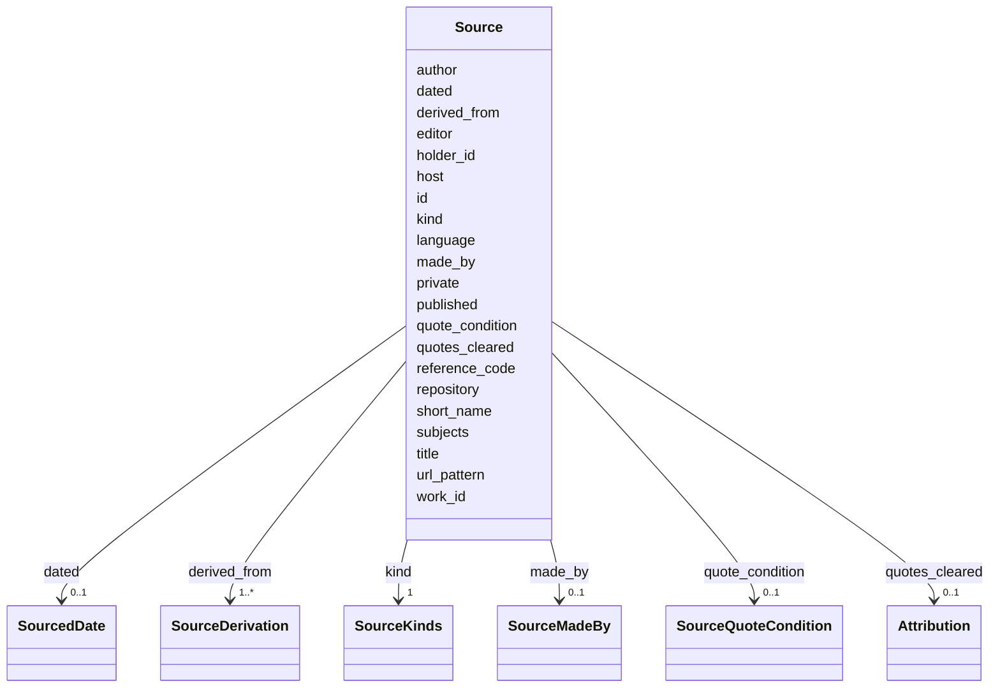

---
search:
  boost: 10.0
---

# Class: Source 


_A record the statements rest on: a book, an archive's database, a family document, the paper itself and the like, registered once and cited by its id._


<div data-search-exclude markdown="1">


URI: [ehri:RecordResource](http://lod.ehri-project-test.eu/ontology#RecordResource)





<!-- no inheritance hierarchy -->

## Class Properties

| Property | Value |
| --- | --- |
| Class URI | [ehri:RecordResource](http://lod.ehri-project-test.eu/ontology#RecordResource) |


## Slots

| Name | Cardinality and Range | Description | Inheritance |
| ---  | --- | --- | --- |
| [made_by](made_by.md) | 0..1 <br/> [SourceMadeBy](SourceMadeBy.md) | Who made the source, as a category (family, studio, institution, perpetrator, unknown); never its creator. | direct |
| [id](id.md) | 1 <br/> [NonBlankText](NonBlankText.md) | The source's id in the record, which citations name. | direct |
| [kind](kind.md) | 1 <br/> [SourceKinds](SourceKinds.md) | What kind of source it is: a book, a memorial book, an archive's database, the paper and so on. | direct |
| [title](title.md) | 1 <br/> [NonBlankText](NonBlankText.md) | The source's title. | direct |
| [short_name](short_name.md) | 0..1 <br/> [NonBlankText](NonBlankText.md) | A short name the site shows for the source. | direct |
| [holder_id](holder_id.md) | 0..1 <br/> [NonBlankText](NonBlankText.md) | Who holds the source, by its id in the record's holders. | direct |
| [reference_code](reference_code.md) | 0..1 <br/> [NonBlankText](NonBlankText.md) | The holder's own reference for the record, as the holder writes it. | direct |
| [language](language.md) | 1..* <br/> [LanguageTag](LanguageTag.md) | The languages of the record, as BCP 47 tags. | direct |
| [derived_from](derived_from.md) | 1..* <br/> [SourceDerivation](SourceDerivation.md) | For a copy or a transcription we hold: the original it was made from, and how. | direct |
| [dated](dated.md) | 0..1 <br/> [SourcedDate](SourcedDate.md) | The record's own date, apart from when it was published or consulted. | direct |
| [quotes_cleared](quotes_cleared.md) | 0..1 <br/> [Attribution](Attribution.md) | Who allowed quotes from this private document to be published, and on what day. | direct |
| [quote_condition](quote_condition.md) | 0..1 <br/> [SourceQuoteCondition](SourceQuoteCondition.md) | The owner's condition on the cleared quotes: shown only where no other record says the same. | direct |
| [private](private.md) | 0..1 <br/> [Boolean](Boolean.md) | True when the document itself is never shown. | direct |
| [work_id](work_id.md) | 0..1 <br/> [String](String.md) | The id of the work in the project's files; never published where it is a file name. | direct |
| [author](author.md) | 0..1 <br/> [String](String.md) | Who wrote the source: an institution, never a member of its staff. | direct |
| [editor](editor.md) | 0..1 <br/> [String](String.md) | Who edited the source. | direct |
| [published](published.md) | 0..1 <br/> [String](String.md) | When or where the source was published, as written. | direct |
| [repository](repository.md) | 0..1 <br/> [String](String.md) | The old free-text holder, read for one release; holder_id replaces it. | direct |
| [url_pattern](url_pattern.md) | 0..1 <br/> [String](String.md) | How an address of one of the source's records is formed. | direct |
| [host](host.md) | 0..1 <br/> [HostName](HostName.md) | The web host the source's records are served from, without www: every address cited from it is on that host or a subdomain of it. | direct |
| [subjects](subjects.md) | 1..* <br/> [NonBlankText](NonBlankText.md) | The persons, places or events the source shows or speaks of, by their ids. | direct |


## Rules


### 

| Rule Applied | Preconditions | Postconditions | Elseconditions |
|--------------|---------------|----------------|----------------|
| slot_conditions |```{'host': {'value_presence': 'PRESENT'}}``` |```{'host': {'pattern': '^(?!www\\.)'}}``` | |


## Identifier and Mapping Information


### Schema Source


* from schema: https://pruzhany.org/ns/mentions


## Mappings

| Mapping Type | Mapped Value |
| ---  | ---  |
| self | ehri:RecordResource |
| native | pc:Source |


## LinkML Source

<!-- TODO: investigate https://stackoverflow.com/questions/37606292/how-to-create-tabbed-code-blocks-in-mkdocs-or-sphinx -->

### Direct

<details>
```yaml
name: Source
description: 'A record the statements rest on: a book, an archive''s database, a family
  document, the paper itself and the like, registered once and cited by its id.'
from_schema: https://pruzhany.org/ns/mentions
rank: 1000
attributes:
  made_by:
    name: made_by
    description: Who made the source, as a category (family, studio, institution,
      perpetrator, unknown); never its creator.
    from_schema: https://pruzhany.org/ns/sourced_entities
    rank: 1000
    slot_uri: pc:source_made_by
    domain_of:
    - Source
    range: SourceMadeBy
  id:
    name: id
    description: The source's id in the record, which citations name.
    from_schema: https://pruzhany.org/ns/sourced_entities
    domain_of:
    - IssueMention
    - Source
    - Fact
    - Mention
    range: NonBlankText
    required: true
  kind:
    name: kind
    description: 'What kind of source it is: a book, a memorial book, an archive''s
      database, the paper and so on.'
    from_schema: https://pruzhany.org/ns/sourced_entities
    rank: 1000
    domain_of:
    - Source
    - Name
    - Authorship
    range: SourceKinds
    required: true
  title:
    name: title
    description: The source's title.
    from_schema: https://pruzhany.org/ns/sourced_entities
    domain_of:
    - IssueMention
    - Source
    - Mention
    range: NonBlankText
    required: true
  short_name:
    name: short_name
    description: A short name the site shows for the source.
    from_schema: https://pruzhany.org/ns/sourced_entities
    rank: 1000
    slot_uri: pc:site_source_display
    domain_of:
    - Source
    range: NonBlankText
  holder_id:
    name: holder_id
    description: Who holds the source, by its id in the record's holders.
    from_schema: https://pruzhany.org/ns/sourced_entities
    rank: 1000
    slot_uri: rico:hasOrHadHolder
    domain_of:
    - Source
    range: NonBlankText
  reference_code:
    name: reference_code
    description: The holder's own reference for the record, as the holder writes it.
    from_schema: https://pruzhany.org/ns/sourced_entities
    rank: 1000
    slot_uri: rico:hasOrHadIdentifier
    domain_of:
    - Source
    - Citation
    range: NonBlankText
  language:
    name: language
    description: The languages of the record, as BCP 47 tags.
    from_schema: https://pruzhany.org/ns/sourced_entities
    rank: 1000
    slot_uri: rico:hasOrHadLanguage
    domain_of:
    - Source
    - SuppliedTitle
    - Translation
    range: LanguageTag
    multivalued: true
    minimum_cardinality: 1
  derived_from:
    name: derived_from
    description: 'For a copy or a transcription we hold: the original it was made
      from, and how.'
    from_schema: https://pruzhany.org/ns/sourced_entities
    rank: 1000
    domain_of:
    - Source
    range: SourceDerivation
    multivalued: true
    inlined_as_list: true
    minimum_cardinality: 1
  dated:
    name: dated
    description: The record's own date, apart from when it was published or consulted.
    from_schema: https://pruzhany.org/ns/sourced_entities
    rank: 1000
    slot_uri: rico:hasCreationDate
    domain_of:
    - Source
    range: SourcedDate
    inlined: true
  quotes_cleared:
    name: quotes_cleared
    description: Who allowed quotes from this private document to be published, and
      on what day.
    from_schema: https://pruzhany.org/ns/sourced_entities
    related_mappings:
    - pc:site_source_privacy
    rank: 1000
    domain_of:
    - Source
    range: Attribution
    inlined: true
  quote_condition:
    name: quote_condition
    description: 'The owner''s condition on the cleared quotes: shown only where no
      other record says the same.'
    from_schema: https://pruzhany.org/ns/sourced_entities
    rank: 1000
    slot_uri: pc:site_source_quote_condition
    domain_of:
    - Source
    range: SourceQuoteCondition
  private:
    name: private
    description: True when the document itself is never shown.
    from_schema: https://pruzhany.org/ns/sourced_entities
    related_mappings:
    - pc:site_source_privacy
    rank: 1000
    domain_of:
    - Source
    range: boolean
  work_id:
    name: work_id
    description: The id of the work in the project's files; never published where
      it is a file name.
    from_schema: https://pruzhany.org/ns/sourced_entities
    rank: 1000
    domain_of:
    - Source
    range: string
  author:
    name: author
    description: 'Who wrote the source: an institution, never a member of its staff.'
    from_schema: https://pruzhany.org/ns/sourced_entities
    rank: 1000
    slot_uri: rico:hasCreator
    domain_of:
    - Source
    range: string
  editor:
    name: editor
    description: Who edited the source.
    from_schema: https://pruzhany.org/ns/sourced_entities
    rank: 1000
    domain_of:
    - Source
    range: string
  published:
    name: published
    description: When or where the source was published, as written.
    from_schema: https://pruzhany.org/ns/sourced_entities
    rank: 1000
    domain_of:
    - Source
    range: string
  repository:
    name: repository
    description: The old free-text holder, read for one release; holder_id replaces
      it.
    from_schema: https://pruzhany.org/ns/sourced_entities
    rank: 1000
    domain_of:
    - Source
    range: string
  url_pattern:
    name: url_pattern
    description: How an address of one of the source's records is formed.
    from_schema: https://pruzhany.org/ns/sourced_entities
    rank: 1000
    domain_of:
    - Source
    range: string
  host:
    name: host
    description: 'The web host the source''s records are served from, without www:
      every address cited from it is on that host or a subdomain of it.'
    from_schema: https://pruzhany.org/ns/sourced_entities
    rank: 1000
    slot_uri: pc:site_source_host
    domain_of:
    - Source
    range: HostName
  subjects:
    name: subjects
    description: The persons, places or events the source shows or speaks of, by their
      ids.
    from_schema: https://pruzhany.org/ns/sourced_entities
    rank: 1000
    slot_uri: rico:hasOrHadSubject
    domain_of:
    - Source
    range: NonBlankText
    multivalued: true
    minimum_cardinality: 1
class_uri: ehri:RecordResource
rules:
- preconditions:
    slot_conditions:
      host:
        name: host
        value_presence: PRESENT
  postconditions:
    slot_conditions:
      host:
        name: host
        pattern: ^(?!www\.)
  description: A source's host is written without www.

```
</details>

### Induced

<details>
```yaml
name: Source
description: 'A record the statements rest on: a book, an archive''s database, a family
  document, the paper itself and the like, registered once and cited by its id.'
from_schema: https://pruzhany.org/ns/mentions
rank: 1000
attributes:
  made_by:
    name: made_by
    description: Who made the source, as a category (family, studio, institution,
      perpetrator, unknown); never its creator.
    from_schema: https://pruzhany.org/ns/sourced_entities
    rank: 1000
    slot_uri: pc:source_made_by
    owner: Source
    domain_of:
    - Source
    range: SourceMadeBy
  id:
    name: id
    description: The source's id in the record, which citations name.
    from_schema: https://pruzhany.org/ns/sourced_entities
    owner: Source
    domain_of:
    - IssueMention
    - Source
    - Fact
    - Mention
    range: NonBlankText
    required: true
  kind:
    name: kind
    description: 'What kind of source it is: a book, a memorial book, an archive''s
      database, the paper and so on.'
    from_schema: https://pruzhany.org/ns/sourced_entities
    rank: 1000
    owner: Source
    domain_of:
    - Source
    - Name
    - Authorship
    range: SourceKinds
    required: true
  title:
    name: title
    description: The source's title.
    from_schema: https://pruzhany.org/ns/sourced_entities
    owner: Source
    domain_of:
    - IssueMention
    - Source
    - Mention
    range: NonBlankText
    required: true
  short_name:
    name: short_name
    description: A short name the site shows for the source.
    from_schema: https://pruzhany.org/ns/sourced_entities
    rank: 1000
    slot_uri: pc:site_source_display
    owner: Source
    domain_of:
    - Source
    range: NonBlankText
  holder_id:
    name: holder_id
    description: Who holds the source, by its id in the record's holders.
    from_schema: https://pruzhany.org/ns/sourced_entities
    rank: 1000
    slot_uri: rico:hasOrHadHolder
    owner: Source
    domain_of:
    - Source
    range: NonBlankText
  reference_code:
    name: reference_code
    description: The holder's own reference for the record, as the holder writes it.
    from_schema: https://pruzhany.org/ns/sourced_entities
    rank: 1000
    slot_uri: rico:hasOrHadIdentifier
    owner: Source
    domain_of:
    - Source
    - Citation
    range: NonBlankText
  language:
    name: language
    description: The languages of the record, as BCP 47 tags.
    from_schema: https://pruzhany.org/ns/sourced_entities
    rank: 1000
    slot_uri: rico:hasOrHadLanguage
    owner: Source
    domain_of:
    - Source
    - SuppliedTitle
    - Translation
    range: LanguageTag
    multivalued: true
    minimum_cardinality: 1
  derived_from:
    name: derived_from
    description: 'For a copy or a transcription we hold: the original it was made
      from, and how.'
    from_schema: https://pruzhany.org/ns/sourced_entities
    rank: 1000
    owner: Source
    domain_of:
    - Source
    range: SourceDerivation
    multivalued: true
    inlined: true
    inlined_as_list: true
    minimum_cardinality: 1
  dated:
    name: dated
    description: The record's own date, apart from when it was published or consulted.
    from_schema: https://pruzhany.org/ns/sourced_entities
    rank: 1000
    slot_uri: rico:hasCreationDate
    owner: Source
    domain_of:
    - Source
    range: SourcedDate
    inlined: true
  quotes_cleared:
    name: quotes_cleared
    description: Who allowed quotes from this private document to be published, and
      on what day.
    from_schema: https://pruzhany.org/ns/sourced_entities
    related_mappings:
    - pc:site_source_privacy
    rank: 1000
    owner: Source
    domain_of:
    - Source
    range: Attribution
    inlined: true
  quote_condition:
    name: quote_condition
    description: 'The owner''s condition on the cleared quotes: shown only where no
      other record says the same.'
    from_schema: https://pruzhany.org/ns/sourced_entities
    rank: 1000
    slot_uri: pc:site_source_quote_condition
    owner: Source
    domain_of:
    - Source
    range: SourceQuoteCondition
  private:
    name: private
    description: True when the document itself is never shown.
    from_schema: https://pruzhany.org/ns/sourced_entities
    related_mappings:
    - pc:site_source_privacy
    rank: 1000
    owner: Source
    domain_of:
    - Source
    range: boolean
  work_id:
    name: work_id
    description: The id of the work in the project's files; never published where
      it is a file name.
    from_schema: https://pruzhany.org/ns/sourced_entities
    rank: 1000
    owner: Source
    domain_of:
    - Source
    range: string
  author:
    name: author
    description: 'Who wrote the source: an institution, never a member of its staff.'
    from_schema: https://pruzhany.org/ns/sourced_entities
    rank: 1000
    slot_uri: rico:hasCreator
    owner: Source
    domain_of:
    - Source
    range: string
  editor:
    name: editor
    description: Who edited the source.
    from_schema: https://pruzhany.org/ns/sourced_entities
    rank: 1000
    owner: Source
    domain_of:
    - Source
    range: string
  published:
    name: published
    description: When or where the source was published, as written.
    from_schema: https://pruzhany.org/ns/sourced_entities
    rank: 1000
    owner: Source
    domain_of:
    - Source
    range: string
  repository:
    name: repository
    description: The old free-text holder, read for one release; holder_id replaces
      it.
    from_schema: https://pruzhany.org/ns/sourced_entities
    rank: 1000
    owner: Source
    domain_of:
    - Source
    range: string
  url_pattern:
    name: url_pattern
    description: How an address of one of the source's records is formed.
    from_schema: https://pruzhany.org/ns/sourced_entities
    rank: 1000
    owner: Source
    domain_of:
    - Source
    range: string
  host:
    name: host
    description: 'The web host the source''s records are served from, without www:
      every address cited from it is on that host or a subdomain of it.'
    from_schema: https://pruzhany.org/ns/sourced_entities
    rank: 1000
    slot_uri: pc:site_source_host
    owner: Source
    domain_of:
    - Source
    range: HostName
  subjects:
    name: subjects
    description: The persons, places or events the source shows or speaks of, by their
      ids.
    from_schema: https://pruzhany.org/ns/sourced_entities
    rank: 1000
    slot_uri: rico:hasOrHadSubject
    owner: Source
    domain_of:
    - Source
    range: NonBlankText
    multivalued: true
    minimum_cardinality: 1
class_uri: ehri:RecordResource
rules:
- preconditions:
    slot_conditions:
      host:
        name: host
        value_presence: PRESENT
  postconditions:
    slot_conditions:
      host:
        name: host
        pattern: ^(?!www\.)
  description: A source's host is written without www.

```
</details></div>
