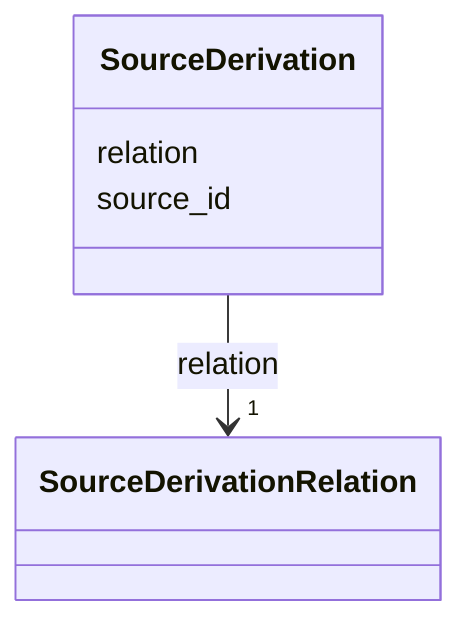

---
search:
  boost: 10.0
---

# Class: SourceDerivation 


_The record a source we hold was made from, and how: a copy or a transcription of it._


<div data-search-exclude markdown="1">


URI: [pc:SourceDerivation](https://pruzhany.org/ns/sourced-entities#SourceDerivation)





<!-- no inheritance hierarchy -->

## Slots

| Name | Cardinality and Range | Description | Inheritance |
| ---  | --- | --- | --- |
| [source_id](source_id.md) | 1 <br/> [NonBlankText](NonBlankText.md) | The original source, by its id in the record's sources. | direct |
| [relation](relation.md) | 1 <br/> [SourceDerivationRelation](SourceDerivationRelation.md) | Whether this source is a copy or a transcription of the original. | direct |


## Usages

| used by | used in | type | used |
| ---  | --- | --- | --- |
| [Source](Source.md) | [derived_from](derived_from.md) | range | [SourceDerivation](SourceDerivation.md) |


## Identifier and Mapping Information


### Schema Source


* from schema: https://pruzhany.org/ns/mentions


## Mappings

| Mapping Type | Mapped Value |
| ---  | ---  |
| self | pc:SourceDerivation |
| native | pc:SourceDerivation |


## LinkML Source

<!-- TODO: investigate https://stackoverflow.com/questions/37606292/how-to-create-tabbed-code-blocks-in-mkdocs-or-sphinx -->

### Direct

<details>
```yaml
name: SourceDerivation
description: 'The record a source we hold was made from, and how: a copy or a transcription
  of it.'
from_schema: https://pruzhany.org/ns/mentions
rank: 1000
attributes:
  source_id:
    name: source_id
    description: The original source, by its id in the record's sources.
    from_schema: https://pruzhany.org/ns/sourced_entities
    rank: 1000
    domain_of:
    - SourceDerivation
    - Citation
    range: NonBlankText
    required: true
  relation:
    name: relation
    description: Whether this source is a copy or a transcription of the original.
    from_schema: https://pruzhany.org/ns/sourced_entities
    rank: 1000
    domain_of:
    - SourceDerivation
    range: SourceDerivationRelation
    required: true

```
</details>

### Induced

<details>
```yaml
name: SourceDerivation
description: 'The record a source we hold was made from, and how: a copy or a transcription
  of it.'
from_schema: https://pruzhany.org/ns/mentions
rank: 1000
attributes:
  source_id:
    name: source_id
    description: The original source, by its id in the record's sources.
    from_schema: https://pruzhany.org/ns/sourced_entities
    rank: 1000
    owner: SourceDerivation
    domain_of:
    - SourceDerivation
    - Citation
    range: NonBlankText
    required: true
  relation:
    name: relation
    description: Whether this source is a copy or a transcription of the original.
    from_schema: https://pruzhany.org/ns/sourced_entities
    rank: 1000
    owner: SourceDerivation
    domain_of:
    - SourceDerivation
    range: SourceDerivationRelation
    required: true

```
</details></div>
