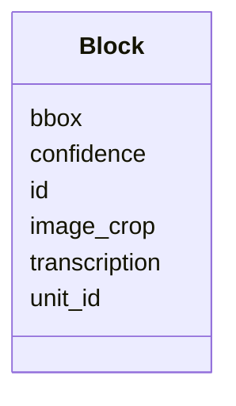

---
search:
  boost: 10.0
---

# Class: Block 


_One region of print on a page, its box and the words read in it, belonging to one content item, or to no item when it is a section heading._


<div data-search-exclude markdown="1">


URI: [pc:Block](https://pruzhany.org/ns/sourced-entities#Block)





<!-- no inheritance hierarchy -->

## Slots

| Name | Cardinality and Range | Description | Inheritance |
| ---  | --- | --- | --- |
| [id](id.md) | 1 <br/> [String](String.md) | The region's id, such as blk-p4-001. | direct |
| [bbox](bbox.md) | 1..* <br/> [NonNegativeInteger](NonNegativeInteger.md) | The region's box on the page picture: left, top, width and height, in the picture's pixels. | direct |
| [transcription](transcription.md) | 1 <br/> [String](String.md) | The words read in the region, its lines separated by line breaks. | direct |
| [confidence](confidence.md) | 0..1 <br/> [Float](Float.md) | How sure the reading is, from 0 to 1, where it was recorded. | direct |
| [image_crop](image_crop.md) | 0..1 <br/> [String](String.md) | A picture of the region alone, by its path, where one was made. | direct |
| [unit_id](unit_id.md) | 0..1 <br/> [String](String.md) | The content item the region belongs to, by its id; null for a region that is a section's heading. | direct |


## Usages

| used by | used in | type | used |
| ---  | --- | --- | --- |
| [Page](Page.md) | [blocks](blocks.md) | range | [Block](Block.md) |


## Identifier and Mapping Information


### Annotations

| property | value |
| --- | --- |
| impresso | A page region (page.schema.json r[]). |


### Schema Source


* from schema: https://pruzhany.org/ns/pages


## Mappings

| Mapping Type | Mapped Value |
| ---  | ---  |
| self | pc:Block |
| native | pc:Block |


## LinkML Source

<!-- TODO: investigate https://stackoverflow.com/questions/37606292/how-to-create-tabbed-code-blocks-in-mkdocs-or-sphinx -->

### Direct

<details>
```yaml
name: Block
annotations:
  impresso:
    tag: impresso
    value: A page region (page.schema.json r[]).
description: One region of print on a page, its box and the words read in it, belonging
  to one content item, or to no item when it is a section heading.
from_schema: https://pruzhany.org/ns/pages
rank: 1000
attributes:
  id:
    name: id
    description: The region's id, such as blk-p4-001.
    from_schema: https://pruzhany.org/ns/pages
    domain_of:
    - Page
    - Block
    required: true
  bbox:
    name: bbox
    annotations:
      impresso:
        tag: impresso
        value: The region's coordinates (r[].c).
    description: 'The region''s box on the page picture: left, top, width and height,
      in the picture''s pixels.'
    from_schema: https://pruzhany.org/ns/pages
    rank: 1000
    domain_of:
    - Block
    range: NonNegativeInteger
    required: true
    multivalued: true
    minimum_cardinality: 4
    maximum_cardinality: 4
  transcription:
    name: transcription
    description: The words read in the region, its lines separated by line breaks.
    from_schema: https://pruzhany.org/ns/pages
    rank: 1000
    domain_of:
    - Block
    required: true
  confidence:
    name: confidence
    description: How sure the reading is, from 0 to 1, where it was recorded.
    from_schema: https://pruzhany.org/ns/pages
    rank: 1000
    domain_of:
    - Block
    range: float
  image_crop:
    name: image_crop
    description: A picture of the region alone, by its path, where one was made.
    from_schema: https://pruzhany.org/ns/pages
    rank: 1000
    domain_of:
    - Block
  unit_id:
    name: unit_id
    annotations:
      impresso:
        tag: impresso
        value: The content item a region belongs to (r[].pOf).
    description: The content item the region belongs to, by its id; null for a region
      that is a section's heading.
    from_schema: https://pruzhany.org/ns/pages
    rank: 1000
    domain_of:
    - Block

```
</details>

### Induced

<details>
```yaml
name: Block
annotations:
  impresso:
    tag: impresso
    value: A page region (page.schema.json r[]).
description: One region of print on a page, its box and the words read in it, belonging
  to one content item, or to no item when it is a section heading.
from_schema: https://pruzhany.org/ns/pages
rank: 1000
attributes:
  id:
    name: id
    description: The region's id, such as blk-p4-001.
    from_schema: https://pruzhany.org/ns/pages
    owner: Block
    domain_of:
    - Page
    - Block
    range: string
    required: true
  bbox:
    name: bbox
    annotations:
      impresso:
        tag: impresso
        value: The region's coordinates (r[].c).
    description: 'The region''s box on the page picture: left, top, width and height,
      in the picture''s pixels.'
    from_schema: https://pruzhany.org/ns/pages
    rank: 1000
    owner: Block
    domain_of:
    - Block
    range: NonNegativeInteger
    required: true
    multivalued: true
    minimum_cardinality: 4
    maximum_cardinality: 4
  transcription:
    name: transcription
    description: The words read in the region, its lines separated by line breaks.
    from_schema: https://pruzhany.org/ns/pages
    rank: 1000
    owner: Block
    domain_of:
    - Block
    range: string
    required: true
  confidence:
    name: confidence
    description: How sure the reading is, from 0 to 1, where it was recorded.
    from_schema: https://pruzhany.org/ns/pages
    rank: 1000
    owner: Block
    domain_of:
    - Block
    range: float
  image_crop:
    name: image_crop
    description: A picture of the region alone, by its path, where one was made.
    from_schema: https://pruzhany.org/ns/pages
    rank: 1000
    owner: Block
    domain_of:
    - Block
    range: string
  unit_id:
    name: unit_id
    annotations:
      impresso:
        tag: impresso
        value: The content item a region belongs to (r[].pOf).
    description: The content item the region belongs to, by its id; null for a region
      that is a section's heading.
    from_schema: https://pruzhany.org/ns/pages
    rank: 1000
    owner: Block
    domain_of:
    - Block
    range: string

```
</details></div>
