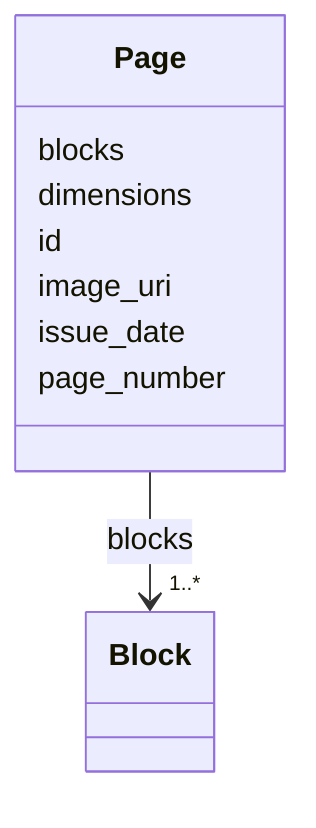

---
search:
  boost: 10.0
---

# Class: Page 


_One printed page of the issue: its picture, its size and its regions of print._


<div data-search-exclude markdown="1">


URI: [pc:Page](https://pruzhany.org/ns/sourced-entities#Page)





<!-- no inheritance hierarchy -->

## Slots

| Name | Cardinality and Range | Description | Inheritance |
| ---  | --- | --- | --- |
| [id](id.md) | 1 <br/> [String](String.md) | The page's id, such as page-1938-12-16-4. | direct |
| [issue_date](issue_date.md) | 1 <br/> [String](String.md) | The date of the issue the page belongs to, written YYYY-MM-DD. | direct |
| [page_number](page_number.md) | 1 <br/> [Integer](Integer.md) | The page's number within the issue, from 1. | direct |
| [image_uri](image_uri.md) | 1 <br/> [String](String.md) | The page's picture, by its name or address. | direct |
| [dimensions](dimensions.md) | 1..* <br/> [Integer](Integer.md) | The picture's width and height, in its pixels. | direct |
| [blocks](blocks.md) | 1..* <br/> [Block](Block.md) | The regions of print on the page. | direct |


## Usages

| used by | used in | type | used |
| ---  | --- | --- | --- |
| [PagesData](PagesData.md) | [pages](pages.md) | range | [Page](Page.md) |


## Identifier and Mapping Information


### Annotations

| property | value |
| --- | --- |
| impresso | A page file (page.schema.json). |


### Schema Source


* from schema: https://pruzhany.org/ns/pages


## Mappings

| Mapping Type | Mapped Value |
| ---  | ---  |
| self | pc:Page |
| native | pc:Page |
| close | schema:CreativeWork |


## LinkML Source

<!-- TODO: investigate https://stackoverflow.com/questions/37606292/how-to-create-tabbed-code-blocks-in-mkdocs-or-sphinx -->

### Direct

<details>
```yaml
name: Page
annotations:
  impresso:
    tag: impresso
    value: A page file (page.schema.json).
description: 'One printed page of the issue: its picture, its size and its regions
  of print.'
from_schema: https://pruzhany.org/ns/pages
close_mappings:
- schema:CreativeWork
rank: 1000
attributes:
  id:
    name: id
    annotations:
      impresso:
        tag: impresso
        value: The page file's id.
    description: The page's id, such as page-1938-12-16-4.
    from_schema: https://pruzhany.org/ns/pages
    rank: 1000
    domain_of:
    - Page
    - Block
    required: true
  issue_date:
    name: issue_date
    description: The date of the issue the page belongs to, written YYYY-MM-DD.
    from_schema: https://pruzhany.org/ns/pages
    rank: 1000
    domain_of:
    - Page
    required: true
  page_number:
    name: page_number
    description: The page's number within the issue, from 1.
    from_schema: https://pruzhany.org/ns/pages
    rank: 1000
    domain_of:
    - Page
    range: integer
    required: true
  image_uri:
    name: image_uri
    description: The page's picture, by its name or address.
    from_schema: https://pruzhany.org/ns/pages
    rank: 1000
    domain_of:
    - Page
    required: true
  dimensions:
    name: dimensions
    annotations:
      impresso:
        tag: impresso
        value: The page file's fw and fh, the width and height of the facsimile.
    description: The picture's width and height, in its pixels.
    from_schema: https://pruzhany.org/ns/pages
    rank: 1000
    domain_of:
    - Page
    range: integer
    required: true
    multivalued: true
    minimum_cardinality: 2
    maximum_cardinality: 2
  blocks:
    name: blocks
    annotations:
      impresso:
        tag: impresso
        value: The page file's regions (r).
    description: The regions of print on the page.
    from_schema: https://pruzhany.org/ns/pages
    rank: 1000
    domain_of:
    - Page
    range: Block
    required: true
    multivalued: true
    inlined_as_list: true

```
</details>

### Induced

<details>
```yaml
name: Page
annotations:
  impresso:
    tag: impresso
    value: A page file (page.schema.json).
description: 'One printed page of the issue: its picture, its size and its regions
  of print.'
from_schema: https://pruzhany.org/ns/pages
close_mappings:
- schema:CreativeWork
rank: 1000
attributes:
  id:
    name: id
    annotations:
      impresso:
        tag: impresso
        value: The page file's id.
    description: The page's id, such as page-1938-12-16-4.
    from_schema: https://pruzhany.org/ns/pages
    rank: 1000
    owner: Page
    domain_of:
    - Page
    - Block
    range: string
    required: true
  issue_date:
    name: issue_date
    description: The date of the issue the page belongs to, written YYYY-MM-DD.
    from_schema: https://pruzhany.org/ns/pages
    rank: 1000
    owner: Page
    domain_of:
    - Page
    range: string
    required: true
  page_number:
    name: page_number
    description: The page's number within the issue, from 1.
    from_schema: https://pruzhany.org/ns/pages
    rank: 1000
    owner: Page
    domain_of:
    - Page
    range: integer
    required: true
  image_uri:
    name: image_uri
    description: The page's picture, by its name or address.
    from_schema: https://pruzhany.org/ns/pages
    rank: 1000
    owner: Page
    domain_of:
    - Page
    range: string
    required: true
  dimensions:
    name: dimensions
    annotations:
      impresso:
        tag: impresso
        value: The page file's fw and fh, the width and height of the facsimile.
    description: The picture's width and height, in its pixels.
    from_schema: https://pruzhany.org/ns/pages
    rank: 1000
    owner: Page
    domain_of:
    - Page
    range: integer
    required: true
    multivalued: true
    minimum_cardinality: 2
    maximum_cardinality: 2
  blocks:
    name: blocks
    annotations:
      impresso:
        tag: impresso
        value: The page file's regions (r).
    description: The regions of print on the page.
    from_schema: https://pruzhany.org/ns/pages
    rank: 1000
    owner: Page
    domain_of:
    - Page
    range: Block
    required: true
    multivalued: true
    inlined: true
    inlined_as_list: true

```
</details></div>
