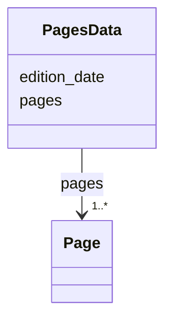

---
search:
  boost: 10.0
---

# Class: PagesData 


_One issue's pages document: the issue's date and its pages in order._


<div data-search-exclude markdown="1">


URI: [pc:PagesData](https://pruzhany.org/ns/sourced-entities#PagesData)





<!-- no inheritance hierarchy -->

## Class Properties

| Property | Value |
| --- | --- |
| Tree Root | Yes |


## Slots

| Name | Cardinality and Range | Description | Inheritance |
| ---  | --- | --- | --- |
| [edition_date](edition_date.md) | 1 <br/> [String](String.md) | The issue's date, written YYYY-MM-DD. | direct |
| [pages](pages.md) | 1..* <br/> [Page](Page.md) | The issue's pages. | direct |


## Identifier and Mapping Information


### Annotations

| property | value |
| --- | --- |
| impresso | The page files of one issue (page.schema.json), and the issue file's list of its pages (issue.schema.json pp). |


### Schema Source


* from schema: https://pruzhany.org/ns/pages


## Mappings

| Mapping Type | Mapped Value |
| ---  | ---  |
| self | pc:PagesData |
| native | pc:PagesData |


## LinkML Source

<!-- TODO: investigate https://stackoverflow.com/questions/37606292/how-to-create-tabbed-code-blocks-in-mkdocs-or-sphinx -->

### Direct

<details>
```yaml
name: PagesData
annotations:
  impresso:
    tag: impresso
    value: The page files of one issue (page.schema.json), and the issue file's list
      of its pages (issue.schema.json pp).
description: 'One issue''s pages document: the issue''s date and its pages in order.'
from_schema: https://pruzhany.org/ns/pages
rank: 1000
attributes:
  edition_date:
    name: edition_date
    description: The issue's date, written YYYY-MM-DD.
    from_schema: https://pruzhany.org/ns/pages
    rank: 1000
    domain_of:
    - PagesData
    required: true
  pages:
    name: pages
    description: The issue's pages.
    from_schema: https://pruzhany.org/ns/pages
    rank: 1000
    domain_of:
    - PagesData
    range: Page
    required: true
    multivalued: true
    inlined_as_list: true
tree_root: true

```
</details>

### Induced

<details>
```yaml
name: PagesData
annotations:
  impresso:
    tag: impresso
    value: The page files of one issue (page.schema.json), and the issue file's list
      of its pages (issue.schema.json pp).
description: 'One issue''s pages document: the issue''s date and its pages in order.'
from_schema: https://pruzhany.org/ns/pages
rank: 1000
attributes:
  edition_date:
    name: edition_date
    description: The issue's date, written YYYY-MM-DD.
    from_schema: https://pruzhany.org/ns/pages
    rank: 1000
    owner: PagesData
    domain_of:
    - PagesData
    range: string
    required: true
  pages:
    name: pages
    description: The issue's pages.
    from_schema: https://pruzhany.org/ns/pages
    rank: 1000
    owner: PagesData
    domain_of:
    - PagesData
    range: Page
    required: true
    multivalued: true
    inlined: true
    inlined_as_list: true
tree_root: true

```
</details></div>
