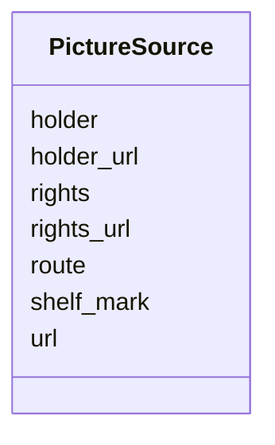

---
search:
  boost: 10.0
---

# Class: PictureSource 


_The credit for pictures made from a holding: its holder's name, a separate access service or collection, the shelf mark and a link. Shared by a newspaper's default credit and a page whose picture comes from elsewhere._


<div data-search-exclude markdown="1">


URI: [pc:PictureSource](https://pruzhany.org/ns/sourced-entities#PictureSource)





<!-- no inheritance hierarchy -->

## Class Properties

| Property | Value |
| --- | --- |
| Class URI | [pc:PictureSource](https://pruzhany.org/ns/sourced-entities#PictureSource) |


## Slots

| Name | Cardinality and Range | Description | Inheritance |
| ---  | --- | --- | --- |
| [holder](holder.md) | 1 <br/> [NonBlankText](NonBlankText.md) | The name of the institution holding the pages the pictures were made from. | direct |
| [holder_url](holder_url.md) | 0..1 <br/> [Uri](Uri.md) | The web address of the institution named in holder: its page for the holding where the source register has one, otherwise its home page. | direct |
| [route](route.md) | 0..1 <br/> [NonBlankText](NonBlankText.md) | The name of the service or collection readers reach the pages through, when it differs from the holder itself. | direct |
| [shelf_mark](shelf_mark.md) | 0..1 <br/> [NonBlankText](NonBlankText.md) | The holder's shelf mark or call number for the pages. | direct |
| [url](url.md) | 0..1 <br/> [Uri](Uri.md) | The pages' descriptive page at the holder or access route. | direct |
| [rights](rights.md) | 0..1 <br/> [NonBlankText](NonBlankText.md) | The rights statement for the pictures, as text. | direct |
| [rights_url](rights_url.md) | 0..1 <br/> [Uri](Uri.md) | The address where the rights statement was read. | direct |


## Usages

| used by | used in | type | used |
| ---  | --- | --- | --- |
| [Page](Page.md) | [picture_source](picture_source.md) | range | [PictureSource](PictureSource.md) |


## Identifier and Mapping Information


### Schema Source


* from schema: https://pruzhany.org/ns/pages


## Mappings

| Mapping Type | Mapped Value |
| ---  | ---  |
| self | pc:PictureSource |
| native | pc:PictureSource |


## LinkML Source

<!-- TODO: investigate https://stackoverflow.com/questions/37606292/how-to-create-tabbed-code-blocks-in-mkdocs-or-sphinx -->

### Direct

<details>
```yaml
name: PictureSource
description: 'The credit for pictures made from a holding: its holder''s name, a separate
  access service or collection, the shelf mark and a link. Shared by a newspaper''s
  default credit and a page whose picture comes from elsewhere.'
from_schema: https://pruzhany.org/ns/pages
rank: 1000
attributes:
  holder:
    name: holder
    description: The name of the institution holding the pages the pictures were made
      from.
    from_schema: https://pruzhany.org/ns/picture_source
    close_mappings:
    - rico:hasOrHadHolder
    rank: 1000
    slot_uri: pc:picture_holder_name
    domain_of:
    - PictureSource
    range: NonBlankText
    required: true
  holder_url:
    name: holder_url
    description: 'The web address of the institution named in holder: its page for
      the holding where the source register has one, otherwise its home page.'
    from_schema: https://pruzhany.org/ns/picture_source
    close_mappings:
    - rdfs:seeAlso
    rank: 1000
    slot_uri: pc:picture_holder_url
    domain_of:
    - PictureSource
    range: uri
  route:
    name: route
    description: The name of the service or collection readers reach the pages through,
      when it differs from the holder itself.
    from_schema: https://pruzhany.org/ns/picture_source
    rank: 1000
    slot_uri: pc:picture_access_route
    domain_of:
    - PictureSource
    range: NonBlankText
  shelf_mark:
    name: shelf_mark
    description: The holder's shelf mark or call number for the pages.
    from_schema: https://pruzhany.org/ns/picture_source
    rank: 1000
    slot_uri: rico:identifier
    domain_of:
    - PictureSource
    range: NonBlankText
  url:
    name: url
    description: The pages' descriptive page at the holder or access route.
    from_schema: https://pruzhany.org/ns/picture_source
    close_mappings:
    - rdfs:seeAlso
    rank: 1000
    slot_uri: pc:holding_object_url
    domain_of:
    - PictureSource
    range: uri
  rights:
    name: rights
    description: The rights statement for the pictures, as text.
    from_schema: https://pruzhany.org/ns/picture_source
    rank: 1000
    slot_uri: rico:conditionsOfUse
    domain_of:
    - PictureSource
    range: NonBlankText
  rights_url:
    name: rights_url
    description: The address where the rights statement was read.
    from_schema: https://pruzhany.org/ns/picture_source
    rank: 1000
    slot_uri: pc:picture_rights_url
    domain_of:
    - PictureSource
    range: uri
class_uri: pc:PictureSource

```
</details>

### Induced

<details>
```yaml
name: PictureSource
description: 'The credit for pictures made from a holding: its holder''s name, a separate
  access service or collection, the shelf mark and a link. Shared by a newspaper''s
  default credit and a page whose picture comes from elsewhere.'
from_schema: https://pruzhany.org/ns/pages
rank: 1000
attributes:
  holder:
    name: holder
    description: The name of the institution holding the pages the pictures were made
      from.
    from_schema: https://pruzhany.org/ns/picture_source
    close_mappings:
    - rico:hasOrHadHolder
    rank: 1000
    slot_uri: pc:picture_holder_name
    owner: PictureSource
    domain_of:
    - PictureSource
    range: NonBlankText
    required: true
  holder_url:
    name: holder_url
    description: 'The web address of the institution named in holder: its page for
      the holding where the source register has one, otherwise its home page.'
    from_schema: https://pruzhany.org/ns/picture_source
    close_mappings:
    - rdfs:seeAlso
    rank: 1000
    slot_uri: pc:picture_holder_url
    owner: PictureSource
    domain_of:
    - PictureSource
    range: uri
  route:
    name: route
    description: The name of the service or collection readers reach the pages through,
      when it differs from the holder itself.
    from_schema: https://pruzhany.org/ns/picture_source
    rank: 1000
    slot_uri: pc:picture_access_route
    owner: PictureSource
    domain_of:
    - PictureSource
    range: NonBlankText
  shelf_mark:
    name: shelf_mark
    description: The holder's shelf mark or call number for the pages.
    from_schema: https://pruzhany.org/ns/picture_source
    rank: 1000
    slot_uri: rico:identifier
    owner: PictureSource
    domain_of:
    - PictureSource
    range: NonBlankText
  url:
    name: url
    description: The pages' descriptive page at the holder or access route.
    from_schema: https://pruzhany.org/ns/picture_source
    close_mappings:
    - rdfs:seeAlso
    rank: 1000
    slot_uri: pc:holding_object_url
    owner: PictureSource
    domain_of:
    - PictureSource
    range: uri
  rights:
    name: rights
    description: The rights statement for the pictures, as text.
    from_schema: https://pruzhany.org/ns/picture_source
    rank: 1000
    slot_uri: rico:conditionsOfUse
    owner: PictureSource
    domain_of:
    - PictureSource
    range: NonBlankText
  rights_url:
    name: rights_url
    description: The address where the rights statement was read.
    from_schema: https://pruzhany.org/ns/picture_source
    rank: 1000
    slot_uri: pc:picture_rights_url
    owner: PictureSource
    domain_of:
    - PictureSource
    range: uri
class_uri: pc:PictureSource

```
</details></div>
