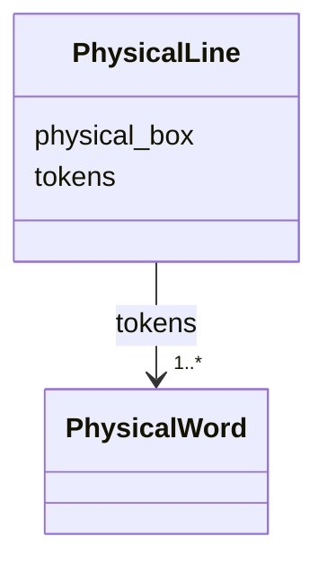

---
search:
  boost: 10.0
---

# Class: PhysicalLine 


_One line with a box and ordered OCR tokens._


<div data-search-exclude markdown="1">


URI: [pc:PhysicalLine](https://pruzhany.org/ns/sourced-entities#PhysicalLine)





<!-- no inheritance hierarchy -->

## Slots

| Name | Cardinality and Range | Description | Inheritance |
| ---  | --- | --- | --- |
| [physical_box](physical_box.md) | 1..* <br/> [Integer](Integer.md) | A box [x, y, width, height] in pixels of this page's picture, with origin at its upper left. Impresso requires exactly four integers, without a nonnegative or positive bound. It is an array, not an object with invented coordinate fields. | direct |
| [tokens](tokens.md) | 1..* <br/> [PhysicalWord](PhysicalWord.md) | OCR tokens in line order; Impresso permits an empty list. | direct |


## Usages

| used by | used in | type | used |
| ---  | --- | --- | --- |
| [PhysicalParagraph](PhysicalParagraph.md) | [lines](lines.md) | range | [PhysicalLine](PhysicalLine.md) |


## Identifier and Mapping Information


### Annotations

| property | value |
| --- | --- |
| impresso | page.schema.json r[].p[].l[]. |
| alto | ALTO 4.4 TextLine inside TextBlock. |
| computed_id | <region id>-l<LLL>; LLL is the 1-based line position across all paragraphs of the region in order, zero-padded to three digits. See the module description. |


### Schema Source


* from schema: https://pruzhany.org/ns/physical


## Mappings

| Mapping Type | Mapped Value |
| ---  | ---  |
| self | pc:PhysicalLine |
| native | pc:PhysicalLine |


## LinkML Source

<!-- TODO: investigate https://stackoverflow.com/questions/37606292/how-to-create-tabbed-code-blocks-in-mkdocs-or-sphinx -->

### Direct

<details>
```yaml
name: PhysicalLine
annotations:
  impresso:
    tag: impresso
    value: page.schema.json r[].p[].l[].
  alto:
    tag: alto
    value: ALTO 4.4 TextLine inside TextBlock.
  computed_id:
    tag: computed_id
    value: <region id>-l<LLL>; LLL is the 1-based line position across all paragraphs
      of the region in order, zero-padded to three digits. See the module description.
description: One line with a box and ordered OCR tokens.
from_schema: https://pruzhany.org/ns/physical
rank: 1000
slots:
- physical_box
slot_usage:
  physical_box:
    name: physical_box
    required: true
attributes:
  tokens:
    name: tokens
    annotations:
      impresso:
        tag: impresso
        value: page.schema.json r[].p[].l[].t.
      alto:
        tag: alto
        value: TextLine/String, with SP or HYP as appropriate for spacing and hyphenation.
    description: OCR tokens in line order; Impresso permits an empty list.
    from_schema: https://pruzhany.org/ns/physical
    rank: 1000
    alias: t
    domain_of:
    - PhysicalLine
    range: PhysicalWord
    required: true
    multivalued: true
    inlined_as_list: true
extra_slots:
  allowed: true

```
</details>

### Induced

<details>
```yaml
name: PhysicalLine
annotations:
  impresso:
    tag: impresso
    value: page.schema.json r[].p[].l[].
  alto:
    tag: alto
    value: ALTO 4.4 TextLine inside TextBlock.
  computed_id:
    tag: computed_id
    value: <region id>-l<LLL>; LLL is the 1-based line position across all paragraphs
      of the region in order, zero-padded to three digits. See the module description.
description: One line with a box and ordered OCR tokens.
from_schema: https://pruzhany.org/ns/physical
rank: 1000
slot_usage:
  physical_box:
    name: physical_box
    required: true
attributes:
  tokens:
    name: tokens
    annotations:
      impresso:
        tag: impresso
        value: page.schema.json r[].p[].l[].t.
      alto:
        tag: alto
        value: TextLine/String, with SP or HYP as appropriate for spacing and hyphenation.
    description: OCR tokens in line order; Impresso permits an empty list.
    from_schema: https://pruzhany.org/ns/physical
    rank: 1000
    alias: t
    owner: PhysicalLine
    domain_of:
    - PhysicalLine
    range: PhysicalWord
    required: true
    multivalued: true
    inlined: true
    inlined_as_list: true
  physical_box:
    name: physical_box
    annotations:
      impresso:
        tag: impresso
        value: page.schema.json $defs/coordinates; c on region, paragraph, line and
          token.
      alto:
        tag: alto
        value: ALTO 4.4 HPOS, VPOS, WIDTH, HEIGHT respectively on TextBlock, TextLine
          or String; Description/MeasurementUnit must be pixel and the image frame
          must agree. ALTO accepts floating-point measurements; this Impresso contract
          requires integers.
    description: A box [x, y, width, height] in pixels of this page's picture, with
      origin at its upper left. Impresso requires exactly four integers, without a
      nonnegative or positive bound. It is an array, not an object with invented coordinate
      fields.
    from_schema: https://pruzhany.org/ns/physical
    rank: 1000
    alias: c
    owner: PhysicalLine
    domain_of:
    - PhysicalRegion
    - PhysicalParagraph
    - PhysicalLine
    - PhysicalWord
    range: integer
    required: true
    multivalued: true
    minimum_cardinality: 4
    maximum_cardinality: 4
extra_slots:
  allowed: true

```
</details></div>
