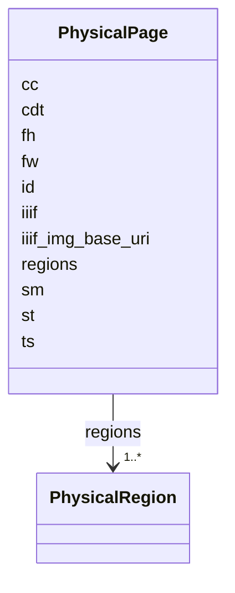

---
search:
  boost: 10.0
---

# Class: PhysicalPage 


_One Impresso page file, with its picture metadata and physical text hierarchy. Impresso allows unknown properties at every object level; no such properties are defined here. Exactly one image key and at least one timestamp key must be present._


<div data-search-exclude markdown="1">


URI: [pc:PhysicalPage](https://pruzhany.org/ns/sourced-entities#PhysicalPage)





<!-- no inheritance hierarchy -->

## Class Properties

| Property | Value |
| --- | --- |
| Tree Root | Yes |


## Slots

| Name | Cardinality and Range | Description | Inheritance |
| ---  | --- | --- | --- |
| [id](id.md) | 1 <br/> [String](String.md) | Impresso's canonical page identifier; for example FABLE-1900-01-01-a-p0001. | direct |
| [iiif](iiif.md) | 0..1 <br/> [String](String.md) | Deprecated IIIF manifest URI, retained for compatibility; Impresso validates plain text, not URI syntax. Exactly one of this and iiif_img_base_uri is present. | direct |
| [iiif_img_base_uri](iiif_img_base_uri.md) | 0..1 <br/> [String](String.md) | Base IIIF image URI without a suffix; Impresso validates plain text, not URI syntax. | direct |
| [fw](fw.md) | 0..1 <br/> [Integer](Integer.md) | Facsimile width in pixels; present together with fh, with no bound in Impresso. | direct |
| [fh](fh.md) | 0..1 <br/> [Integer](Integer.md) | Facsimile height in pixels; present together with fw, with no bound in Impresso. | direct |
| [st](st.md) | 0..1 <br/> [String](String.md) | Media source type; present together with sm. Newspaper requires print; radio_broadcast requires typescript. | direct |
| [sm](sm.md) | 0..1 <br/> [String](String.md) | Original source medium; present together with st. | direct |
| [cc](cc.md) | 0..1 <br/> [Boolean](Boolean.md) | Whether legacy coordinates were converted or rescaled to the IIIF picture frame. | direct |
| [cdt](cdt.md) | 0..1 <br/> [String](String.md) | Legacy JSON creation timestamp; Impresso validates a string without a date format. | direct |
| [ts](ts.md) | 0..1 <br/> [String](String.md) | JSON creation timestamp, intended as YYYY-MM-DDTHH:MM:SSZ; Impresso imposes no format constraint. At least one of ts and cdt is present; both are allowed. | direct |
| [regions](regions.md) | 1..* <br/> [PhysicalRegion](PhysicalRegion.md) | Regions in page order; an empty list is accepted by Impresso. | direct |

<details>
<summary>Expressions & Logic</summary>
#### Any Of

The class must satisfy at least one of:
- AnonymousClassExpression({'slot_conditions': {'ts': SlotDefinition({'name': 'ts', 'required': True})}})
- AnonymousClassExpression({'slot_conditions': {'cdt': SlotDefinition({'name': 'cdt', 'required': True})}})
#### Exactly One Of

The class must satisfy exactly one of:
- AnonymousClassExpression({'slot_conditions': {'iiif': SlotDefinition({'name': 'iiif', 'required': True})}})
- AnonymousClassExpression({
  'slot_conditions': {'iiif_img_base_uri': SlotDefinition({'name': 'iiif_img_base_uri', 'required': True})}
})

</details>


## Rules


### 

| Rule Applied | Preconditions | Postconditions | Elseconditions |
|--------------|---------------|----------------|----------------|
| slot_conditions |```{'fw': {'required': True}}``` |```{'fh': {'required': True}}``` | |


### 

| Rule Applied | Preconditions | Postconditions | Elseconditions |
|--------------|---------------|----------------|----------------|
| slot_conditions |```{'fh': {'required': True}}``` |```{'fw': {'required': True}}``` | |


### 

| Rule Applied | Preconditions | Postconditions | Elseconditions |
|--------------|---------------|----------------|----------------|
| slot_conditions |```{'st': {'required': True}}``` |```{'sm': {'required': True}}``` | |


### 

| Rule Applied | Preconditions | Postconditions | Elseconditions |
|--------------|---------------|----------------|----------------|
| slot_conditions |```{'sm': {'required': True}}``` |```{'st': {'required': True}}``` | |


### 

| Rule Applied | Preconditions | Postconditions | Elseconditions |
|--------------|---------------|----------------|----------------|
| slot_conditions |```{'st': {'required': False, 'equals_string': 'newspaper'}}``` |```{'sm': {'required': False, 'equals_string': 'print'}}``` | |


### 

| Rule Applied | Preconditions | Postconditions | Elseconditions |
|--------------|---------------|----------------|----------------|
| slot_conditions |```{'st': {'required': False, 'equals_string': 'radio_broadcast'}}``` |```{'sm': {'required': False, 'equals_string': 'typescript'}}``` | |


## Identifier and Mapping Information


### Annotations

| property | value |
| --- | --- |
| impresso | page.schema.json root, Printed Page. |
| alto | ALTO 4.4 Layout/Page (PageType). A full ALTO document also needs Description, MeasurementUnit and PHYSICAL_IMG_NR, which this file does not directly store. |


### Schema Source


* from schema: https://pruzhany.org/ns/physical


## Mappings

| Mapping Type | Mapped Value |
| ---  | ---  |
| self | pc:PhysicalPage |
| native | pc:PhysicalPage |


## LinkML Source

<!-- TODO: investigate https://stackoverflow.com/questions/37606292/how-to-create-tabbed-code-blocks-in-mkdocs-or-sphinx -->

### Direct

<details>
```yaml
name: PhysicalPage
annotations:
  impresso:
    tag: impresso
    value: page.schema.json root, Printed Page.
  alto:
    tag: alto
    value: ALTO 4.4 Layout/Page (PageType). A full ALTO document also needs Description,
      MeasurementUnit and PHYSICAL_IMG_NR, which this file does not directly store.
description: One Impresso page file, with its picture metadata and physical text hierarchy.
  Impresso allows unknown properties at every object level; no such properties are
  defined here. Exactly one image key and at least one timestamp key must be present.
from_schema: https://pruzhany.org/ns/physical
rank: 1000
attributes:
  id:
    name: id
    annotations:
      impresso:
        tag: impresso
        value: page.schema.json id, with its exact pattern.
      alto:
        tag: alto
        value: Page/@ID after ensuring the ALTO XML ID lexical constraints.
    description: Impresso's canonical page identifier; for example FABLE-1900-01-01-a-p0001.
    from_schema: https://pruzhany.org/ns/physical
    rank: 1000
    domain_of:
    - PhysicalPage
    required: true
    pattern: ^[A-Za-z][A-Za-z0-9_]*-\d{4}-\d{2}-\d{2}-[a-z]{1,2}-p[0-9]{4}$
  iiif:
    name: iiif
    annotations:
      impresso:
        tag: impresso
        value: page.schema.json iiif.
      alto:
        tag: alto
        value: 'No direct equivalent: a manifest is not sourceImageInformation/fileName.'
    description: Deprecated IIIF manifest URI, retained for compatibility; Impresso
      validates plain text, not URI syntax. Exactly one of this and iiif_img_base_uri
      is present.
    from_schema: https://pruzhany.org/ns/physical
    rank: 1000
    domain_of:
    - PhysicalPage
  iiif_img_base_uri:
    name: iiif_img_base_uri
    annotations:
      impresso:
        tag: impresso
        value: page.schema.json iiif_img_base_uri.
      alto:
        tag: alto
        value: Description/sourceImageInformation/fileName can identify the source
          picture; an image-service base URI needs an export policy to select the
          actual image.
    description: Base IIIF image URI without a suffix; Impresso validates plain text,
      not URI syntax.
    from_schema: https://pruzhany.org/ns/physical
    rank: 1000
    domain_of:
    - PhysicalPage
  fw:
    name: fw
    annotations:
      impresso:
        tag: impresso
        value: page.schema.json fw.
      alto:
        tag: alto
        value: Page/@WIDTH with MeasurementUnit pixel.
    description: Facsimile width in pixels; present together with fh, with no bound
      in Impresso.
    from_schema: https://pruzhany.org/ns/physical
    rank: 1000
    domain_of:
    - PhysicalPage
    range: integer
  fh:
    name: fh
    annotations:
      impresso:
        tag: impresso
        value: page.schema.json fh.
      alto:
        tag: alto
        value: Page/@HEIGHT with MeasurementUnit pixel.
    description: Facsimile height in pixels; present together with fw, with no bound
      in Impresso.
    from_schema: https://pruzhany.org/ns/physical
    rank: 1000
    domain_of:
    - PhysicalPage
    range: integer
  st:
    name: st
    annotations:
      impresso:
        tag: impresso
        value: page.schema.json st, SourceType values.
      alto:
        tag: alto
        value: No direct ALTO page attribute for this source classification.
    description: Media source type; present together with sm. Newspaper requires print;
      radio_broadcast requires typescript.
    from_schema: https://pruzhany.org/ns/physical
    rank: 1000
    domain_of:
    - PhysicalPage
    equals_string_in:
    - newspaper
    - radio_broadcast
    - radio_magazine
    - radio_schedule
    - monograph
    - encyclopedia
  sm:
    name: sm
    annotations:
      impresso:
        tag: impresso
        value: page.schema.json sm.
      alto:
        tag: alto
        value: No direct equivalent; Page/@PAGECLASS is user-defined, not this enumeration.
    description: Original source medium; present together with st.
    from_schema: https://pruzhany.org/ns/physical
    rank: 1000
    domain_of:
    - PhysicalPage
    equals_string_in:
    - print
    - typescript
  cc:
    name: cc
    annotations:
      impresso:
        tag: impresso
        value: page.schema.json cc.
      alto:
        tag: alto
        value: No direct flag; an export must resolve coordinates in its MeasurementUnit
          and source picture frame before writing HPOS, VPOS, WIDTH and HEIGHT.
    description: Whether legacy coordinates were converted or rescaled to the IIIF
      picture frame.
    from_schema: https://pruzhany.org/ns/physical
    rank: 1000
    domain_of:
    - PhysicalPage
    range: boolean
  cdt:
    name: cdt
    annotations:
      impresso:
        tag: impresso
        value: page.schema.json cdt.
      alto:
        tag: alto
        value: Processing/processingStep/processingDateTime only if that step created
          this file; a JSON file timestamp is not necessarily an OCR processing time.
    description: Legacy JSON creation timestamp; Impresso validates a string without
      a date format.
    from_schema: https://pruzhany.org/ns/physical
    rank: 1000
    domain_of:
    - PhysicalPage
  ts:
    name: ts
    annotations:
      impresso:
        tag: impresso
        value: page.schema.json ts.
      alto:
        tag: alto
        value: Processing/processingStep/processingDateTime only for the corresponding
          creation step, with export-time conversion if needed.
    description: JSON creation timestamp, intended as YYYY-MM-DDTHH:MM:SSZ; Impresso
      imposes no format constraint. At least one of ts and cdt is present; both are
      allowed.
    from_schema: https://pruzhany.org/ns/physical
    rank: 1000
    domain_of:
    - PhysicalPage
  regions:
    name: regions
    annotations:
      impresso:
        tag: impresso
        value: page.schema.json r.
      alto:
        tag: alto
        value: Page/PrintSpace/TextBlock in order; this module adds no ALTO ReadingOrder
          field.
    description: Regions in page order; an empty list is accepted by Impresso.
    from_schema: https://pruzhany.org/ns/physical
    rank: 1000
    alias: r
    domain_of:
    - PhysicalPage
    range: PhysicalRegion
    required: true
    multivalued: true
    inlined_as_list: true
tree_root: true
rules:
- preconditions:
    slot_conditions:
      fw:
        name: fw
        required: true
  postconditions:
    slot_conditions:
      fh:
        name: fh
        required: true
- preconditions:
    slot_conditions:
      fh:
        name: fh
        required: true
  postconditions:
    slot_conditions:
      fw:
        name: fw
        required: true
- preconditions:
    slot_conditions:
      st:
        name: st
        required: true
  postconditions:
    slot_conditions:
      sm:
        name: sm
        required: true
- preconditions:
    slot_conditions:
      sm:
        name: sm
        required: true
  postconditions:
    slot_conditions:
      st:
        name: st
        required: true
- preconditions:
    slot_conditions:
      st:
        name: st
        required: false
        equals_string: newspaper
  postconditions:
    slot_conditions:
      sm:
        name: sm
        required: false
        equals_string: print
- preconditions:
    slot_conditions:
      st:
        name: st
        required: false
        equals_string: radio_broadcast
  postconditions:
    slot_conditions:
      sm:
        name: sm
        required: false
        equals_string: typescript
extra_slots:
  allowed: true
any_of:
- slot_conditions:
    ts:
      name: ts
      required: true
- slot_conditions:
    cdt:
      name: cdt
      required: true
exactly_one_of:
- slot_conditions:
    iiif:
      name: iiif
      required: true
- slot_conditions:
    iiif_img_base_uri:
      name: iiif_img_base_uri
      required: true

```
</details>

### Induced

<details>
```yaml
name: PhysicalPage
annotations:
  impresso:
    tag: impresso
    value: page.schema.json root, Printed Page.
  alto:
    tag: alto
    value: ALTO 4.4 Layout/Page (PageType). A full ALTO document also needs Description,
      MeasurementUnit and PHYSICAL_IMG_NR, which this file does not directly store.
description: One Impresso page file, with its picture metadata and physical text hierarchy.
  Impresso allows unknown properties at every object level; no such properties are
  defined here. Exactly one image key and at least one timestamp key must be present.
from_schema: https://pruzhany.org/ns/physical
rank: 1000
attributes:
  id:
    name: id
    annotations:
      impresso:
        tag: impresso
        value: page.schema.json id, with its exact pattern.
      alto:
        tag: alto
        value: Page/@ID after ensuring the ALTO XML ID lexical constraints.
    description: Impresso's canonical page identifier; for example FABLE-1900-01-01-a-p0001.
    from_schema: https://pruzhany.org/ns/physical
    rank: 1000
    owner: PhysicalPage
    domain_of:
    - PhysicalPage
    range: string
    required: true
    pattern: ^[A-Za-z][A-Za-z0-9_]*-\d{4}-\d{2}-\d{2}-[a-z]{1,2}-p[0-9]{4}$
  iiif:
    name: iiif
    annotations:
      impresso:
        tag: impresso
        value: page.schema.json iiif.
      alto:
        tag: alto
        value: 'No direct equivalent: a manifest is not sourceImageInformation/fileName.'
    description: Deprecated IIIF manifest URI, retained for compatibility; Impresso
      validates plain text, not URI syntax. Exactly one of this and iiif_img_base_uri
      is present.
    from_schema: https://pruzhany.org/ns/physical
    rank: 1000
    owner: PhysicalPage
    domain_of:
    - PhysicalPage
    range: string
  iiif_img_base_uri:
    name: iiif_img_base_uri
    annotations:
      impresso:
        tag: impresso
        value: page.schema.json iiif_img_base_uri.
      alto:
        tag: alto
        value: Description/sourceImageInformation/fileName can identify the source
          picture; an image-service base URI needs an export policy to select the
          actual image.
    description: Base IIIF image URI without a suffix; Impresso validates plain text,
      not URI syntax.
    from_schema: https://pruzhany.org/ns/physical
    rank: 1000
    owner: PhysicalPage
    domain_of:
    - PhysicalPage
    range: string
  fw:
    name: fw
    annotations:
      impresso:
        tag: impresso
        value: page.schema.json fw.
      alto:
        tag: alto
        value: Page/@WIDTH with MeasurementUnit pixel.
    description: Facsimile width in pixels; present together with fh, with no bound
      in Impresso.
    from_schema: https://pruzhany.org/ns/physical
    rank: 1000
    owner: PhysicalPage
    domain_of:
    - PhysicalPage
    range: integer
  fh:
    name: fh
    annotations:
      impresso:
        tag: impresso
        value: page.schema.json fh.
      alto:
        tag: alto
        value: Page/@HEIGHT with MeasurementUnit pixel.
    description: Facsimile height in pixels; present together with fw, with no bound
      in Impresso.
    from_schema: https://pruzhany.org/ns/physical
    rank: 1000
    owner: PhysicalPage
    domain_of:
    - PhysicalPage
    range: integer
  st:
    name: st
    annotations:
      impresso:
        tag: impresso
        value: page.schema.json st, SourceType values.
      alto:
        tag: alto
        value: No direct ALTO page attribute for this source classification.
    description: Media source type; present together with sm. Newspaper requires print;
      radio_broadcast requires typescript.
    from_schema: https://pruzhany.org/ns/physical
    rank: 1000
    owner: PhysicalPage
    domain_of:
    - PhysicalPage
    range: string
    equals_string_in:
    - newspaper
    - radio_broadcast
    - radio_magazine
    - radio_schedule
    - monograph
    - encyclopedia
  sm:
    name: sm
    annotations:
      impresso:
        tag: impresso
        value: page.schema.json sm.
      alto:
        tag: alto
        value: No direct equivalent; Page/@PAGECLASS is user-defined, not this enumeration.
    description: Original source medium; present together with st.
    from_schema: https://pruzhany.org/ns/physical
    rank: 1000
    owner: PhysicalPage
    domain_of:
    - PhysicalPage
    range: string
    equals_string_in:
    - print
    - typescript
  cc:
    name: cc
    annotations:
      impresso:
        tag: impresso
        value: page.schema.json cc.
      alto:
        tag: alto
        value: No direct flag; an export must resolve coordinates in its MeasurementUnit
          and source picture frame before writing HPOS, VPOS, WIDTH and HEIGHT.
    description: Whether legacy coordinates were converted or rescaled to the IIIF
      picture frame.
    from_schema: https://pruzhany.org/ns/physical
    rank: 1000
    owner: PhysicalPage
    domain_of:
    - PhysicalPage
    range: boolean
  cdt:
    name: cdt
    annotations:
      impresso:
        tag: impresso
        value: page.schema.json cdt.
      alto:
        tag: alto
        value: Processing/processingStep/processingDateTime only if that step created
          this file; a JSON file timestamp is not necessarily an OCR processing time.
    description: Legacy JSON creation timestamp; Impresso validates a string without
      a date format.
    from_schema: https://pruzhany.org/ns/physical
    rank: 1000
    owner: PhysicalPage
    domain_of:
    - PhysicalPage
    range: string
  ts:
    name: ts
    annotations:
      impresso:
        tag: impresso
        value: page.schema.json ts.
      alto:
        tag: alto
        value: Processing/processingStep/processingDateTime only for the corresponding
          creation step, with export-time conversion if needed.
    description: JSON creation timestamp, intended as YYYY-MM-DDTHH:MM:SSZ; Impresso
      imposes no format constraint. At least one of ts and cdt is present; both are
      allowed.
    from_schema: https://pruzhany.org/ns/physical
    rank: 1000
    owner: PhysicalPage
    domain_of:
    - PhysicalPage
    range: string
  regions:
    name: regions
    annotations:
      impresso:
        tag: impresso
        value: page.schema.json r.
      alto:
        tag: alto
        value: Page/PrintSpace/TextBlock in order; this module adds no ALTO ReadingOrder
          field.
    description: Regions in page order; an empty list is accepted by Impresso.
    from_schema: https://pruzhany.org/ns/physical
    rank: 1000
    alias: r
    owner: PhysicalPage
    domain_of:
    - PhysicalPage
    range: PhysicalRegion
    required: true
    multivalued: true
    inlined: true
    inlined_as_list: true
tree_root: true
rules:
- preconditions:
    slot_conditions:
      fw:
        name: fw
        required: true
  postconditions:
    slot_conditions:
      fh:
        name: fh
        required: true
- preconditions:
    slot_conditions:
      fh:
        name: fh
        required: true
  postconditions:
    slot_conditions:
      fw:
        name: fw
        required: true
- preconditions:
    slot_conditions:
      st:
        name: st
        required: true
  postconditions:
    slot_conditions:
      sm:
        name: sm
        required: true
- preconditions:
    slot_conditions:
      sm:
        name: sm
        required: true
  postconditions:
    slot_conditions:
      st:
        name: st
        required: true
- preconditions:
    slot_conditions:
      st:
        name: st
        required: false
        equals_string: newspaper
  postconditions:
    slot_conditions:
      sm:
        name: sm
        required: false
        equals_string: print
- preconditions:
    slot_conditions:
      st:
        name: st
        required: false
        equals_string: radio_broadcast
  postconditions:
    slot_conditions:
      sm:
        name: sm
        required: false
        equals_string: typescript
extra_slots:
  allowed: true
any_of:
- slot_conditions:
    ts:
      name: ts
      required: true
- slot_conditions:
    cdt:
      name: cdt
      required: true
exactly_one_of:
- slot_conditions:
    iiif:
      name: iiif
      required: true
- slot_conditions:
    iiif_img_base_uri:
      name: iiif_img_base_uri
      required: true

```
</details></div>
