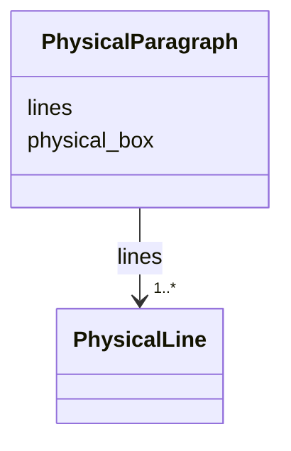

---
search:
  boost: 10.0
---

# Class: PhysicalParagraph 


_One ordered group of lines in a region, optionally with its own box; no computed id is assigned to paragraphs by this contract._


<div data-search-exclude markdown="1">


URI: [pc:PhysicalParagraph](https://pruzhany.org/ns/sourced-entities#PhysicalParagraph)





<!-- no inheritance hierarchy -->

## Slots

| Name | Cardinality and Range | Description | Inheritance |
| ---  | --- | --- | --- |
| [physical_box](physical_box.md) | 4..* <br/> [Integer](Integer.md) | A box [x, y, width, height] in pixels of this page's picture, with origin at its upper left. Impresso requires exactly four integers, without a nonnegative or positive bound. It is an array, not an object with invented coordinate fields. | direct |
| [lines](lines.md) | 1..* <br/> [PhysicalLine](PhysicalLine.md) | Lines in paragraph order, including an empty list if stored that way. | direct |


## Usages

| used by | used in | type | used |
| ---  | --- | --- | --- |
| [PhysicalRegion](PhysicalRegion.md) | [paragraphs](paragraphs.md) | range | [PhysicalParagraph](PhysicalParagraph.md) |


## Identifier and Mapping Information


### Annotations

| property | value |
| --- | --- |
| impresso | page.schema.json r[].p[]. |
| alto | ALTO 4.4 has no paragraph wrapper between TextBlock and TextLine; its lines are flattened into their region's TextBlock. A paragraph box has no separate target. |


### Schema Source


* from schema: https://pruzhany.org/ns/physical


## Mappings

| Mapping Type | Mapped Value |
| ---  | ---  |
| self | pc:PhysicalParagraph |
| native | pc:PhysicalParagraph |


## LinkML Source

<!-- TODO: investigate https://stackoverflow.com/questions/37606292/how-to-create-tabbed-code-blocks-in-mkdocs-or-sphinx -->

### Direct

<details>
```yaml
name: PhysicalParagraph
annotations:
  impresso:
    tag: impresso
    value: page.schema.json r[].p[].
  alto:
    tag: alto
    value: ALTO 4.4 has no paragraph wrapper between TextBlock and TextLine; its lines
      are flattened into their region's TextBlock. A paragraph box has no separate
      target.
description: One ordered group of lines in a region, optionally with its own box;
  no computed id is assigned to paragraphs by this contract.
from_schema: https://pruzhany.org/ns/physical
rank: 1000
slots:
- physical_box
attributes:
  lines:
    name: lines
    annotations:
      impresso:
        tag: impresso
        value: page.schema.json r[].p[].l.
      alto:
        tag: alto
        value: TextBlock/TextLine in the paragraphs' combined order.
    description: Lines in paragraph order, including an empty list if stored that
      way.
    from_schema: https://pruzhany.org/ns/physical
    rank: 1000
    alias: l
    domain_of:
    - PhysicalParagraph
    range: PhysicalLine
    required: true
    multivalued: true
    inlined_as_list: true
extra_slots:
  allowed: true

```
</details>

### Induced

<details>
```yaml
name: PhysicalParagraph
annotations:
  impresso:
    tag: impresso
    value: page.schema.json r[].p[].
  alto:
    tag: alto
    value: ALTO 4.4 has no paragraph wrapper between TextBlock and TextLine; its lines
      are flattened into their region's TextBlock. A paragraph box has no separate
      target.
description: One ordered group of lines in a region, optionally with its own box;
  no computed id is assigned to paragraphs by this contract.
from_schema: https://pruzhany.org/ns/physical
rank: 1000
attributes:
  lines:
    name: lines
    annotations:
      impresso:
        tag: impresso
        value: page.schema.json r[].p[].l.
      alto:
        tag: alto
        value: TextBlock/TextLine in the paragraphs' combined order.
    description: Lines in paragraph order, including an empty list if stored that
      way.
    from_schema: https://pruzhany.org/ns/physical
    rank: 1000
    alias: l
    owner: PhysicalParagraph
    domain_of:
    - PhysicalParagraph
    range: PhysicalLine
    required: true
    multivalued: true
    inlined: true
    inlined_as_list: true
  physical_box:
    name: physical_box
    annotations:
      impresso:
        tag: impresso
        value: page.schema.json $defs/coordinates; c on region, paragraph, line and
          token.
      alto:
        tag: alto
        value: ALTO 4.4 HPOS, VPOS, WIDTH, HEIGHT respectively on TextBlock, TextLine
          or String; Description/MeasurementUnit must be pixel and the image frame
          must agree. ALTO accepts floating-point measurements; this Impresso contract
          requires integers.
    description: A box [x, y, width, height] in pixels of this page's picture, with
      origin at its upper left. Impresso requires exactly four integers, without a
      nonnegative or positive bound. It is an array, not an object with invented coordinate
      fields.
    from_schema: https://pruzhany.org/ns/physical
    rank: 1000
    alias: c
    owner: PhysicalParagraph
    domain_of:
    - PhysicalRegion
    - PhysicalParagraph
    - PhysicalLine
    - PhysicalWord
    range: integer
    multivalued: true
    minimum_cardinality: 4
    maximum_cardinality: 4
extra_slots:
  allowed: true

```
</details></div>
