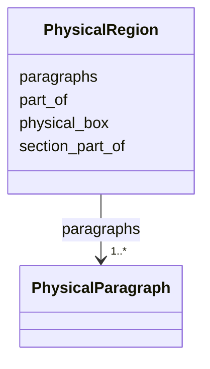

---
search:
  boost: 10.0
---

# Class: PhysicalRegion 


_One region of the page, with a box, ordered paragraphs and optional semantic links._


<div data-search-exclude markdown="1">


URI: [pc:PhysicalRegion](https://pruzhany.org/ns/sourced-entities#PhysicalRegion)





<!-- no inheritance hierarchy -->

## Slots

| Name | Cardinality and Range | Description | Inheritance |
| ---  | --- | --- | --- |
| [physical_box](physical_box.md) | 1..* <br/> [Integer](Integer.md) | A box [x, y, width, height] in pixels of this page's picture, with origin at its upper left. Impresso requires exactly four integers, without a nonnegative or positive bound. It is an array, not an object with invented coordinate fields. | direct |
| [paragraphs](paragraphs.md) | 1..* <br/> [PhysicalParagraph](PhysicalParagraph.md) | Paragraphs in region order; Impresso permits zero, one or several. | direct |
| [part_of](part_of.md) | 0..1 <br/> [String](String.md) | Canonical content-item id, absent or null when no item is assigned. | direct |
| [section_part_of](section_part_of.md) | * <br/> [String](String.md) | Content-item ids grouped by this section-heading region. The list may be absent or null; Impresso also permits null members and empty lists. | direct |


## Usages

| used by | used in | type | used |
| ---  | --- | --- | --- |
| [PhysicalPage](PhysicalPage.md) | [regions](regions.md) | range | [PhysicalRegion](PhysicalRegion.md) |


## Identifier and Mapping Information


### Annotations

| property | value |
| --- | --- |
| impresso | page.schema.json r[]. |
| alto | ALTO 4.4 TextBlock (TextBlockType), normally inside PrintSpace. |
| computed_id | <page id>-r<RRR>; RRR is the 1-based r position, zero-padded to three digits. See the module description for the 999 limit and segmentation lifecycle. |


### Schema Source


* from schema: https://pruzhany.org/ns/physical


## Mappings

| Mapping Type | Mapped Value |
| ---  | ---  |
| self | pc:PhysicalRegion |
| native | pc:PhysicalRegion |


## LinkML Source

<!-- TODO: investigate https://stackoverflow.com/questions/37606292/how-to-create-tabbed-code-blocks-in-mkdocs-or-sphinx -->

### Direct

<details>
```yaml
name: PhysicalRegion
annotations:
  impresso:
    tag: impresso
    value: page.schema.json r[].
  alto:
    tag: alto
    value: ALTO 4.4 TextBlock (TextBlockType), normally inside PrintSpace.
  computed_id:
    tag: computed_id
    value: <page id>-r<RRR>; RRR is the 1-based r position, zero-padded to three digits.
      See the module description for the 999 limit and segmentation lifecycle.
description: One region of the page, with a box, ordered paragraphs and optional semantic
  links.
from_schema: https://pruzhany.org/ns/physical
rank: 1000
slots:
- physical_box
slot_usage:
  physical_box:
    name: physical_box
    required: true
attributes:
  paragraphs:
    name: paragraphs
    annotations:
      impresso:
        tag: impresso
        value: page.schema.json r[].p.
      alto:
        tag: alto
        value: No intermediate paragraph element between TextBlock and TextLine; flatten
          the paragraphs' lines in order when exporting this region as a TextBlock.
    description: Paragraphs in region order; Impresso permits zero, one or several.
    from_schema: https://pruzhany.org/ns/physical
    rank: 1000
    alias: p
    domain_of:
    - PhysicalRegion
    range: PhysicalParagraph
    required: true
    multivalued: true
    inlined_as_list: true
  part_of:
    name: part_of
    annotations:
      nullable:
        tag: nullable
        value: true
      impresso:
        tag: impresso
        value: page.schema.json r[].pOf.
      alto:
        tag: alto
        value: No direct semantic content-item property on TextBlock; linking belongs
          to a companion logical structure such as METS, outside this module.
    description: Canonical content-item id, absent or null when no item is assigned.
    from_schema: https://pruzhany.org/ns/physical
    rank: 1000
    alias: pOf
    domain_of:
    - PhysicalRegion
  section_part_of:
    name: section_part_of
    annotations:
      nullable:
        tag: nullable
        value: true
      nullable_items:
        tag: nullable_items
        value: true
      impresso:
        tag: impresso
        value: page.schema.json r[].section_pOf.
      alto:
        tag: alto
        value: No direct ALTO equivalent for a section's semantic content-item membership.
    description: Content-item ids grouped by this section-heading region. The list
      may be absent or null; Impresso also permits null members and empty lists.
    from_schema: https://pruzhany.org/ns/physical
    rank: 1000
    alias: section_pOf
    domain_of:
    - PhysicalRegion
    multivalued: true
extra_slots:
  allowed: true

```
</details>

### Induced

<details>
```yaml
name: PhysicalRegion
annotations:
  impresso:
    tag: impresso
    value: page.schema.json r[].
  alto:
    tag: alto
    value: ALTO 4.4 TextBlock (TextBlockType), normally inside PrintSpace.
  computed_id:
    tag: computed_id
    value: <page id>-r<RRR>; RRR is the 1-based r position, zero-padded to three digits.
      See the module description for the 999 limit and segmentation lifecycle.
description: One region of the page, with a box, ordered paragraphs and optional semantic
  links.
from_schema: https://pruzhany.org/ns/physical
rank: 1000
slot_usage:
  physical_box:
    name: physical_box
    required: true
attributes:
  paragraphs:
    name: paragraphs
    annotations:
      impresso:
        tag: impresso
        value: page.schema.json r[].p.
      alto:
        tag: alto
        value: No intermediate paragraph element between TextBlock and TextLine; flatten
          the paragraphs' lines in order when exporting this region as a TextBlock.
    description: Paragraphs in region order; Impresso permits zero, one or several.
    from_schema: https://pruzhany.org/ns/physical
    rank: 1000
    alias: p
    owner: PhysicalRegion
    domain_of:
    - PhysicalRegion
    range: PhysicalParagraph
    required: true
    multivalued: true
    inlined: true
    inlined_as_list: true
  part_of:
    name: part_of
    annotations:
      nullable:
        tag: nullable
        value: true
      impresso:
        tag: impresso
        value: page.schema.json r[].pOf.
      alto:
        tag: alto
        value: No direct semantic content-item property on TextBlock; linking belongs
          to a companion logical structure such as METS, outside this module.
    description: Canonical content-item id, absent or null when no item is assigned.
    from_schema: https://pruzhany.org/ns/physical
    rank: 1000
    alias: pOf
    owner: PhysicalRegion
    domain_of:
    - PhysicalRegion
    range: string
  section_part_of:
    name: section_part_of
    annotations:
      nullable:
        tag: nullable
        value: true
      nullable_items:
        tag: nullable_items
        value: true
      impresso:
        tag: impresso
        value: page.schema.json r[].section_pOf.
      alto:
        tag: alto
        value: No direct ALTO equivalent for a section's semantic content-item membership.
    description: Content-item ids grouped by this section-heading region. The list
      may be absent or null; Impresso also permits null members and empty lists.
    from_schema: https://pruzhany.org/ns/physical
    rank: 1000
    alias: section_pOf
    owner: PhysicalRegion
    domain_of:
    - PhysicalRegion
    range: string
    multivalued: true
  physical_box:
    name: physical_box
    annotations:
      impresso:
        tag: impresso
        value: page.schema.json $defs/coordinates; c on region, paragraph, line and
          token.
      alto:
        tag: alto
        value: ALTO 4.4 HPOS, VPOS, WIDTH, HEIGHT respectively on TextBlock, TextLine
          or String; Description/MeasurementUnit must be pixel and the image frame
          must agree. ALTO accepts floating-point measurements; this Impresso contract
          requires integers.
    description: A box [x, y, width, height] in pixels of this page's picture, with
      origin at its upper left. Impresso requires exactly four integers, without a
      nonnegative or positive bound. It is an array, not an object with invented coordinate
      fields.
    from_schema: https://pruzhany.org/ns/physical
    rank: 1000
    alias: c
    owner: PhysicalRegion
    domain_of:
    - PhysicalRegion
    - PhysicalParagraph
    - PhysicalLine
    - PhysicalWord
    range: integer
    required: true
    multivalued: true
    minimum_cardinality: 4
    maximum_cardinality: 4
extra_slots:
  allowed: true

```
</details></div>
