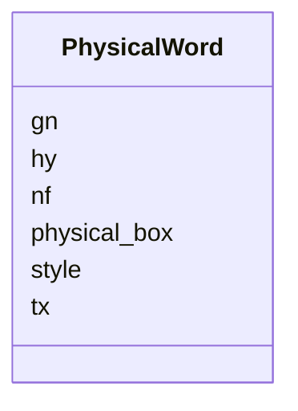

---
search:
  boost: 10.0
---

# Class: PhysicalWord 


_One OCR token (a word or word part), with its own box and surface text._


<div data-search-exclude markdown="1">


URI: [pc:PhysicalWord](https://pruzhany.org/ns/sourced-entities#PhysicalWord)





<!-- no inheritance hierarchy -->

## Slots

| Name | Cardinality and Range | Description | Inheritance |
| ---  | --- | --- | --- |
| [physical_box](physical_box.md) | 1..* <br/> [Integer](Integer.md) | A box [x, y, width, height] in pixels of this page's picture, with origin at its upper left. Impresso requires exactly four integers, without a nonnegative or positive bound. It is an array, not an object with invented coordinate fields. | direct |
| [tx](tx.md) | 1 <br/> [String](String.md) | Token surface text, including empty text if stored that way. | direct |
| [style](style.md) | 0..1 <br/> [Integer](Integer.md) | Style id in the separate issue file's s list; no style fields are added here. | direct |
| [gn](gn.md) | 0..1 <br/> [Boolean](Boolean.md) | Glue next: true means no following whitespace. When absent readers assume false; the schema inserts no default. | direct |
| [hy](hy.md) | 0..1 <br/> [Boolean](Boolean.md) | Whether this token is the first part of a hyphenated word, including the hyphen. Readers assume false when absent; the schema inserts no default. | direct |
| [nf](nf.md) | 0..1 <br/> [String](String.md) | Normalized dehyphenated form on the latter part or parts of a hyphenated word. | direct |


## Usages

| used by | used in | type | used |
| ---  | --- | --- | --- |
| [PhysicalLine](PhysicalLine.md) | [tokens](tokens.md) | range | [PhysicalWord](PhysicalWord.md) |


## Identifier and Mapping Information


### Annotations

| property | value |
| --- | --- |
| impresso | page.schema.json r[].p[].l[].t[]. |
| alto | ALTO 4.4 String (StringType). |
| computed_id | <line id>-w<WWW>; WWW is the 1-based t position, zero-padded to three digits. See the module description for the 999 limit and segmentation lifecycle. |


### Schema Source


* from schema: https://pruzhany.org/ns/physical


## Mappings

| Mapping Type | Mapped Value |
| ---  | ---  |
| self | pc:PhysicalWord |
| native | pc:PhysicalWord |


## LinkML Source

<!-- TODO: investigate https://stackoverflow.com/questions/37606292/how-to-create-tabbed-code-blocks-in-mkdocs-or-sphinx -->

### Direct

<details>
```yaml
name: PhysicalWord
annotations:
  impresso:
    tag: impresso
    value: page.schema.json r[].p[].l[].t[].
  alto:
    tag: alto
    value: ALTO 4.4 String (StringType).
  computed_id:
    tag: computed_id
    value: <line id>-w<WWW>; WWW is the 1-based t position, zero-padded to three digits.
      See the module description for the 999 limit and segmentation lifecycle.
description: One OCR token (a word or word part), with its own box and surface text.
from_schema: https://pruzhany.org/ns/physical
rank: 1000
slots:
- physical_box
slot_usage:
  physical_box:
    name: physical_box
    required: true
attributes:
  tx:
    name: tx
    annotations:
      impresso:
        tag: impresso
        value: page.schema.json r[].p[].l[].t[].tx.
      alto:
        tag: alto
        value: String/@CONTENT.
    description: Token surface text, including empty text if stored that way.
    from_schema: https://pruzhany.org/ns/physical
    rank: 1000
    domain_of:
    - PhysicalWord
    required: true
  style:
    name: style
    annotations:
      impresso:
        tag: impresso
        value: page.schema.json r[].p[].l[].t[].s; issue.schema.json s.
      alto:
        tag: alto
        value: String/@STYLEREFS after mapping this numeric issue style id to an ALTO
          Styles ID.
    description: Style id in the separate issue file's s list; no style fields are
      added here.
    from_schema: https://pruzhany.org/ns/physical
    rank: 1000
    alias: s
    domain_of:
    - PhysicalWord
    range: integer
  gn:
    name: gn
    annotations:
      impresso:
        tag: impresso
        value: page.schema.json r[].p[].l[].t[].gn.
      alto:
        tag: alto
        value: Omit the intervening SP when true; no equivalent boolean on String.
    description: 'Glue next: true means no following whitespace. When absent readers
      assume false; the schema inserts no default.'
    from_schema: https://pruzhany.org/ns/physical
    rank: 1000
    domain_of:
    - PhysicalWord
    range: boolean
  hy:
    name: hy
    annotations:
      impresso:
        tag: impresso
        value: page.schema.json r[].p[].l[].t[].hy.
      alto:
        tag: alto
        value: String/@SUBS_TYPE HypPart1; an export must handle a trailing HYP consistently.
    description: Whether this token is the first part of a hyphenated word, including
      the hyphen. Readers assume false when absent; the schema inserts no default.
    from_schema: https://pruzhany.org/ns/physical
    rank: 1000
    domain_of:
    - PhysicalWord
    range: boolean
  nf:
    name: nf
    annotations:
      impresso:
        tag: impresso
        value: page.schema.json r[].p[].l[].t[].nf.
      alto:
        tag: alto
        value: String/@SUBS_CONTENT with SUBS_TYPE HypPart2 for the latter part.
    description: Normalized dehyphenated form on the latter part or parts of a hyphenated
      word.
    from_schema: https://pruzhany.org/ns/physical
    rank: 1000
    domain_of:
    - PhysicalWord
extra_slots:
  allowed: true

```
</details>

### Induced

<details>
```yaml
name: PhysicalWord
annotations:
  impresso:
    tag: impresso
    value: page.schema.json r[].p[].l[].t[].
  alto:
    tag: alto
    value: ALTO 4.4 String (StringType).
  computed_id:
    tag: computed_id
    value: <line id>-w<WWW>; WWW is the 1-based t position, zero-padded to three digits.
      See the module description for the 999 limit and segmentation lifecycle.
description: One OCR token (a word or word part), with its own box and surface text.
from_schema: https://pruzhany.org/ns/physical
rank: 1000
slot_usage:
  physical_box:
    name: physical_box
    required: true
attributes:
  tx:
    name: tx
    annotations:
      impresso:
        tag: impresso
        value: page.schema.json r[].p[].l[].t[].tx.
      alto:
        tag: alto
        value: String/@CONTENT.
    description: Token surface text, including empty text if stored that way.
    from_schema: https://pruzhany.org/ns/physical
    rank: 1000
    owner: PhysicalWord
    domain_of:
    - PhysicalWord
    range: string
    required: true
  style:
    name: style
    annotations:
      impresso:
        tag: impresso
        value: page.schema.json r[].p[].l[].t[].s; issue.schema.json s.
      alto:
        tag: alto
        value: String/@STYLEREFS after mapping this numeric issue style id to an ALTO
          Styles ID.
    description: Style id in the separate issue file's s list; no style fields are
      added here.
    from_schema: https://pruzhany.org/ns/physical
    rank: 1000
    alias: s
    owner: PhysicalWord
    domain_of:
    - PhysicalWord
    range: integer
  gn:
    name: gn
    annotations:
      impresso:
        tag: impresso
        value: page.schema.json r[].p[].l[].t[].gn.
      alto:
        tag: alto
        value: Omit the intervening SP when true; no equivalent boolean on String.
    description: 'Glue next: true means no following whitespace. When absent readers
      assume false; the schema inserts no default.'
    from_schema: https://pruzhany.org/ns/physical
    rank: 1000
    owner: PhysicalWord
    domain_of:
    - PhysicalWord
    range: boolean
  hy:
    name: hy
    annotations:
      impresso:
        tag: impresso
        value: page.schema.json r[].p[].l[].t[].hy.
      alto:
        tag: alto
        value: String/@SUBS_TYPE HypPart1; an export must handle a trailing HYP consistently.
    description: Whether this token is the first part of a hyphenated word, including
      the hyphen. Readers assume false when absent; the schema inserts no default.
    from_schema: https://pruzhany.org/ns/physical
    rank: 1000
    owner: PhysicalWord
    domain_of:
    - PhysicalWord
    range: boolean
  nf:
    name: nf
    annotations:
      impresso:
        tag: impresso
        value: page.schema.json r[].p[].l[].t[].nf.
      alto:
        tag: alto
        value: String/@SUBS_CONTENT with SUBS_TYPE HypPart2 for the latter part.
    description: Normalized dehyphenated form on the latter part or parts of a hyphenated
      word.
    from_schema: https://pruzhany.org/ns/physical
    rank: 1000
    owner: PhysicalWord
    domain_of:
    - PhysicalWord
    range: string
  physical_box:
    name: physical_box
    annotations:
      impresso:
        tag: impresso
        value: page.schema.json $defs/coordinates; c on region, paragraph, line and
          token.
      alto:
        tag: alto
        value: ALTO 4.4 HPOS, VPOS, WIDTH, HEIGHT respectively on TextBlock, TextLine
          or String; Description/MeasurementUnit must be pixel and the image frame
          must agree. ALTO accepts floating-point measurements; this Impresso contract
          requires integers.
    description: A box [x, y, width, height] in pixels of this page's picture, with
      origin at its upper left. Impresso requires exactly four integers, without a
      nonnegative or positive bound. It is an array, not an object with invented coordinate
      fields.
    from_schema: https://pruzhany.org/ns/physical
    rank: 1000
    alias: c
    owner: PhysicalWord
    domain_of:
    - PhysicalRegion
    - PhysicalParagraph
    - PhysicalLine
    - PhysicalWord
    range: integer
    required: true
    multivalued: true
    minimum_cardinality: 4
    maximum_cardinality: 4
extra_slots:
  allowed: true

```
</details></div>
