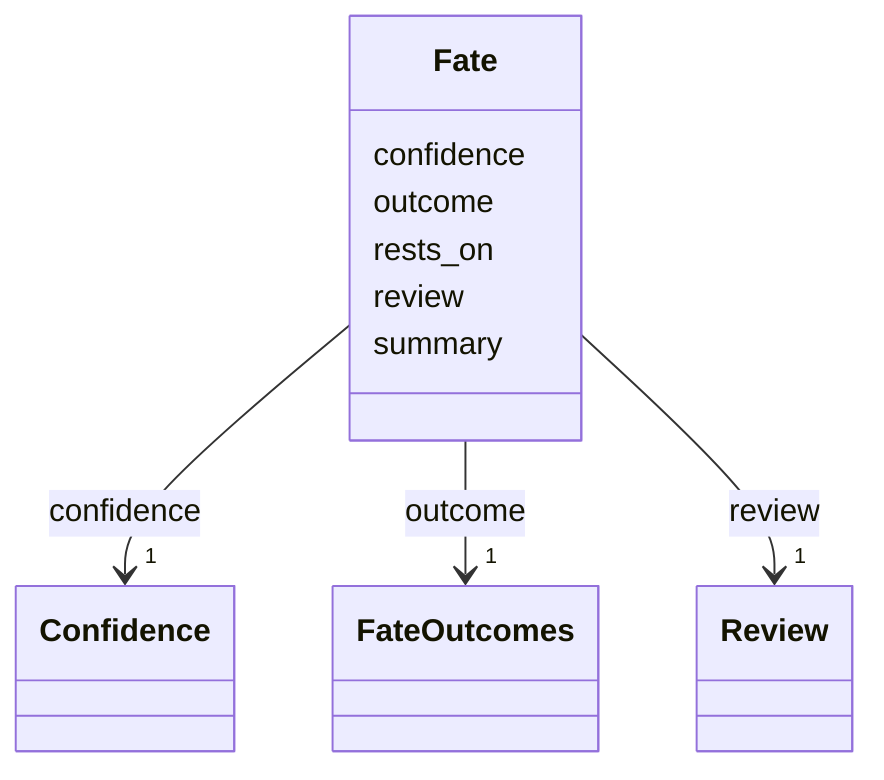

---
search:
  boost: 10.0
---

# Class: Fate 


_What became of a person in the Holocaust, as far as the record shows, the facts it rests on and its review._


<div data-search-exclude markdown="1">


URI: [pc:Fate](https://pruzhany.org/ns/sourced-entities#Fate)





<!-- no inheritance hierarchy -->

## Slots

| Name | Cardinality and Range | Description | Inheritance |
| ---  | --- | --- | --- |
| [outcome](outcome.md) | 1 <br/> [FateOutcomes](FateOutcomes.md) | What became of the person: unknown, perished, survived, died before, or not applicable. | direct |
| [confidence](confidence.md) | 1 <br/> [Confidence](Confidence.md) | How sure the outcome is. | direct |
| [rests_on](rests_on.md) | 1..* <br/> [String](String.md) | The facts the outcome rests on, by their ids in the record. | direct |
| [review](review.md) | 1 <br/> [Review](Review.md) | Whether a person has reviewed the outcome. | direct |
| [summary](summary.md) | 0..1 <br/> [String](String.md) | A short summary in words. | direct |


## Usages

| used by | used in | type | used |
| ---  | --- | --- | --- |
| [SharedPerson](SharedPerson.md) | [fate](fate.md) | range | [Fate](Fate.md) |


## Identifier and Mapping Information


### Schema Source


* from schema: https://pruzhany.org/ns/shared_record


## Mappings

| Mapping Type | Mapped Value |
| ---  | ---  |
| self | pc:Fate |
| native | pc:Fate |


## LinkML Source

<!-- TODO: investigate https://stackoverflow.com/questions/37606292/how-to-create-tabbed-code-blocks-in-mkdocs-or-sphinx -->

### Direct

<details>
```yaml
name: Fate
description: What became of a person in the Holocaust, as far as the record shows,
  the facts it rests on and its review.
from_schema: https://pruzhany.org/ns/shared_record
rank: 1000
attributes:
  outcome:
    name: outcome
    description: 'What became of the person: unknown, perished, survived, died before,
      or not applicable.'
    from_schema: https://pruzhany.org/ns/sourced_entities
    rank: 1000
    domain_of:
    - Fate
    range: FateOutcomes
    required: true
  confidence:
    name: confidence
    description: How sure the outcome is.
    from_schema: https://pruzhany.org/ns/sourced_entities
    rank: 1000
    domain_of:
    - Fate
    range: Confidence
    required: true
  rests_on:
    name: rests_on
    description: The facts the outcome rests on, by their ids in the record.
    from_schema: https://pruzhany.org/ns/sourced_entities
    rank: 1000
    domain_of:
    - Fate
    range: string
    required: true
    multivalued: true
  review:
    name: review
    description: Whether a person has reviewed the outcome.
    from_schema: https://pruzhany.org/ns/sourced_entities
    domain_of:
    - Fact
    - Fate
    range: Review
    required: true
    inlined: true
  summary:
    name: summary
    description: A short summary in words.
    from_schema: https://pruzhany.org/ns/sourced_entities
    rank: 1000
    domain_of:
    - Fate
    range: string

```
</details>

### Induced

<details>
```yaml
name: Fate
description: What became of a person in the Holocaust, as far as the record shows,
  the facts it rests on and its review.
from_schema: https://pruzhany.org/ns/shared_record
rank: 1000
attributes:
  outcome:
    name: outcome
    description: 'What became of the person: unknown, perished, survived, died before,
      or not applicable.'
    from_schema: https://pruzhany.org/ns/sourced_entities
    rank: 1000
    owner: Fate
    domain_of:
    - Fate
    range: FateOutcomes
    required: true
  confidence:
    name: confidence
    description: How sure the outcome is.
    from_schema: https://pruzhany.org/ns/sourced_entities
    rank: 1000
    owner: Fate
    domain_of:
    - Fate
    range: Confidence
    required: true
  rests_on:
    name: rests_on
    description: The facts the outcome rests on, by their ids in the record.
    from_schema: https://pruzhany.org/ns/sourced_entities
    rank: 1000
    owner: Fate
    domain_of:
    - Fate
    range: string
    required: true
    multivalued: true
  review:
    name: review
    description: Whether a person has reviewed the outcome.
    from_schema: https://pruzhany.org/ns/sourced_entities
    owner: Fate
    domain_of:
    - Fact
    - Fate
    range: Review
    required: true
    inlined: true
  summary:
    name: summary
    description: A short summary in words.
    from_schema: https://pruzhany.org/ns/sourced_entities
    rank: 1000
    owner: Fate
    domain_of:
    - Fate
    range: string

```
</details></div>
