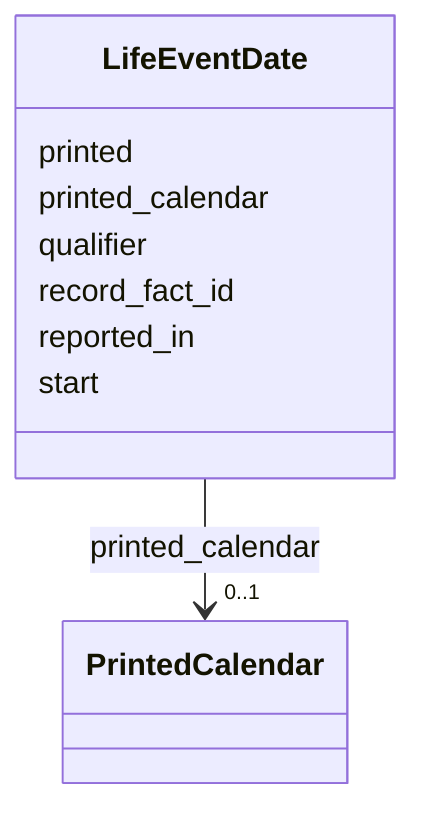

---
search:
  boost: 10.0
---

# Class: LifeEventDate 


_One date of a life event: the words printed with their calendar, or, where no date is printed, the day of the first issue that reported it, or the preferred record statement's date for a death known from records alone._


<div data-search-exclude markdown="1">


URI: [rico:Date](https://www.ica.org/standards/RiC/ontology#Date)





<!-- no inheritance hierarchy -->

## Class Properties

| Property | Value |
| --- | --- |
| Class URI | [rico:Date](https://www.ica.org/standards/RiC/ontology#Date) |


## Slots

| Name | Cardinality and Range | Description | Inheritance |
| ---  | --- | --- | --- |
| [record_fact_id](record_fact_id.md) | 0..1 <br/> [NonBlankText](NonBlankText.md) | For a death known from records: the accepted death fact whose date and place describe it, by the fact's id. | direct |
| [printed](printed.md) | 0..1 <br/> [NonBlankText](NonBlankText.md) | The date's words as printed. | direct |
| [printed_calendar](printed_calendar.md) | 0..1 <br/> [PrintedCalendar](PrintedCalendar.md) | The calendar the date was printed in. | direct |
| [start](start.md) | 0..1 <br/> [IsoYearMonthOrDay](IsoYearMonthOrDay.md) | The printed date normalized, for a date printed in the Gregorian calendar only. | direct |
| [qualifier](qualifier.md) | 0..1 <br/> [String](String.md) | reported_in: the day is the first issue's that reported the event, not the day it happened. | direct |
| [reported_in](reported_in.md) | 0..1 <br/> [IsoDay](IsoDay.md) | The day of the first issue that reported the event, where no date is printed. | direct |


## Usages

| used by | used in | type | used |
| ---  | --- | --- | --- |
| [SharedEvent](SharedEvent.md) | [dates](dates.md) | range | [LifeEventDate](LifeEventDate.md) |


## Rules


### 

| Rule Applied | Preconditions | Postconditions | Elseconditions |
|--------------|---------------|----------------|----------------|
| slot_conditions |```{'record_fact_id': {'value_presence': 'PRESENT'}}``` | | |
| none_of | |```[{'slot_conditions': {'printed': {'required': True}}}, {'slot_conditions': {'printed_calendar': {'required': True}}}, {'slot_conditions': {'start': {'required': True}}}, {'slot_conditions': {'qualifier': {'required': True}}}, {'slot_conditions': {'reported_in': {'required': True}}}]``` | |


### 

| Rule Applied | Preconditions | Postconditions | Elseconditions |
|--------------|---------------|----------------|----------------|
| slot_conditions |```{'record_fact_id': {'value_presence': 'ABSENT'}}``` | | |
| any_of | |```[{'none_of': [{'slot_conditions': {'printed': {'required': True}}}, {'slot_conditions': {'printed_calendar': {'required': True}}}, {'slot_conditions': {'start': {'required': True}}}], 'slot_conditions': {'qualifier': {'required': True, 'equals_string': 'reported_in'}, 'reported_in': {'required': True}}}, {'none_of': [{'slot_conditions': {'qualifier': {'required': True}}}, {'slot_conditions': {'reported_in': {'required': True}}}], 'slot_conditions': {'printed': {'required': True}, 'printed_calendar': {'required': True}}}]``` | |


### 

| Rule Applied | Preconditions | Postconditions | Elseconditions |
|--------------|---------------|----------------|----------------|
| slot_conditions |```{'printed_calendar': {'equals_string': 'hebrew'}}``` |```{'start': {'value_presence': 'ABSENT'}}``` | |


## Identifier and Mapping Information


### Schema Source


* from schema: https://pruzhany.org/ns/shared_record


## Mappings

| Mapping Type | Mapped Value |
| ---  | ---  |
| self | rico:Date |
| native | pc:LifeEventDate |


## LinkML Source

<!-- TODO: investigate https://stackoverflow.com/questions/37606292/how-to-create-tabbed-code-blocks-in-mkdocs-or-sphinx -->

### Direct

<details>
```yaml
name: LifeEventDate
description: 'One date of a life event: the words printed with their calendar, or,
  where no date is printed, the day of the first issue that reported it, or the preferred
  record statement''s date for a death known from records alone.'
from_schema: https://pruzhany.org/ns/shared_record
rank: 1000
attributes:
  record_fact_id:
    name: record_fact_id
    description: 'For a death known from records: the accepted death fact whose date
      and place describe it, by the fact''s id.'
    from_schema: https://pruzhany.org/ns/shared_record
    rank: 1000
    slot_uri: pc:site_event_record_date
    domain_of:
    - LifeEventDate
    range: NonBlankText
  printed:
    name: printed
    description: The date's words as printed.
    from_schema: https://pruzhany.org/ns/shared_record
    rank: 1000
    slot_uri: rico:expressedDate
    domain_of:
    - LifeEventDate
    - SourcedDate
    range: NonBlankText
  printed_calendar:
    name: printed_calendar
    description: The calendar the date was printed in.
    from_schema: https://pruzhany.org/ns/shared_record
    related_mappings:
    - rico:expressedDate
    rank: 1000
    domain_of:
    - LifeEventDate
    - SourcedDate
    range: PrintedCalendar
  start:
    name: start
    description: The printed date normalized, for a date printed in the Gregorian
      calendar only.
    from_schema: https://pruzhany.org/ns/shared_record
    rank: 1000
    slot_uri: rico:normalizedDateValue
    domain_of:
    - LifeEventDate
    - SourcedDate
    range: IsoYearMonthOrDay
  qualifier:
    name: qualifier
    description: 'reported_in: the day is the first issue''s that reported the event,
      not the day it happened.'
    from_schema: https://pruzhany.org/ns/shared_record
    rank: 1000
    slot_uri: rico:dateQualifier
    domain_of:
    - LifeEventDate
    range: string
    equals_string: reported_in
  reported_in:
    name: reported_in
    description: The day of the first issue that reported the event, where no date
      is printed.
    from_schema: https://pruzhany.org/ns/shared_record
    rank: 1000
    domain_of:
    - LifeEventDate
    range: IsoDay
class_uri: rico:Date
rules:
- preconditions:
    slot_conditions:
      record_fact_id:
        name: record_fact_id
        value_presence: PRESENT
  postconditions:
    none_of:
    - slot_conditions:
        printed:
          name: printed
          required: true
    - slot_conditions:
        printed_calendar:
          name: printed_calendar
          required: true
    - slot_conditions:
        start:
          name: start
          required: true
    - slot_conditions:
        qualifier:
          name: qualifier
          required: true
    - slot_conditions:
        reported_in:
          name: reported_in
          required: true
  description: A record date names its fact and nothing else.
- preconditions:
    slot_conditions:
      record_fact_id:
        name: record_fact_id
        value_presence: ABSENT
  postconditions:
    any_of:
    - none_of:
      - slot_conditions:
          printed:
            name: printed
            required: true
      - slot_conditions:
          printed_calendar:
            name: printed_calendar
            required: true
      - slot_conditions:
          start:
            name: start
            required: true
      slot_conditions:
        qualifier:
          name: qualifier
          required: true
          equals_string: reported_in
        reported_in:
          name: reported_in
          required: true
    - none_of:
      - slot_conditions:
          qualifier:
            name: qualifier
            required: true
      - slot_conditions:
          reported_in:
            name: reported_in
            required: true
      slot_conditions:
        printed:
          name: printed
          required: true
        printed_calendar:
          name: printed_calendar
          required: true
  description: Any other date is printed words with their calendar, or the day it
    was first reported.
- preconditions:
    slot_conditions:
      printed_calendar:
        name: printed_calendar
        equals_string: hebrew
  postconditions:
    slot_conditions:
      start:
        name: start
        value_presence: ABSENT
  description: A date printed in the Hebrew calendar is not normalized.

```
</details>

### Induced

<details>
```yaml
name: LifeEventDate
description: 'One date of a life event: the words printed with their calendar, or,
  where no date is printed, the day of the first issue that reported it, or the preferred
  record statement''s date for a death known from records alone.'
from_schema: https://pruzhany.org/ns/shared_record
rank: 1000
attributes:
  record_fact_id:
    name: record_fact_id
    description: 'For a death known from records: the accepted death fact whose date
      and place describe it, by the fact''s id.'
    from_schema: https://pruzhany.org/ns/shared_record
    rank: 1000
    slot_uri: pc:site_event_record_date
    owner: LifeEventDate
    domain_of:
    - LifeEventDate
    range: NonBlankText
  printed:
    name: printed
    description: The date's words as printed.
    from_schema: https://pruzhany.org/ns/shared_record
    rank: 1000
    slot_uri: rico:expressedDate
    owner: LifeEventDate
    domain_of:
    - LifeEventDate
    - SourcedDate
    range: NonBlankText
  printed_calendar:
    name: printed_calendar
    description: The calendar the date was printed in.
    from_schema: https://pruzhany.org/ns/shared_record
    related_mappings:
    - rico:expressedDate
    rank: 1000
    owner: LifeEventDate
    domain_of:
    - LifeEventDate
    - SourcedDate
    range: PrintedCalendar
  start:
    name: start
    description: The printed date normalized, for a date printed in the Gregorian
      calendar only.
    from_schema: https://pruzhany.org/ns/shared_record
    rank: 1000
    slot_uri: rico:normalizedDateValue
    owner: LifeEventDate
    domain_of:
    - LifeEventDate
    - SourcedDate
    range: IsoYearMonthOrDay
  qualifier:
    name: qualifier
    description: 'reported_in: the day is the first issue''s that reported the event,
      not the day it happened.'
    from_schema: https://pruzhany.org/ns/shared_record
    rank: 1000
    slot_uri: rico:dateQualifier
    owner: LifeEventDate
    domain_of:
    - LifeEventDate
    range: string
    equals_string: reported_in
  reported_in:
    name: reported_in
    description: The day of the first issue that reported the event, where no date
      is printed.
    from_schema: https://pruzhany.org/ns/shared_record
    rank: 1000
    owner: LifeEventDate
    domain_of:
    - LifeEventDate
    range: IsoDay
class_uri: rico:Date
rules:
- preconditions:
    slot_conditions:
      record_fact_id:
        name: record_fact_id
        value_presence: PRESENT
  postconditions:
    none_of:
    - slot_conditions:
        printed:
          name: printed
          required: true
    - slot_conditions:
        printed_calendar:
          name: printed_calendar
          required: true
    - slot_conditions:
        start:
          name: start
          required: true
    - slot_conditions:
        qualifier:
          name: qualifier
          required: true
    - slot_conditions:
        reported_in:
          name: reported_in
          required: true
  description: A record date names its fact and nothing else.
- preconditions:
    slot_conditions:
      record_fact_id:
        name: record_fact_id
        value_presence: ABSENT
  postconditions:
    any_of:
    - none_of:
      - slot_conditions:
          printed:
            name: printed
            required: true
      - slot_conditions:
          printed_calendar:
            name: printed_calendar
            required: true
      - slot_conditions:
          start:
            name: start
            required: true
      slot_conditions:
        qualifier:
          name: qualifier
          required: true
          equals_string: reported_in
        reported_in:
          name: reported_in
          required: true
    - none_of:
      - slot_conditions:
          qualifier:
            name: qualifier
            required: true
      - slot_conditions:
          reported_in:
            name: reported_in
            required: true
      slot_conditions:
        printed:
          name: printed
          required: true
        printed_calendar:
          name: printed_calendar
          required: true
  description: Any other date is printed words with their calendar, or the day it
    was first reported.
- preconditions:
    slot_conditions:
      printed_calendar:
        name: printed_calendar
        equals_string: hebrew
  postconditions:
    slot_conditions:
      start:
        name: start
        value_presence: ABSENT
  description: A date printed in the Hebrew calendar is not normalized.

```
</details></div>
