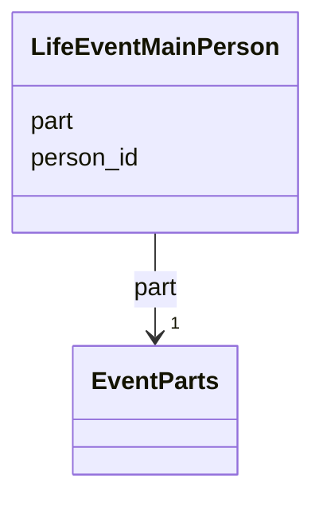

---
search:
  boost: 10.0
---

# Class: LifeEventMainPerson 


_One main person of a life event and their part in it (the baby, a parent, the bride, the groom, the boy, the one who died, the one remembered); each part means a declared local subproperty of rico:affectsOrAffected or rico:hasOrHadParticipant (EventParts)._


<div data-search-exclude markdown="1">


URI: [pc:LifeEventMainPerson](https://pruzhany.org/ns/sourced-entities#LifeEventMainPerson)





<!-- no inheritance hierarchy -->

## Slots

| Name | Cardinality and Range | Description | Inheritance |
| ---  | --- | --- | --- |
| [person_id](person_id.md) | 1 <br/> [NonBlankText](NonBlankText.md) | The person, by the person's id in the record. | direct |
| [part](part.md) | 1 <br/> [EventParts](EventParts.md) | The person's part in the event. | direct |


## Usages

| used by | used in | type | used |
| ---  | --- | --- | --- |
| [SharedEvent](SharedEvent.md) | [main_people](main_people.md) | range | [LifeEventMainPerson](LifeEventMainPerson.md) |


## Identifier and Mapping Information


### Schema Source


* from schema: https://pruzhany.org/ns/shared_record


## Mappings

| Mapping Type | Mapped Value |
| ---  | ---  |
| self | pc:LifeEventMainPerson |
| native | pc:LifeEventMainPerson |


## LinkML Source

<!-- TODO: investigate https://stackoverflow.com/questions/37606292/how-to-create-tabbed-code-blocks-in-mkdocs-or-sphinx -->

### Direct

<details>
```yaml
name: LifeEventMainPerson
description: One main person of a life event and their part in it (the baby, a parent,
  the bride, the groom, the boy, the one who died, the one remembered); each part
  means a declared local subproperty of rico:affectsOrAffected or rico:hasOrHadParticipant
  (EventParts).
from_schema: https://pruzhany.org/ns/shared_record
rank: 1000
attributes:
  person_id:
    name: person_id
    description: The person, by the person's id in the record.
    from_schema: https://pruzhany.org/ns/shared_record
    rank: 1000
    domain_of:
    - LifeEventMainPerson
    - Mention
    - MediaDepicted
    range: NonBlankText
    required: true
  part:
    name: part
    description: The person's part in the event.
    from_schema: https://pruzhany.org/ns/shared_record
    rank: 1000
    domain_of:
    - LifeEventMainPerson
    range: EventParts
    required: true

```
</details>

### Induced

<details>
```yaml
name: LifeEventMainPerson
description: One main person of a life event and their part in it (the baby, a parent,
  the bride, the groom, the boy, the one who died, the one remembered); each part
  means a declared local subproperty of rico:affectsOrAffected or rico:hasOrHadParticipant
  (EventParts).
from_schema: https://pruzhany.org/ns/shared_record
rank: 1000
attributes:
  person_id:
    name: person_id
    description: The person, by the person's id in the record.
    from_schema: https://pruzhany.org/ns/shared_record
    rank: 1000
    owner: LifeEventMainPerson
    domain_of:
    - LifeEventMainPerson
    - Mention
    - MediaDepicted
    range: NonBlankText
    required: true
  part:
    name: part
    description: The person's part in the event.
    from_schema: https://pruzhany.org/ns/shared_record
    rank: 1000
    owner: LifeEventMainPerson
    domain_of:
    - LifeEventMainPerson
    range: EventParts
    required: true

```
</details></div>
