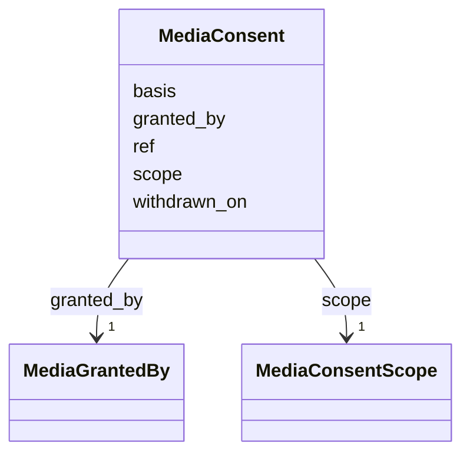

---
search:
  boost: 10.0
---

# Class: MediaConsent 


_The private record of the permission to show a medium: its basis, who gave it by role, what it covers, the document that holds it and any withdrawal. Never public._


<div data-search-exclude markdown="1">


URI: [pc:MediaConsent](https://pruzhany.org/ns/sourced-entities#MediaConsent)





<!-- no inheritance hierarchy -->

## Slots

| Name | Cardinality and Range | Description | Inheritance |
| ---  | --- | --- | --- |
| [basis](basis.md) | 1 <br/> [String](String.md) | What the permission rests on: an institution's terms, the holder's licence, the family's permission, the public domain, or the owner's family papers. | direct |
| [granted_by](granted_by.md) | 1 <br/> [MediaGrantedBy](MediaGrantedBy.md) | Who gave the permission, by role; never a person's name. | direct |
| [scope](scope.md) | 1 <br/> [MediaConsentScope](MediaConsentScope.md) | What the permission covers. | direct |
| [ref](ref.md) | 1 <br/> [NonBlankText](NonBlankText.md) | The private reference of the document that holds the permission. | direct |
| [withdrawn_on](withdrawn_on.md) | 0..1 <br/> [IsoDay](IsoDay.md) | The day the permission was withdrawn. | direct |


## Usages

| used by | used in | type | used |
| ---  | --- | --- | --- |
| [Media](Media.md) | [consent](consent.md) | range | [MediaConsent](MediaConsent.md) |


## Identifier and Mapping Information


### Schema Source


* from schema: https://pruzhany.org/ns/shared_record


## Mappings

| Mapping Type | Mapped Value |
| ---  | ---  |
| self | pc:MediaConsent |
| native | pc:MediaConsent |


## LinkML Source

<!-- TODO: investigate https://stackoverflow.com/questions/37606292/how-to-create-tabbed-code-blocks-in-mkdocs-or-sphinx -->

### Direct

<details>
```yaml
name: MediaConsent
description: 'The private record of the permission to show a medium: its basis, who
  gave it by role, what it covers, the document that holds it and any withdrawal.
  Never public.'
from_schema: https://pruzhany.org/ns/shared_record
rank: 1000
attributes:
  basis:
    name: basis
    description: 'What the permission rests on: an institution''s terms, the holder''s
      licence, the family''s permission, the public domain, or the owner''s family
      papers.'
    from_schema: https://pruzhany.org/ns/media
    rank: 1000
    domain_of:
    - MediaConsent
    range: string
    required: true
    equals_string_in:
    - institution-terms
    - holder-licence
    - family-permission
    - public-domain
    - owner-family-papers
  granted_by:
    name: granted_by
    description: Who gave the permission, by role; never a person's name.
    from_schema: https://pruzhany.org/ns/media
    rank: 1000
    domain_of:
    - MediaConsent
    range: MediaGrantedBy
    required: true
  scope:
    name: scope
    description: What the permission covers.
    from_schema: https://pruzhany.org/ns/media
    rank: 1000
    domain_of:
    - MediaConsent
    range: MediaConsentScope
    required: true
    inlined: true
  ref:
    name: ref
    description: The private reference of the document that holds the permission.
    from_schema: https://pruzhany.org/ns/media
    rank: 1000
    domain_of:
    - MediaConsent
    range: NonBlankText
    required: true
  withdrawn_on:
    name: withdrawn_on
    description: The day the permission was withdrawn.
    from_schema: https://pruzhany.org/ns/media
    rank: 1000
    domain_of:
    - MediaConsent
    range: IsoDay

```
</details>

### Induced

<details>
```yaml
name: MediaConsent
description: 'The private record of the permission to show a medium: its basis, who
  gave it by role, what it covers, the document that holds it and any withdrawal.
  Never public.'
from_schema: https://pruzhany.org/ns/shared_record
rank: 1000
attributes:
  basis:
    name: basis
    description: 'What the permission rests on: an institution''s terms, the holder''s
      licence, the family''s permission, the public domain, or the owner''s family
      papers.'
    from_schema: https://pruzhany.org/ns/media
    rank: 1000
    owner: MediaConsent
    domain_of:
    - MediaConsent
    range: string
    required: true
    equals_string_in:
    - institution-terms
    - holder-licence
    - family-permission
    - public-domain
    - owner-family-papers
  granted_by:
    name: granted_by
    description: Who gave the permission, by role; never a person's name.
    from_schema: https://pruzhany.org/ns/media
    rank: 1000
    owner: MediaConsent
    domain_of:
    - MediaConsent
    range: MediaGrantedBy
    required: true
  scope:
    name: scope
    description: What the permission covers.
    from_schema: https://pruzhany.org/ns/media
    rank: 1000
    owner: MediaConsent
    domain_of:
    - MediaConsent
    range: MediaConsentScope
    required: true
    inlined: true
  ref:
    name: ref
    description: The private reference of the document that holds the permission.
    from_schema: https://pruzhany.org/ns/media
    rank: 1000
    owner: MediaConsent
    domain_of:
    - MediaConsent
    range: NonBlankText
    required: true
  withdrawn_on:
    name: withdrawn_on
    description: The day the permission was withdrawn.
    from_schema: https://pruzhany.org/ns/media
    rank: 1000
    owner: MediaConsent
    domain_of:
    - MediaConsent
    range: IsoDay

```
</details></div>
