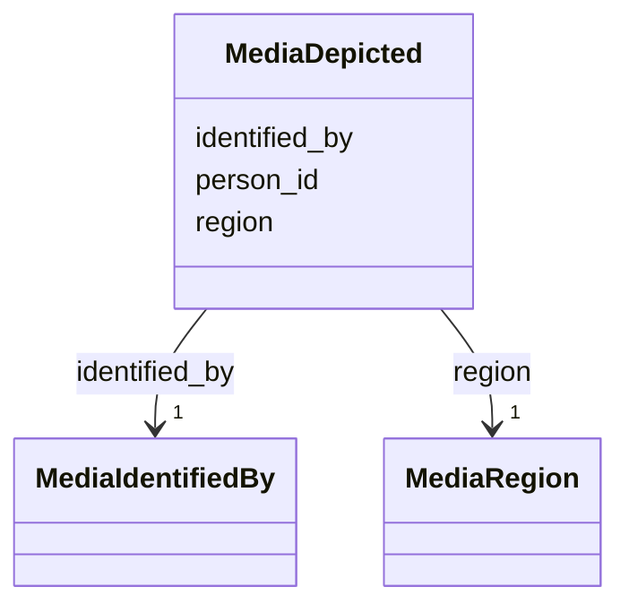

---
search:
  boost: 10.0
---

# Class: MediaDepicted 


_One person a picture shows, identified or not, where in the picture, and on whose identification._


<div data-search-exclude markdown="1">


URI: [pc:MediaDepicted](https://pruzhany.org/ns/sourced-entities#MediaDepicted)





<!-- no inheritance hierarchy -->

## Slots

| Name | Cardinality and Range | Description | Inheritance |
| ---  | --- | --- | --- |
| [person_id](person_id.md) | 0..1 <br/> [NonBlankText](NonBlankText.md) | The person shown, by the person's id; null for a person not identified. | direct |
| [region](region.md) | 1 <br/> [MediaRegion](MediaRegion.md) | Where in the picture the person is. | direct |
| [identified_by](identified_by.md) | 1 <br/> [MediaIdentifiedBy](MediaIdentifiedBy.md) | What identifies the person: the family, a record, or the picture's inscription. | direct |


## Usages

| used by | used in | type | used |
| ---  | --- | --- | --- |
| [PublicMedia](PublicMedia.md) | [depicted](depicted.md) | range | [MediaDepicted](MediaDepicted.md) |
| [Media](Media.md) | [depicted](depicted.md) | range | [MediaDepicted](MediaDepicted.md) |


## Identifier and Mapping Information


### Schema Source


* from schema: https://pruzhany.org/ns/shared_record


## Mappings

| Mapping Type | Mapped Value |
| ---  | ---  |
| self | pc:MediaDepicted |
| native | pc:MediaDepicted |


## LinkML Source

<!-- TODO: investigate https://stackoverflow.com/questions/37606292/how-to-create-tabbed-code-blocks-in-mkdocs-or-sphinx -->

### Direct

<details>
```yaml
name: MediaDepicted
description: One person a picture shows, identified or not, where in the picture,
  and on whose identification.
from_schema: https://pruzhany.org/ns/shared_record
rank: 1000
attributes:
  person_id:
    name: person_id
    description: The person shown, by the person's id; null for a person not identified.
    from_schema: https://pruzhany.org/ns/media
    domain_of:
    - LifeEventMainPerson
    - Mention
    - MediaDepicted
    range: NonBlankText
  region:
    name: region
    description: Where in the picture the person is.
    from_schema: https://pruzhany.org/ns/media
    rank: 1000
    domain_of:
    - MediaDepicted
    - MediaPortrait
    range: MediaRegion
    required: true
    inlined: true
  identified_by:
    name: identified_by
    description: 'What identifies the person: the family, a record, or the picture''s
      inscription.'
    from_schema: https://pruzhany.org/ns/media
    rank: 1000
    domain_of:
    - MediaDepicted
    range: MediaIdentifiedBy
    required: true

```
</details>

### Induced

<details>
```yaml
name: MediaDepicted
description: One person a picture shows, identified or not, where in the picture,
  and on whose identification.
from_schema: https://pruzhany.org/ns/shared_record
rank: 1000
attributes:
  person_id:
    name: person_id
    description: The person shown, by the person's id; null for a person not identified.
    from_schema: https://pruzhany.org/ns/media
    owner: MediaDepicted
    domain_of:
    - LifeEventMainPerson
    - Mention
    - MediaDepicted
    range: NonBlankText
  region:
    name: region
    description: Where in the picture the person is.
    from_schema: https://pruzhany.org/ns/media
    rank: 1000
    owner: MediaDepicted
    domain_of:
    - MediaDepicted
    - MediaPortrait
    range: MediaRegion
    required: true
    inlined: true
  identified_by:
    name: identified_by
    description: 'What identifies the person: the family, a record, or the picture''s
      inscription.'
    from_schema: https://pruzhany.org/ns/media
    rank: 1000
    owner: MediaDepicted
    domain_of:
    - MediaDepicted
    range: MediaIdentifiedBy
    required: true

```
</details></div>
