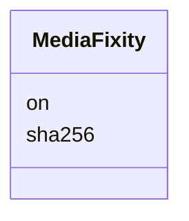

---
search:
  boost: 10.0
---

# Class: MediaFixity 


_A dated check that a master file still has its digest._


<div data-search-exclude markdown="1">


URI: [pc:MediaFixity](https://pruzhany.org/ns/sourced-entities#MediaFixity)





<!-- no inheritance hierarchy -->

## Slots

| Name | Cardinality and Range | Description | Inheritance |
| ---  | --- | --- | --- |
| [on](on.md) | 1 <br/> [IsoDay](IsoDay.md) | The day of the check. | direct |
| [sha256](sha256.md) | 1 <br/> [Sha256Hex](Sha256Hex.md) | The SHA-256 digest found on that day. | direct |


## Usages

| used by | used in | type | used |
| ---  | --- | --- | --- |
| [MediaMaster](MediaMaster.md) | [checked](checked.md) | range | [MediaFixity](MediaFixity.md) |


## Identifier and Mapping Information


### Schema Source


* from schema: https://pruzhany.org/ns/shared_record


## Mappings

| Mapping Type | Mapped Value |
| ---  | ---  |
| self | pc:MediaFixity |
| native | pc:MediaFixity |


## LinkML Source

<!-- TODO: investigate https://stackoverflow.com/questions/37606292/how-to-create-tabbed-code-blocks-in-mkdocs-or-sphinx -->

### Direct

<details>
```yaml
name: MediaFixity
description: A dated check that a master file still has its digest.
from_schema: https://pruzhany.org/ns/shared_record
rank: 1000
attributes:
  'on':
    name: 'on'
    description: The day of the check.
    from_schema: https://pruzhany.org/ns/media
    domain_of:
    - Review
    - Attribution
    - MediaDecision
    - MediaWithdrawal
    - MediaFixity
    range: IsoDay
    required: true
  sha256:
    name: sha256
    description: The SHA-256 digest found on that day.
    from_schema: https://pruzhany.org/ns/media
    rank: 1000
    domain_of:
    - MediaFixity
    - MediaMaster
    range: Sha256Hex
    required: true

```
</details>

### Induced

<details>
```yaml
name: MediaFixity
description: A dated check that a master file still has its digest.
from_schema: https://pruzhany.org/ns/shared_record
rank: 1000
attributes:
  'on':
    name: 'on'
    description: The day of the check.
    from_schema: https://pruzhany.org/ns/media
    owner: MediaFixity
    domain_of:
    - Review
    - Attribution
    - MediaDecision
    - MediaWithdrawal
    - MediaFixity
    range: IsoDay
    required: true
  sha256:
    name: sha256
    description: The SHA-256 digest found on that day.
    from_schema: https://pruzhany.org/ns/media
    rank: 1000
    owner: MediaFixity
    domain_of:
    - MediaFixity
    - MediaMaster
    range: Sha256Hex
    required: true

```
</details></div>
