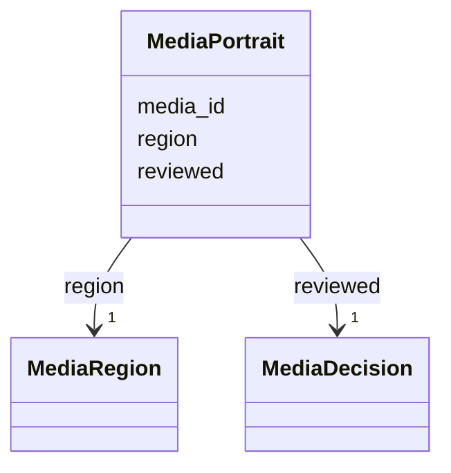

---
search:
  boost: 10.0
---

# Class: MediaPortrait 


_The picture a person's page shows as their portrait: a reviewed medium and the region of it to show._


<div data-search-exclude markdown="1">


URI: [pc:MediaPortrait](https://pruzhany.org/ns/sourced-entities#MediaPortrait)





<!-- no inheritance hierarchy -->

## Slots

| Name | Cardinality and Range | Description | Inheritance |
| ---  | --- | --- | --- |
| [media_id](media_id.md) | 1 <br/> [NonBlankText](NonBlankText.md) | The medium, by its id in the record's media. | direct |
| [region](region.md) | 1 <br/> [MediaRegion](MediaRegion.md) | The part of the picture to show, in its master pixels. | direct |
| [reviewed](reviewed.md) | 1 <br/> [MediaDecision](MediaDecision.md) | Who chose the portrait, by role, and on what day. | direct |


## Usages

| used by | used in | type | used |
| ---  | --- | --- | --- |
| [SharedPerson](SharedPerson.md) | [portrait](portrait.md) | range | [MediaPortrait](MediaPortrait.md) |


## Identifier and Mapping Information


### Schema Source


* from schema: https://pruzhany.org/ns/shared_record


## Mappings

| Mapping Type | Mapped Value |
| ---  | ---  |
| self | pc:MediaPortrait |
| native | pc:MediaPortrait |


## LinkML Source

<!-- TODO: investigate https://stackoverflow.com/questions/37606292/how-to-create-tabbed-code-blocks-in-mkdocs-or-sphinx -->

### Direct

<details>
```yaml
name: MediaPortrait
description: 'The picture a person''s page shows as their portrait: a reviewed medium
  and the region of it to show.'
from_schema: https://pruzhany.org/ns/shared_record
rank: 1000
attributes:
  media_id:
    name: media_id
    description: The medium, by its id in the record's media.
    from_schema: https://pruzhany.org/ns/media
    rank: 1000
    domain_of:
    - MediaPortrait
    range: NonBlankText
    required: true
  region:
    name: region
    description: The part of the picture to show, in its master pixels.
    from_schema: https://pruzhany.org/ns/media
    domain_of:
    - MediaDepicted
    - MediaPortrait
    range: MediaRegion
    required: true
    inlined: true
  reviewed:
    name: reviewed
    description: Who chose the portrait, by role, and on what day.
    from_schema: https://pruzhany.org/ns/media
    domain_of:
    - MediaText
    - MediaPortrait
    range: MediaDecision
    required: true
    inlined: true

```
</details>

### Induced

<details>
```yaml
name: MediaPortrait
description: 'The picture a person''s page shows as their portrait: a reviewed medium
  and the region of it to show.'
from_schema: https://pruzhany.org/ns/shared_record
rank: 1000
attributes:
  media_id:
    name: media_id
    description: The medium, by its id in the record's media.
    from_schema: https://pruzhany.org/ns/media
    rank: 1000
    owner: MediaPortrait
    domain_of:
    - MediaPortrait
    range: NonBlankText
    required: true
  region:
    name: region
    description: The part of the picture to show, in its master pixels.
    from_schema: https://pruzhany.org/ns/media
    owner: MediaPortrait
    domain_of:
    - MediaDepicted
    - MediaPortrait
    range: MediaRegion
    required: true
    inlined: true
  reviewed:
    name: reviewed
    description: Who chose the portrait, by role, and on what day.
    from_schema: https://pruzhany.org/ns/media
    owner: MediaPortrait
    domain_of:
    - MediaText
    - MediaPortrait
    range: MediaDecision
    required: true
    inlined: true

```
</details></div>
