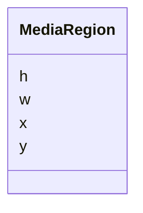

---
search:
  boost: 10.0
---

# Class: MediaRegion 


_A rectangle in a medium's master picture, in its own pixels after orientation._


<div data-search-exclude markdown="1">


URI: [pc:MediaRegion](https://pruzhany.org/ns/sourced-entities#MediaRegion)





<!-- no inheritance hierarchy -->

## Slots

| Name | Cardinality and Range | Description | Inheritance |
| ---  | --- | --- | --- |
| [x](x.md) | 1 <br/> [NonNegativeInteger](NonNegativeInteger.md) | The left edge, in pixels from the picture's left. | direct |
| [y](y.md) | 1 <br/> [NonNegativeInteger](NonNegativeInteger.md) | The top edge, in pixels from the picture's top. | direct |
| [w](w.md) | 1 <br/> [PositiveInteger](PositiveInteger.md) | The width, in pixels. | direct |
| [h](h.md) | 1 <br/> [PositiveInteger](PositiveInteger.md) | The height, in pixels. | direct |


## Usages

| used by | used in | type | used |
| ---  | --- | --- | --- |
| [MediaDepicted](MediaDepicted.md) | [region](region.md) | range | [MediaRegion](MediaRegion.md) |
| [MediaPortrait](MediaPortrait.md) | [region](region.md) | range | [MediaRegion](MediaRegion.md) |


## Identifier and Mapping Information


### Schema Source


* from schema: https://pruzhany.org/ns/shared_record


## Mappings

| Mapping Type | Mapped Value |
| ---  | ---  |
| self | pc:MediaRegion |
| native | pc:MediaRegion |


## LinkML Source

<!-- TODO: investigate https://stackoverflow.com/questions/37606292/how-to-create-tabbed-code-blocks-in-mkdocs-or-sphinx -->

### Direct

<details>
```yaml
name: MediaRegion
description: A rectangle in a medium's master picture, in its own pixels after orientation.
from_schema: https://pruzhany.org/ns/shared_record
rank: 1000
attributes:
  x:
    name: x
    description: The left edge, in pixels from the picture's left.
    from_schema: https://pruzhany.org/ns/media
    rank: 1000
    domain_of:
    - MediaRegion
    range: NonNegativeInteger
    required: true
  y:
    name: y
    description: The top edge, in pixels from the picture's top.
    from_schema: https://pruzhany.org/ns/media
    rank: 1000
    domain_of:
    - MediaRegion
    range: NonNegativeInteger
    required: true
  w:
    name: w
    description: The width, in pixels.
    from_schema: https://pruzhany.org/ns/media
    rank: 1000
    domain_of:
    - MediaRegion
    range: PositiveInteger
    required: true
  h:
    name: h
    description: The height, in pixels.
    from_schema: https://pruzhany.org/ns/media
    rank: 1000
    domain_of:
    - MediaRegion
    range: PositiveInteger
    required: true

```
</details>

### Induced

<details>
```yaml
name: MediaRegion
description: A rectangle in a medium's master picture, in its own pixels after orientation.
from_schema: https://pruzhany.org/ns/shared_record
rank: 1000
attributes:
  x:
    name: x
    description: The left edge, in pixels from the picture's left.
    from_schema: https://pruzhany.org/ns/media
    rank: 1000
    owner: MediaRegion
    domain_of:
    - MediaRegion
    range: NonNegativeInteger
    required: true
  y:
    name: y
    description: The top edge, in pixels from the picture's top.
    from_schema: https://pruzhany.org/ns/media
    rank: 1000
    owner: MediaRegion
    domain_of:
    - MediaRegion
    range: NonNegativeInteger
    required: true
  w:
    name: w
    description: The width, in pixels.
    from_schema: https://pruzhany.org/ns/media
    rank: 1000
    owner: MediaRegion
    domain_of:
    - MediaRegion
    range: PositiveInteger
    required: true
  h:
    name: h
    description: The height, in pixels.
    from_schema: https://pruzhany.org/ns/media
    rank: 1000
    owner: MediaRegion
    domain_of:
    - MediaRegion
    range: PositiveInteger
    required: true

```
</details></div>
