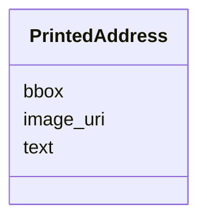

---
search:
  boost: 10.0
---

# Class: PrintedAddress 


_Where some printed words stand: the page picture they are on, a box in that picture's own pixels, and the words read inside it._


<div data-search-exclude markdown="1">


URI: [pc:PrintedAddress](https://pruzhany.org/ns/sourced-entities#PrintedAddress)





<!-- no inheritance hierarchy -->

## Slots

| Name | Cardinality and Range | Description | Inheritance |
| ---  | --- | --- | --- |
| [image_uri](image_uri.md) | 1 <br/> [NonBlankText](NonBlankText.md) | The page picture the words are on, by its key or address. | direct |
| [bbox](bbox.md) | 1..* <br/> [NonNegativeNumber](NonNegativeNumber.md) | The box around the words, in the picture's own pixels: x, y, width and height. | direct |
| [text](text.md) | 1 <br/> [String](String.md) | The words read inside the box, exactly; empty for a patch with no readable line. | direct |


## Usages

| used by | used in | type | used |
| ---  | --- | --- | --- |
| [SiteCitation](SiteCitation.md) | [addresses](addresses.md) | range | [PrintedAddress](PrintedAddress.md) |


## Identifier and Mapping Information


### Schema Source


* from schema: https://pruzhany.org/ns/shared_record


## Mappings

| Mapping Type | Mapped Value |
| ---  | ---  |
| self | pc:PrintedAddress |
| native | pc:PrintedAddress |


## LinkML Source

<!-- TODO: investigate https://stackoverflow.com/questions/37606292/how-to-create-tabbed-code-blocks-in-mkdocs-or-sphinx -->

### Direct

<details>
```yaml
name: PrintedAddress
description: 'Where some printed words stand: the page picture they are on, a box
  in that picture''s own pixels, and the words read inside it.'
from_schema: https://pruzhany.org/ns/shared_record
rank: 1000
attributes:
  image_uri:
    name: image_uri
    description: The page picture the words are on, by its key or address.
    from_schema: https://pruzhany.org/ns/site_common_address
    rank: 1000
    domain_of:
    - PrintedAddress
    range: NonBlankText
    required: true
  bbox:
    name: bbox
    description: 'The box around the words, in the picture''s own pixels: x, y, width
      and height.'
    from_schema: https://pruzhany.org/ns/site_common_address
    rank: 1000
    domain_of:
    - PrintedAddress
    range: NonNegativeNumber
    required: true
    multivalued: true
    minimum_cardinality: 4
    maximum_cardinality: 4
  text:
    name: text
    description: The words read inside the box, exactly; empty for a patch with no
      readable line.
    from_schema: https://pruzhany.org/ns/site_common_address
    domain_of:
    - MediaText
    - PrintedAddress
    range: string
    required: true

```
</details>

### Induced

<details>
```yaml
name: PrintedAddress
description: 'Where some printed words stand: the page picture they are on, a box
  in that picture''s own pixels, and the words read inside it.'
from_schema: https://pruzhany.org/ns/shared_record
rank: 1000
attributes:
  image_uri:
    name: image_uri
    description: The page picture the words are on, by its key or address.
    from_schema: https://pruzhany.org/ns/site_common_address
    rank: 1000
    owner: PrintedAddress
    domain_of:
    - PrintedAddress
    range: NonBlankText
    required: true
  bbox:
    name: bbox
    description: 'The box around the words, in the picture''s own pixels: x, y, width
      and height.'
    from_schema: https://pruzhany.org/ns/site_common_address
    rank: 1000
    owner: PrintedAddress
    domain_of:
    - PrintedAddress
    range: NonNegativeNumber
    required: true
    multivalued: true
    minimum_cardinality: 4
    maximum_cardinality: 4
  text:
    name: text
    description: The words read inside the box, exactly; empty for a patch with no
      readable line.
    from_schema: https://pruzhany.org/ns/site_common_address
    owner: PrintedAddress
    domain_of:
    - MediaText
    - PrintedAddress
    range: string
    required: true

```
</details></div>
