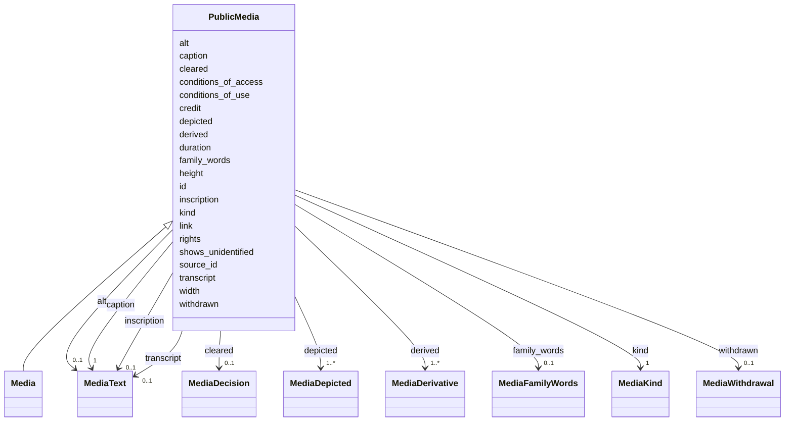

---
search:
  boost: 10.0
---

# Class: PublicMedia 


_One held or linked copy of a registered source (a photograph, document, recording or film), as the public may see it: what it is, what it shows and says, its review, its terms and its served copies._


<div data-search-exclude markdown="1">


URI: [rico:Instantiation](https://www.ica.org/standards/RiC/ontology#Instantiation)





## Inheritance
* **PublicMedia**
    * [Media](Media.md)


## Class Properties

| Property | Value |
| --- | --- |
| Class URI | [rico:Instantiation](https://www.ica.org/standards/RiC/ontology#Instantiation) |


## Slots

| Name | Cardinality and Range | Description | Inheritance |
| ---  | --- | --- | --- |
| [id](id.md) | 1 <br/> [String](String.md) | The medium's id: lowercase letters and digits in parts joined by hyphens. | direct |
| [source_id](source_id.md) | 1 <br/> [NonBlankText](NonBlankText.md) | The source this medium is a copy of, by its id; never the person shown. | direct |
| [kind](kind.md) | 1 <br/> [MediaKind](MediaKind.md) | What the medium is: image, audio, video or document. | direct |
| [caption](caption.md) | 1 <br/> [MediaText](MediaText.md) | The caption the site shows, with its language and review. | direct |
| [alt](alt.md) | 0..1 <br/> [MediaText](MediaText.md) | The description for screen readers of what is visible; required for images and documents. | direct |
| [inscription](inscription.md) | 0..1 <br/> [MediaText](MediaText.md) | The object's own words, such as writing on the back of a photograph. | direct |
| [transcript](transcript.md) | 0..1 <br/> [MediaText](MediaText.md) | A document's full text; required for documents. | direct |
| [family_words](family_words.md) | 0..1 <br/> [MediaFamilyWords](MediaFamilyWords.md) | The family's words about the medium, quoted from a source. | direct |
| [depicted](depicted.md) | 1..* <br/> [MediaDepicted](MediaDepicted.md) | The people the picture shows, identified or not, and where. | direct |
| [shows_unidentified](shows_unidentified.md) | 1 <br/> [Boolean](Boolean.md) | True when the picture shows people not identified. | direct |
| [width](width.md) | 0..1 <br/> [PositiveInteger](PositiveInteger.md) | The master's width in pixels, after orientation. | direct |
| [height](height.md) | 0..1 <br/> [PositiveInteger](PositiveInteger.md) | The master's height in pixels, after orientation. | direct |
| [duration](duration.md) | 0..1 <br/> [NonNegativeNumber](NonNegativeNumber.md) | The master's length in seconds, for sound and film. | direct |
| [credit](credit.md) | 1 <br/> [NonBlankText](NonBlankText.md) | The holder's or the family's credit, as they word it. | direct |
| [conditions_of_access](conditions_of_access.md) | 0..1 <br/> [NonBlankText](NonBlankText.md) | The holder's terms of access, as written. | direct |
| [conditions_of_use](conditions_of_use.md) | 0..1 <br/> [NonBlankText](NonBlankText.md) | The holder's terms of use, as written, with no permission inferred from them. | direct |
| [rights](rights.md) | 0..1 <br/> [String](String.md) | The rights statement or licence that applies, by its address; when absent, copyright not evaluated. | direct |
| [cleared](cleared.md) | 0..1 <br/> [MediaDecision](MediaDecision.md) | Who cleared the medium for the site, by role, and on what day. | direct |
| [withdrawn](withdrawn.md) | 0..1 <br/> [MediaWithdrawal](MediaWithdrawal.md) | That the medium was withdrawn, on what day and why. | direct |
| [link](link.md) | 0..1 <br/> [String](String.md) | For sound or film: the page on the holder's own host where it can be heard or seen. | direct |
| [derived](derived.md) | 1..* <br/> [MediaDerivative](MediaDerivative.md) | The served copies of the picture, one for each exported width. | direct |


## Rules


### 

| Rule Applied | Preconditions | Postconditions | Elseconditions |
|--------------|---------------|----------------|----------------|
| slot_conditions |```{'kind': {'equals_string_in': ['image', 'document']}}``` |```{'alt': {'required': True}}``` | |


### 

| Rule Applied | Preconditions | Postconditions | Elseconditions |
|--------------|---------------|----------------|----------------|
| slot_conditions |```{'kind': {'equals_string': 'document'}}``` |```{'transcript': {'required': True}}``` | |


### 

| Rule Applied | Preconditions | Postconditions | Elseconditions |
|--------------|---------------|----------------|----------------|
| slot_conditions |```{'width': {'value_presence': 'PRESENT'}}``` |```{'height': {'required': True}}``` | |


### 

| Rule Applied | Preconditions | Postconditions | Elseconditions |
|--------------|---------------|----------------|----------------|
| slot_conditions |```{'height': {'value_presence': 'PRESENT'}}``` |```{'width': {'required': True}}``` | |


### 

| Rule Applied | Preconditions | Postconditions | Elseconditions |
|--------------|---------------|----------------|----------------|
| slot_conditions |```{'link': {'value_presence': 'PRESENT'}}``` |```{'kind': {'equals_string_in': ['audio', 'video']}}``` | |


### 

| Rule Applied | Preconditions | Postconditions | Elseconditions |
|--------------|---------------|----------------|----------------|
| slot_conditions |```{'withdrawn': {'value_presence': 'PRESENT'}}``` | | |
| none_of | |```[{'slot_conditions': {'derived': {'required': True}}}, {'slot_conditions': {'link': {'required': True}}}]``` | |


### 

| Rule Applied | Preconditions | Postconditions | Elseconditions |
|--------------|---------------|----------------|----------------|
| slot_conditions |```{'kind': {'equals_string': 'image'}}``` | | |
| none_of | |```[{'slot_conditions': {'rights': {'required': True, 'equals_string': 'http://rightsstatements.org/vocab/InC-OW-EU/1.0/'}}}]``` | |


### 

| Rule Applied | Preconditions | Postconditions | Elseconditions |
|--------------|---------------|----------------|----------------|
| slot_conditions |```{'derived': {'value_presence': 'PRESENT'}}``` |```{'cleared': {'required': True}}``` | |


### 

| Rule Applied | Preconditions | Postconditions | Elseconditions |
|--------------|---------------|----------------|----------------|
| slot_conditions |```{'derived': {'value_presence': 'PRESENT'}}``` | | |
| any_of | |```[{'slot_conditions': {'width': {'required': True}, 'height': {'required': True}}}, {'slot_conditions': {'duration': {'required': True}}}]``` | |


### 

| Rule Applied | Preconditions | Postconditions | Elseconditions |
|--------------|---------------|----------------|----------------|
| slot_conditions |```{'kind': {'equals_string_in': ['image', 'document']}, 'derived': {'value_presence': 'PRESENT'}}``` |```{'width': {'required': True}, 'height': {'required': True}}``` | |


## Identifier and Mapping Information


### Schema Source


* from schema: https://pruzhany.org/ns/shared_record


## Mappings

| Mapping Type | Mapped Value |
| ---  | ---  |
| self | rico:Instantiation |
| native | pc:PublicMedia |


## LinkML Source

<!-- TODO: investigate https://stackoverflow.com/questions/37606292/how-to-create-tabbed-code-blocks-in-mkdocs-or-sphinx -->

### Direct

<details>
```yaml
name: PublicMedia
description: 'One held or linked copy of a registered source (a photograph, document,
  recording or film), as the public may see it: what it is, what it shows and says,
  its review, its terms and its served copies.'
from_schema: https://pruzhany.org/ns/shared_record
rank: 1000
attributes:
  id:
    name: id
    description: 'The medium''s id: lowercase letters and digits in parts joined by
      hyphens.'
    from_schema: https://pruzhany.org/ns/media
    domain_of:
    - SharedPerson
    - SharedFamily
    - Holder
    - SharedPlace
    - SharedOrganization
    - SharedEvent
    - Source
    - Fact
    - Mention
    - PublicMedia
    range: string
    required: true
    pattern: ^[a-z0-9]+(?:-[a-z0-9]+)*$(?![\s\S])
  source_id:
    name: source_id
    description: The source this medium is a copy of, by its id; never the person
      shown.
    from_schema: https://pruzhany.org/ns/media
    slot_uri: rico:isOrWasInstantiationOf
    domain_of:
    - PlaceIdentifier
    - SourceDerivation
    - Citation
    - MediaFamilyWords
    - PublicMedia
    range: NonBlankText
    required: true
  kind:
    name: kind
    description: 'What the medium is: image, audio, video or document.'
    from_schema: https://pruzhany.org/ns/media
    slot_uri: rico:hasRepresentationType
    domain_of:
    - Holder
    - Source
    - Name
    - PublicMedia
    range: MediaKind
    required: true
  caption:
    name: caption
    description: The caption the site shows, with its language and review.
    from_schema: https://pruzhany.org/ns/media
    rank: 1000
    slot_uri: pc:media_caption
    domain_of:
    - PublicMedia
    range: MediaText
    required: true
    inlined: true
  alt:
    name: alt
    description: The description for screen readers of what is visible; required for
      images and documents.
    from_schema: https://pruzhany.org/ns/media
    rank: 1000
    slot_uri: pc:media_alt
    domain_of:
    - PublicMedia
    range: MediaText
    inlined: true
  inscription:
    name: inscription
    description: The object's own words, such as writing on the back of a photograph.
    from_schema: https://pruzhany.org/ns/media
    rank: 1000
    slot_uri: pc:media_inscription
    domain_of:
    - PublicMedia
    range: MediaText
    inlined: true
  transcript:
    name: transcript
    description: A document's full text; required for documents.
    from_schema: https://pruzhany.org/ns/media
    rank: 1000
    slot_uri: pc:media_transcript
    domain_of:
    - PublicMedia
    range: MediaText
    inlined: true
  family_words:
    name: family_words
    description: The family's words about the medium, quoted from a source.
    from_schema: https://pruzhany.org/ns/media
    rank: 1000
    slot_uri: pc:media_family_words
    domain_of:
    - PublicMedia
    range: MediaFamilyWords
    inlined: true
  depicted:
    name: depicted
    description: The people the picture shows, identified or not, and where.
    from_schema: https://pruzhany.org/ns/media
    rank: 1000
    slot_uri: pc:media_depicted
    domain_of:
    - PublicMedia
    range: MediaDepicted
    required: true
    multivalued: true
    inlined_as_list: true
  shows_unidentified:
    name: shows_unidentified
    description: True when the picture shows people not identified.
    from_schema: https://pruzhany.org/ns/media
    rank: 1000
    slot_uri: pc:media_shows_unidentified
    domain_of:
    - PublicMedia
    range: boolean
    required: true
  width:
    name: width
    description: The master's width in pixels, after orientation.
    from_schema: https://pruzhany.org/ns/media
    slot_uri: rico:width
    domain_of:
    - MediaDerivative
    - PublicMedia
    range: PositiveInteger
  height:
    name: height
    description: The master's height in pixels, after orientation.
    from_schema: https://pruzhany.org/ns/media
    slot_uri: rico:height
    domain_of:
    - MediaDerivative
    - PublicMedia
    range: PositiveInteger
  duration:
    name: duration
    description: The master's length in seconds, for sound and film.
    from_schema: https://pruzhany.org/ns/media
    rank: 1000
    slot_uri: pc:media_duration
    domain_of:
    - PublicMedia
    range: NonNegativeNumber
  credit:
    name: credit
    description: The holder's or the family's credit, as they word it.
    from_schema: https://pruzhany.org/ns/media
    rank: 1000
    slot_uri: pc:media_credit
    domain_of:
    - PublicMedia
    range: NonBlankText
    required: true
  conditions_of_access:
    name: conditions_of_access
    description: The holder's terms of access, as written.
    from_schema: https://pruzhany.org/ns/media
    rank: 1000
    slot_uri: rico:conditionsOfAccess
    domain_of:
    - PublicMedia
    range: NonBlankText
  conditions_of_use:
    name: conditions_of_use
    description: The holder's terms of use, as written, with no permission inferred
      from them.
    from_schema: https://pruzhany.org/ns/media
    rank: 1000
    slot_uri: rico:conditionsOfUse
    domain_of:
    - PublicMedia
    range: NonBlankText
  rights:
    name: rights
    description: The rights statement or licence that applies, by its address; when
      absent, copyright not evaluated.
    from_schema: https://pruzhany.org/ns/media
    rank: 1000
    slot_uri: pc:media_rights
    domain_of:
    - PublicMedia
    range: string
    equals_string_in:
    - http://rightsstatements.org/vocab/InC/1.0/
    - http://rightsstatements.org/vocab/InC-OW-EU/1.0/
    - http://rightsstatements.org/vocab/InC-EDU/1.0/
    - http://rightsstatements.org/vocab/InC-NC/1.0/
    - http://rightsstatements.org/vocab/InC-RUU/1.0/
    - http://rightsstatements.org/vocab/NoC-CR/1.0/
    - http://rightsstatements.org/vocab/NoC-NC/1.0/
    - http://rightsstatements.org/vocab/NoC-OKLR/1.0/
    - http://rightsstatements.org/vocab/NoC-US/1.0/
    - http://rightsstatements.org/vocab/CNE/1.0/
    - http://rightsstatements.org/vocab/UND/1.0/
    - http://rightsstatements.org/vocab/NKC/1.0/
    - https://creativecommons.org/licenses/by/4.0/
    - https://creativecommons.org/licenses/by-sa/4.0/
    - https://creativecommons.org/licenses/by-nd/4.0/
    - https://creativecommons.org/licenses/by-nc/4.0/
    - https://creativecommons.org/licenses/by-nc-sa/4.0/
    - https://creativecommons.org/licenses/by-nc-nd/4.0/
    - https://creativecommons.org/publicdomain/zero/1.0/
    - https://creativecommons.org/publicdomain/mark/1.0/
  cleared:
    name: cleared
    description: Who cleared the medium for the site, by role, and on what day.
    from_schema: https://pruzhany.org/ns/media
    rank: 1000
    slot_uri: pc:media_clearance
    domain_of:
    - PublicMedia
    range: MediaDecision
    inlined: true
  withdrawn:
    name: withdrawn
    description: That the medium was withdrawn, on what day and why.
    from_schema: https://pruzhany.org/ns/media
    rank: 1000
    slot_uri: pc:media_withdrawn
    domain_of:
    - PublicMedia
    range: MediaWithdrawal
    inlined: true
  link:
    name: link
    description: 'For sound or film: the page on the holder''s own host where it can
      be heard or seen.'
    from_schema: https://pruzhany.org/ns/media
    rank: 1000
    slot_uri: pc:media_link
    domain_of:
    - PublicMedia
    range: string
    pattern: ^https://[a-z0-9]+(?:[.-][a-z0-9]+)*(?:/[^\s\\]*)?$(?![\s\S])
  derived:
    name: derived
    description: The served copies of the picture, one for each exported width.
    from_schema: https://pruzhany.org/ns/media
    rank: 1000
    slot_uri: pc:media_derived
    domain_of:
    - PublicMedia
    range: MediaDerivative
    multivalued: true
    inlined_as_list: true
    minimum_cardinality: 1
class_uri: rico:Instantiation
rules:
- preconditions:
    slot_conditions:
      kind:
        name: kind
        equals_string_in:
        - image
        - document
  postconditions:
    slot_conditions:
      alt:
        name: alt
        required: true
  description: An image or a document has a description for screen readers.
- preconditions:
    slot_conditions:
      kind:
        name: kind
        equals_string: document
  postconditions:
    slot_conditions:
      transcript:
        name: transcript
        required: true
  description: A document has its transcript.
- preconditions:
    slot_conditions:
      width:
        name: width
        value_presence: PRESENT
  postconditions:
    slot_conditions:
      height:
        name: height
        required: true
  description: A medium with a width has a height.
- preconditions:
    slot_conditions:
      height:
        name: height
        value_presence: PRESENT
  postconditions:
    slot_conditions:
      width:
        name: width
        required: true
  description: A medium with a height has a width.
- preconditions:
    slot_conditions:
      link:
        name: link
        value_presence: PRESENT
  postconditions:
    slot_conditions:
      kind:
        name: kind
        equals_string_in:
        - audio
        - video
  description: Only sound or film has a link to the holder's page.
- preconditions:
    slot_conditions:
      withdrawn:
        name: withdrawn
        value_presence: PRESENT
  postconditions:
    none_of:
    - slot_conditions:
        derived:
          name: derived
          required: true
    - slot_conditions:
        link:
          name: link
          required: true
  description: A withdrawn medium has no served copies and no link.
- preconditions:
    slot_conditions:
      kind:
        name: kind
        equals_string: image
  postconditions:
    none_of:
    - slot_conditions:
        rights:
          name: rights
          required: true
          equals_string: http://rightsstatements.org/vocab/InC-OW-EU/1.0/
  description: A photograph or other image never takes the EU orphan-work statement.
- preconditions:
    slot_conditions:
      derived:
        name: derived
        value_presence: PRESENT
  postconditions:
    slot_conditions:
      cleared:
        name: cleared
        required: true
  description: A medium with served copies is cleared.
- preconditions:
    slot_conditions:
      derived:
        name: derived
        value_presence: PRESENT
  postconditions:
    any_of:
    - slot_conditions:
        width:
          name: width
          required: true
        height:
          name: height
          required: true
    - slot_conditions:
        duration:
          name: duration
          required: true
  description: A medium with served copies has its master's width and height, or its
    duration.
- preconditions:
    slot_conditions:
      kind:
        name: kind
        equals_string_in:
        - image
        - document
      derived:
        name: derived
        value_presence: PRESENT
  postconditions:
    slot_conditions:
      width:
        name: width
        required: true
      height:
        name: height
        required: true
  description: An image or a document with served copies has its master's width and
    height.

```
</details>

### Induced

<details>
```yaml
name: PublicMedia
description: 'One held or linked copy of a registered source (a photograph, document,
  recording or film), as the public may see it: what it is, what it shows and says,
  its review, its terms and its served copies.'
from_schema: https://pruzhany.org/ns/shared_record
rank: 1000
attributes:
  id:
    name: id
    description: 'The medium''s id: lowercase letters and digits in parts joined by
      hyphens.'
    from_schema: https://pruzhany.org/ns/media
    owner: PublicMedia
    domain_of:
    - SharedPerson
    - SharedFamily
    - Holder
    - SharedPlace
    - SharedOrganization
    - SharedEvent
    - Source
    - Fact
    - Mention
    - PublicMedia
    range: string
    required: true
    pattern: ^[a-z0-9]+(?:-[a-z0-9]+)*$(?![\s\S])
  source_id:
    name: source_id
    description: The source this medium is a copy of, by its id; never the person
      shown.
    from_schema: https://pruzhany.org/ns/media
    slot_uri: rico:isOrWasInstantiationOf
    owner: PublicMedia
    domain_of:
    - PlaceIdentifier
    - SourceDerivation
    - Citation
    - MediaFamilyWords
    - PublicMedia
    range: NonBlankText
    required: true
  kind:
    name: kind
    description: 'What the medium is: image, audio, video or document.'
    from_schema: https://pruzhany.org/ns/media
    slot_uri: rico:hasRepresentationType
    owner: PublicMedia
    domain_of:
    - Holder
    - Source
    - Name
    - PublicMedia
    range: MediaKind
    required: true
  caption:
    name: caption
    description: The caption the site shows, with its language and review.
    from_schema: https://pruzhany.org/ns/media
    rank: 1000
    slot_uri: pc:media_caption
    owner: PublicMedia
    domain_of:
    - PublicMedia
    range: MediaText
    required: true
    inlined: true
  alt:
    name: alt
    description: The description for screen readers of what is visible; required for
      images and documents.
    from_schema: https://pruzhany.org/ns/media
    rank: 1000
    slot_uri: pc:media_alt
    owner: PublicMedia
    domain_of:
    - PublicMedia
    range: MediaText
    inlined: true
  inscription:
    name: inscription
    description: The object's own words, such as writing on the back of a photograph.
    from_schema: https://pruzhany.org/ns/media
    rank: 1000
    slot_uri: pc:media_inscription
    owner: PublicMedia
    domain_of:
    - PublicMedia
    range: MediaText
    inlined: true
  transcript:
    name: transcript
    description: A document's full text; required for documents.
    from_schema: https://pruzhany.org/ns/media
    rank: 1000
    slot_uri: pc:media_transcript
    owner: PublicMedia
    domain_of:
    - PublicMedia
    range: MediaText
    inlined: true
  family_words:
    name: family_words
    description: The family's words about the medium, quoted from a source.
    from_schema: https://pruzhany.org/ns/media
    rank: 1000
    slot_uri: pc:media_family_words
    owner: PublicMedia
    domain_of:
    - PublicMedia
    range: MediaFamilyWords
    inlined: true
  depicted:
    name: depicted
    description: The people the picture shows, identified or not, and where.
    from_schema: https://pruzhany.org/ns/media
    rank: 1000
    slot_uri: pc:media_depicted
    owner: PublicMedia
    domain_of:
    - PublicMedia
    range: MediaDepicted
    required: true
    multivalued: true
    inlined: true
    inlined_as_list: true
  shows_unidentified:
    name: shows_unidentified
    description: True when the picture shows people not identified.
    from_schema: https://pruzhany.org/ns/media
    rank: 1000
    slot_uri: pc:media_shows_unidentified
    owner: PublicMedia
    domain_of:
    - PublicMedia
    range: boolean
    required: true
  width:
    name: width
    description: The master's width in pixels, after orientation.
    from_schema: https://pruzhany.org/ns/media
    slot_uri: rico:width
    owner: PublicMedia
    domain_of:
    - MediaDerivative
    - PublicMedia
    range: PositiveInteger
  height:
    name: height
    description: The master's height in pixels, after orientation.
    from_schema: https://pruzhany.org/ns/media
    slot_uri: rico:height
    owner: PublicMedia
    domain_of:
    - MediaDerivative
    - PublicMedia
    range: PositiveInteger
  duration:
    name: duration
    description: The master's length in seconds, for sound and film.
    from_schema: https://pruzhany.org/ns/media
    rank: 1000
    slot_uri: pc:media_duration
    owner: PublicMedia
    domain_of:
    - PublicMedia
    range: NonNegativeNumber
  credit:
    name: credit
    description: The holder's or the family's credit, as they word it.
    from_schema: https://pruzhany.org/ns/media
    rank: 1000
    slot_uri: pc:media_credit
    owner: PublicMedia
    domain_of:
    - PublicMedia
    range: NonBlankText
    required: true
  conditions_of_access:
    name: conditions_of_access
    description: The holder's terms of access, as written.
    from_schema: https://pruzhany.org/ns/media
    rank: 1000
    slot_uri: rico:conditionsOfAccess
    owner: PublicMedia
    domain_of:
    - PublicMedia
    range: NonBlankText
  conditions_of_use:
    name: conditions_of_use
    description: The holder's terms of use, as written, with no permission inferred
      from them.
    from_schema: https://pruzhany.org/ns/media
    rank: 1000
    slot_uri: rico:conditionsOfUse
    owner: PublicMedia
    domain_of:
    - PublicMedia
    range: NonBlankText
  rights:
    name: rights
    description: The rights statement or licence that applies, by its address; when
      absent, copyright not evaluated.
    from_schema: https://pruzhany.org/ns/media
    rank: 1000
    slot_uri: pc:media_rights
    owner: PublicMedia
    domain_of:
    - PublicMedia
    range: string
    equals_string_in:
    - http://rightsstatements.org/vocab/InC/1.0/
    - http://rightsstatements.org/vocab/InC-OW-EU/1.0/
    - http://rightsstatements.org/vocab/InC-EDU/1.0/
    - http://rightsstatements.org/vocab/InC-NC/1.0/
    - http://rightsstatements.org/vocab/InC-RUU/1.0/
    - http://rightsstatements.org/vocab/NoC-CR/1.0/
    - http://rightsstatements.org/vocab/NoC-NC/1.0/
    - http://rightsstatements.org/vocab/NoC-OKLR/1.0/
    - http://rightsstatements.org/vocab/NoC-US/1.0/
    - http://rightsstatements.org/vocab/CNE/1.0/
    - http://rightsstatements.org/vocab/UND/1.0/
    - http://rightsstatements.org/vocab/NKC/1.0/
    - https://creativecommons.org/licenses/by/4.0/
    - https://creativecommons.org/licenses/by-sa/4.0/
    - https://creativecommons.org/licenses/by-nd/4.0/
    - https://creativecommons.org/licenses/by-nc/4.0/
    - https://creativecommons.org/licenses/by-nc-sa/4.0/
    - https://creativecommons.org/licenses/by-nc-nd/4.0/
    - https://creativecommons.org/publicdomain/zero/1.0/
    - https://creativecommons.org/publicdomain/mark/1.0/
  cleared:
    name: cleared
    description: Who cleared the medium for the site, by role, and on what day.
    from_schema: https://pruzhany.org/ns/media
    rank: 1000
    slot_uri: pc:media_clearance
    owner: PublicMedia
    domain_of:
    - PublicMedia
    range: MediaDecision
    inlined: true
  withdrawn:
    name: withdrawn
    description: That the medium was withdrawn, on what day and why.
    from_schema: https://pruzhany.org/ns/media
    rank: 1000
    slot_uri: pc:media_withdrawn
    owner: PublicMedia
    domain_of:
    - PublicMedia
    range: MediaWithdrawal
    inlined: true
  link:
    name: link
    description: 'For sound or film: the page on the holder''s own host where it can
      be heard or seen.'
    from_schema: https://pruzhany.org/ns/media
    rank: 1000
    slot_uri: pc:media_link
    owner: PublicMedia
    domain_of:
    - PublicMedia
    range: string
    pattern: ^https://[a-z0-9]+(?:[.-][a-z0-9]+)*(?:/[^\s\\]*)?$(?![\s\S])
  derived:
    name: derived
    description: The served copies of the picture, one for each exported width.
    from_schema: https://pruzhany.org/ns/media
    rank: 1000
    slot_uri: pc:media_derived
    owner: PublicMedia
    domain_of:
    - PublicMedia
    range: MediaDerivative
    multivalued: true
    inlined: true
    inlined_as_list: true
    minimum_cardinality: 1
class_uri: rico:Instantiation
rules:
- preconditions:
    slot_conditions:
      kind:
        name: kind
        equals_string_in:
        - image
        - document
  postconditions:
    slot_conditions:
      alt:
        name: alt
        required: true
  description: An image or a document has a description for screen readers.
- preconditions:
    slot_conditions:
      kind:
        name: kind
        equals_string: document
  postconditions:
    slot_conditions:
      transcript:
        name: transcript
        required: true
  description: A document has its transcript.
- preconditions:
    slot_conditions:
      width:
        name: width
        value_presence: PRESENT
  postconditions:
    slot_conditions:
      height:
        name: height
        required: true
  description: A medium with a width has a height.
- preconditions:
    slot_conditions:
      height:
        name: height
        value_presence: PRESENT
  postconditions:
    slot_conditions:
      width:
        name: width
        required: true
  description: A medium with a height has a width.
- preconditions:
    slot_conditions:
      link:
        name: link
        value_presence: PRESENT
  postconditions:
    slot_conditions:
      kind:
        name: kind
        equals_string_in:
        - audio
        - video
  description: Only sound or film has a link to the holder's page.
- preconditions:
    slot_conditions:
      withdrawn:
        name: withdrawn
        value_presence: PRESENT
  postconditions:
    none_of:
    - slot_conditions:
        derived:
          name: derived
          required: true
    - slot_conditions:
        link:
          name: link
          required: true
  description: A withdrawn medium has no served copies and no link.
- preconditions:
    slot_conditions:
      kind:
        name: kind
        equals_string: image
  postconditions:
    none_of:
    - slot_conditions:
        rights:
          name: rights
          required: true
          equals_string: http://rightsstatements.org/vocab/InC-OW-EU/1.0/
  description: A photograph or other image never takes the EU orphan-work statement.
- preconditions:
    slot_conditions:
      derived:
        name: derived
        value_presence: PRESENT
  postconditions:
    slot_conditions:
      cleared:
        name: cleared
        required: true
  description: A medium with served copies is cleared.
- preconditions:
    slot_conditions:
      derived:
        name: derived
        value_presence: PRESENT
  postconditions:
    any_of:
    - slot_conditions:
        width:
          name: width
          required: true
        height:
          name: height
          required: true
    - slot_conditions:
        duration:
          name: duration
          required: true
  description: A medium with served copies has its master's width and height, or its
    duration.
- preconditions:
    slot_conditions:
      kind:
        name: kind
        equals_string_in:
        - image
        - document
      derived:
        name: derived
        value_presence: PRESENT
  postconditions:
    slot_conditions:
      width:
        name: width
        required: true
      height:
        name: height
        required: true
  description: An image or a document with served copies has its master's width and
    height.

```
</details></div>
