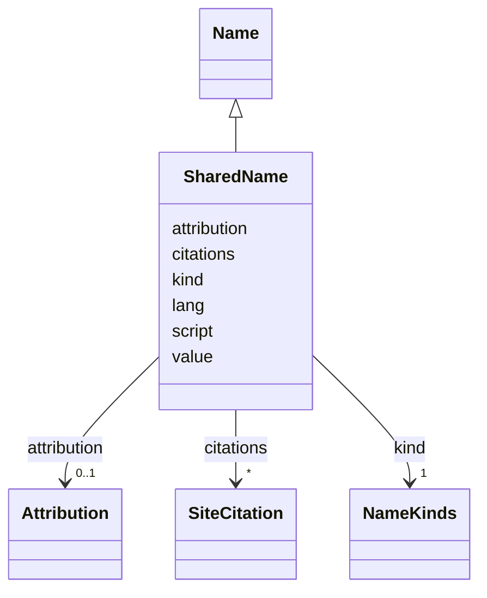

---
search:
  boost: 10.0
---

# Class: SharedName 


_One name of a person in the shared record, with its evidence located on the printed page where the site writer found it._


<div data-search-exclude markdown="1">


URI: [rico:AgentName](https://www.ica.org/standards/RiC/ontology#AgentName)





## Inheritance
* [Name](Name.md)
    * **SharedName**


## Class Properties

| Property | Value |
| --- | --- |
| Class URI | [rico:AgentName](https://www.ica.org/standards/RiC/ontology#AgentName) |


## Slots

| Name | Cardinality and Range | Description | Inheritance |
| ---  | --- | --- | --- |
| [citations](citations.md) | * <br/> [SiteCitation](SiteCitation.md) | Where the name is found. | direct |
| [value](value.md) | 1 <br/> [NonBlankText](NonBlankText.md) | The name, as written. | [Name](Name.md) |
| [kind](kind.md) | 1 <br/> [NameKinds](NameKinds.md) | What kind of name it is: printed, birth, married, supplied and so on. | [Name](Name.md) |
| [script](script.md) | 1 <br/> [ScriptCode](ScriptCode.md) | The script it is written in, as a four-letter ISO 15924 code such as Hebr or Latn. | [Name](Name.md) |
| [lang](lang.md) | 0..1 <br/> [SimpleLanguageTag](SimpleLanguageTag.md) | Its language, as a language tag such as yi or en. | [Name](Name.md) |
| [attribution](attribution.md) | 0..1 <br/> [Attribution](Attribution.md) | For a supplied name only: who wrote the description, and on what day. | [Name](Name.md) |


## Usages

| used by | used in | type | used |
| ---  | --- | --- | --- |
| [SharedPerson](SharedPerson.md) | [names](names.md) | range | [SharedName](SharedName.md) |


## Identifier and Mapping Information


### Schema Source


* from schema: https://pruzhany.org/ns/shared_record


## Mappings

| Mapping Type | Mapped Value |
| ---  | ---  |
| self | rico:AgentName |
| native | pc:SharedName |


## LinkML Source

<!-- TODO: investigate https://stackoverflow.com/questions/37606292/how-to-create-tabbed-code-blocks-in-mkdocs-or-sphinx -->

### Direct

<details>
```yaml
name: SharedName
description: One name of a person in the shared record, with its evidence located
  on the printed page where the site writer found it.
from_schema: https://pruzhany.org/ns/shared_record
rank: 1000
is_a: Name
attributes:
  citations:
    name: citations
    description: Where the name is found.
    from_schema: https://pruzhany.org/ns/shared_record
    rank: 1000
    domain_of:
    - SharedName
    - SharedFact
    - SourcedRelation
    - Fact
    - Name
    range: SiteCitation
    multivalued: true
    inlined_as_list: true
class_uri: rico:AgentName

```
</details>

### Induced

<details>
```yaml
name: SharedName
description: One name of a person in the shared record, with its evidence located
  on the printed page where the site writer found it.
from_schema: https://pruzhany.org/ns/shared_record
rank: 1000
is_a: Name
attributes:
  citations:
    name: citations
    description: Where the name is found.
    from_schema: https://pruzhany.org/ns/shared_record
    rank: 1000
    owner: SharedName
    domain_of:
    - SharedName
    - SharedFact
    - SourcedRelation
    - Fact
    - Name
    range: SiteCitation
    multivalued: true
    inlined: true
    inlined_as_list: true
  value:
    name: value
    description: The name, as written.
    from_schema: https://pruzhany.org/ns/sourced_entities
    owner: SharedName
    domain_of:
    - PlaceIdentifier
    - Fact
    - Name
    range: NonBlankText
    required: true
  kind:
    name: kind
    description: 'What kind of name it is: printed, birth, married, supplied and so
      on.'
    from_schema: https://pruzhany.org/ns/sourced_entities
    owner: SharedName
    domain_of:
    - Holder
    - Source
    - Name
    - PublicMedia
    range: NameKinds
    required: true
  script:
    name: script
    description: The script it is written in, as a four-letter ISO 15924 code such
      as Hebr or Latn.
    from_schema: https://pruzhany.org/ns/sourced_entities
    rank: 1000
    owner: SharedName
    domain_of:
    - Name
    range: ScriptCode
    required: true
  lang:
    name: lang
    description: Its language, as a language tag such as yi or en.
    from_schema: https://pruzhany.org/ns/sourced_entities
    rank: 1000
    owner: SharedName
    domain_of:
    - Name
    - MediaText
    range: SimpleLanguageTag
  attribution:
    name: attribution
    description: 'For a supplied name only: who wrote the description, and on what
      day.'
    from_schema: https://pruzhany.org/ns/sourced_entities
    owner: SharedName
    domain_of:
    - PlaceIdentifier
    - Fact
    - Name
    range: Attribution
    inlined: true
class_uri: rico:AgentName

```
</details></div>
