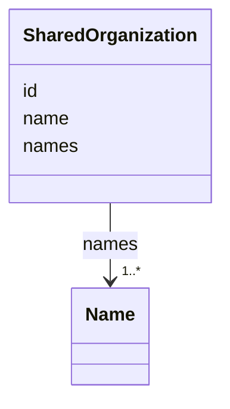

---
search:
  boost: 10.0
---

# Class: SharedOrganization 


_One organisation of the record: its id, the name shown and its names; its offices and members are sourced facts._


<div data-search-exclude markdown="1">


URI: [ehri:CorporateBody](http://lod.ehri-project-test.eu/ontology#CorporateBody)





<!-- no inheritance hierarchy -->

## Class Properties

| Property | Value |
| --- | --- |
| Class URI | [ehri:CorporateBody](http://lod.ehri-project-test.eu/ontology#CorporateBody) |


## Slots

| Name | Cardinality and Range | Description | Inheritance |
| ---  | --- | --- | --- |
| [id](id.md) | 1 <br/> [NonBlankText](NonBlankText.md) | The organisation's id. | direct |
| [name](name.md) | 1 <br/> [NonBlankText](NonBlankText.md) | The name the site shows. | direct |
| [names](names.md) | 1..* <br/> [Name](Name.md) | The organisation's names. | direct |


## Usages

| used by | used in | type | used |
| ---  | --- | --- | --- |
| [SharedRecord](SharedRecord.md) | [organizations](organizations.md) | range | [SharedOrganization](SharedOrganization.md) |


## Identifier and Mapping Information


### Schema Source


* from schema: https://pruzhany.org/ns/shared_record


## Mappings

| Mapping Type | Mapped Value |
| ---  | ---  |
| self | ehri:CorporateBody |
| native | pc:SharedOrganization |


## LinkML Source

<!-- TODO: investigate https://stackoverflow.com/questions/37606292/how-to-create-tabbed-code-blocks-in-mkdocs-or-sphinx -->

### Direct

<details>
```yaml
name: SharedOrganization
description: 'One organisation of the record: its id, the name shown and its names;
  its offices and members are sourced facts.'
from_schema: https://pruzhany.org/ns/shared_record
rank: 1000
attributes:
  id:
    name: id
    description: The organisation's id.
    from_schema: https://pruzhany.org/ns/shared_record
    domain_of:
    - SharedPerson
    - SharedFamily
    - Holder
    - SharedPlace
    - SharedOrganization
    - SharedEvent
    - Source
    - Fact
    - Mention
    - PublicMedia
    range: NonBlankText
    required: true
  name:
    name: name
    description: The name the site shows.
    from_schema: https://pruzhany.org/ns/shared_record
    domain_of:
    - SharedPerson
    - SharedFamily
    - Holder
    - SharedPlace
    - SharedOrganization
    - SharedEvent
    range: NonBlankText
    required: true
  names:
    name: names
    description: The organisation's names.
    from_schema: https://pruzhany.org/ns/shared_record
    domain_of:
    - SharedPerson
    - SharedFamily
    - SharedPlace
    - SharedOrganization
    range: Name
    required: true
    multivalued: true
    inlined_as_list: true
class_uri: ehri:CorporateBody

```
</details>

### Induced

<details>
```yaml
name: SharedOrganization
description: 'One organisation of the record: its id, the name shown and its names;
  its offices and members are sourced facts.'
from_schema: https://pruzhany.org/ns/shared_record
rank: 1000
attributes:
  id:
    name: id
    description: The organisation's id.
    from_schema: https://pruzhany.org/ns/shared_record
    owner: SharedOrganization
    domain_of:
    - SharedPerson
    - SharedFamily
    - Holder
    - SharedPlace
    - SharedOrganization
    - SharedEvent
    - Source
    - Fact
    - Mention
    - PublicMedia
    range: NonBlankText
    required: true
  name:
    name: name
    description: The name the site shows.
    from_schema: https://pruzhany.org/ns/shared_record
    owner: SharedOrganization
    domain_of:
    - SharedPerson
    - SharedFamily
    - Holder
    - SharedPlace
    - SharedOrganization
    - SharedEvent
    range: NonBlankText
    required: true
  names:
    name: names
    description: The organisation's names.
    from_schema: https://pruzhany.org/ns/shared_record
    owner: SharedOrganization
    domain_of:
    - SharedPerson
    - SharedFamily
    - SharedPlace
    - SharedOrganization
    range: Name
    required: true
    multivalued: true
    inlined: true
    inlined_as_list: true
class_uri: ehri:CorporateBody

```
</details></div>
