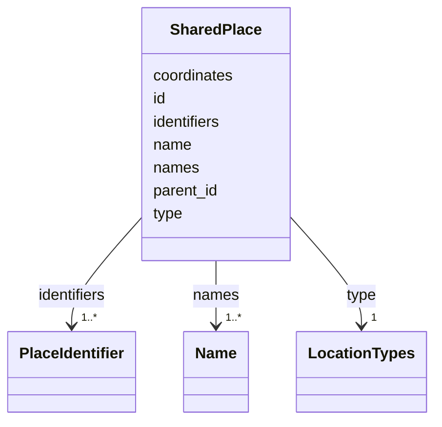

---
search:
  boost: 10.0
---

# Class: SharedPlace 


_One place of the record: its names, its kind, the place it lies in, its coordinates and its outside identifiers._


<div data-search-exclude markdown="1">


URI: [rico:Place](https://www.ica.org/standards/RiC/ontology#Place)





<!-- no inheritance hierarchy -->

## Class Properties

| Property | Value |
| --- | --- |
| Class URI | [rico:Place](https://www.ica.org/standards/RiC/ontology#Place) |


## Slots

| Name | Cardinality and Range | Description | Inheritance |
| ---  | --- | --- | --- |
| [id](id.md) | 1 <br/> [NonBlankText](NonBlankText.md) | The place's id. | direct |
| [name](name.md) | 1 <br/> [NonBlankText](NonBlankText.md) | The name the site shows. | direct |
| [names](names.md) | 1..* <br/> [Name](Name.md) | The place's names. | direct |
| [type](type.md) | 1 <br/> [LocationTypes](LocationTypes.md) | What kind of place it is: a city, a town, a street, a camp and so on. | direct |
| [parent_id](parent_id.md) | 0..1 <br/> [NonBlankText](NonBlankText.md) | The place it lies in, by its id. | direct |
| [coordinates](coordinates.md) | 2..* <br/> [Coordinate](Coordinate.md) | Where it lies: latitude then longitude, in degrees. | direct |
| [identifiers](identifiers.md) | 1..* <br/> [PlaceIdentifier](PlaceIdentifier.md) | The place's outside identifiers, each with its evidence. | direct |


## Usages

| used by | used in | type | used |
| ---  | --- | --- | --- |
| [SharedRecord](SharedRecord.md) | [places](places.md) | range | [SharedPlace](SharedPlace.md) |


## Identifier and Mapping Information


### Schema Source


* from schema: https://pruzhany.org/ns/shared_record


## Mappings

| Mapping Type | Mapped Value |
| ---  | ---  |
| self | rico:Place |
| native | pc:SharedPlace |


## LinkML Source

<!-- TODO: investigate https://stackoverflow.com/questions/37606292/how-to-create-tabbed-code-blocks-in-mkdocs-or-sphinx -->

### Direct

<details>
```yaml
name: SharedPlace
description: 'One place of the record: its names, its kind, the place it lies in,
  its coordinates and its outside identifiers.'
from_schema: https://pruzhany.org/ns/shared_record
rank: 1000
attributes:
  id:
    name: id
    description: The place's id.
    from_schema: https://pruzhany.org/ns/shared_record
    domain_of:
    - SharedPerson
    - SharedFamily
    - Holder
    - SharedPlace
    - SharedOrganization
    - SharedEvent
    - Source
    - Fact
    - Mention
    - PublicMedia
    range: NonBlankText
    required: true
  name:
    name: name
    description: The name the site shows.
    from_schema: https://pruzhany.org/ns/shared_record
    domain_of:
    - SharedPerson
    - SharedFamily
    - Holder
    - SharedPlace
    - SharedOrganization
    - SharedEvent
    range: NonBlankText
    required: true
  names:
    name: names
    description: The place's names.
    from_schema: https://pruzhany.org/ns/shared_record
    domain_of:
    - SharedPerson
    - SharedFamily
    - SharedPlace
    - SharedOrganization
    range: Name
    required: true
    multivalued: true
    inlined_as_list: true
  type:
    name: type
    description: 'What kind of place it is: a city, a town, a street, a camp and so
      on.'
    from_schema: https://pruzhany.org/ns/shared_record
    domain_of:
    - SourcedRelation
    - SharedPlace
    - SharedEvent
    - Fact
    range: LocationTypes
    required: true
  parent_id:
    name: parent_id
    description: The place it lies in, by its id.
    from_schema: https://pruzhany.org/ns/shared_record
    rank: 1000
    slot_uri: rico:isOrWasPartOf
    domain_of:
    - SharedPlace
    range: NonBlankText
  coordinates:
    name: coordinates
    description: 'Where it lies: latitude then longitude, in degrees.'
    from_schema: https://pruzhany.org/ns/shared_record
    rank: 1000
    slot_uri: rico:geographicalCoordinates
    domain_of:
    - SharedPlace
    range: Coordinate
    multivalued: true
    minimum_cardinality: 2
    maximum_cardinality: 2
  identifiers:
    name: identifiers
    description: The place's outside identifiers, each with its evidence.
    from_schema: https://pruzhany.org/ns/shared_record
    slot_uri: rico:hasOrHadIdentifier
    domain_of:
    - Holder
    - SharedPlace
    range: PlaceIdentifier
    multivalued: true
    inlined_as_list: true
    minimum_cardinality: 1
class_uri: rico:Place

```
</details>

### Induced

<details>
```yaml
name: SharedPlace
description: 'One place of the record: its names, its kind, the place it lies in,
  its coordinates and its outside identifiers.'
from_schema: https://pruzhany.org/ns/shared_record
rank: 1000
attributes:
  id:
    name: id
    description: The place's id.
    from_schema: https://pruzhany.org/ns/shared_record
    owner: SharedPlace
    domain_of:
    - SharedPerson
    - SharedFamily
    - Holder
    - SharedPlace
    - SharedOrganization
    - SharedEvent
    - Source
    - Fact
    - Mention
    - PublicMedia
    range: NonBlankText
    required: true
  name:
    name: name
    description: The name the site shows.
    from_schema: https://pruzhany.org/ns/shared_record
    owner: SharedPlace
    domain_of:
    - SharedPerson
    - SharedFamily
    - Holder
    - SharedPlace
    - SharedOrganization
    - SharedEvent
    range: NonBlankText
    required: true
  names:
    name: names
    description: The place's names.
    from_schema: https://pruzhany.org/ns/shared_record
    owner: SharedPlace
    domain_of:
    - SharedPerson
    - SharedFamily
    - SharedPlace
    - SharedOrganization
    range: Name
    required: true
    multivalued: true
    inlined: true
    inlined_as_list: true
  type:
    name: type
    description: 'What kind of place it is: a city, a town, a street, a camp and so
      on.'
    from_schema: https://pruzhany.org/ns/shared_record
    owner: SharedPlace
    domain_of:
    - SourcedRelation
    - SharedPlace
    - SharedEvent
    - Fact
    range: LocationTypes
    required: true
  parent_id:
    name: parent_id
    description: The place it lies in, by its id.
    from_schema: https://pruzhany.org/ns/shared_record
    rank: 1000
    slot_uri: rico:isOrWasPartOf
    owner: SharedPlace
    domain_of:
    - SharedPlace
    range: NonBlankText
  coordinates:
    name: coordinates
    description: 'Where it lies: latitude then longitude, in degrees.'
    from_schema: https://pruzhany.org/ns/shared_record
    rank: 1000
    slot_uri: rico:geographicalCoordinates
    owner: SharedPlace
    domain_of:
    - SharedPlace
    range: Coordinate
    multivalued: true
    minimum_cardinality: 2
    maximum_cardinality: 2
  identifiers:
    name: identifiers
    description: The place's outside identifiers, each with its evidence.
    from_schema: https://pruzhany.org/ns/shared_record
    slot_uri: rico:hasOrHadIdentifier
    owner: SharedPlace
    domain_of:
    - Holder
    - SharedPlace
    range: PlaceIdentifier
    multivalued: true
    inlined: true
    inlined_as_list: true
    minimum_cardinality: 1
class_uri: rico:Place

```
</details></div>
