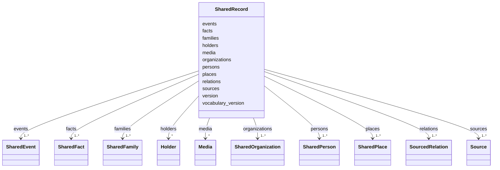

---
search:
  boost: 10.0
---

# Class: SharedRecord 


_The shared record whole: its version, the vocabulary version it uses, and every person, family, place, organisation, event, source, holder, fact, relation and medium._


<div data-search-exclude markdown="1">


URI: [pc:site_shared_record](https://pruzhany.org/ns/sourced-entities#site_shared_record)





<!-- no inheritance hierarchy -->

## Class Properties

| Property | Value |
| --- | --- |
| Class URI | [pc:site_shared_record](https://pruzhany.org/ns/sourced-entities#site_shared_record) |


## Slots

| Name | Cardinality and Range | Description | Inheritance |
| ---  | --- | --- | --- |
| [version](version.md) | 1 <br/> [String](String.md) | The version of the record's shape. | direct |
| [vocabulary_version](vocabulary_version.md) | 1 <br/> [String](String.md) | The version of the sourced-entities vocabulary the record uses. | direct |
| [persons](persons.md) | 1..* <br/> [SharedPerson](SharedPerson.md) | Every person. | direct |
| [families](families.md) | 1..* <br/> [SharedFamily](SharedFamily.md) | Every family. | direct |
| [places](places.md) | 1..* <br/> [SharedPlace](SharedPlace.md) | Every place. | direct |
| [organizations](organizations.md) | 1..* <br/> [SharedOrganization](SharedOrganization.md) | Every organisation. | direct |
| [events](events.md) | 1..* <br/> [SharedEvent](SharedEvent.md) | Every life event, once for each happening. | direct |
| [sources](sources.md) | 1..* <br/> [Source](Source.md) | Every registered source. | direct |
| [holders](holders.md) | * <br/> [Holder](Holder.md) | Every holder of a source. | direct |
| [facts](facts.md) | 1..* <br/> [SharedFact](SharedFact.md) | Every sourced fact. | direct |
| [relations](relations.md) | 1..* <br/> [SourcedRelation](SourcedRelation.md) | Every sourced relation between people. | direct |
| [media](media.md) | * <br/> [Media](Media.md) | Every medium held or linked beside a person. | direct |


## Identifier and Mapping Information


### Schema Source


* from schema: https://pruzhany.org/ns/shared_record


## Mappings

| Mapping Type | Mapped Value |
| ---  | ---  |
| self | pc:site_shared_record |
| native | pc:SharedRecord |


## LinkML Source

<!-- TODO: investigate https://stackoverflow.com/questions/37606292/how-to-create-tabbed-code-blocks-in-mkdocs-or-sphinx -->

### Direct

<details>
```yaml
name: SharedRecord
description: 'The shared record whole: its version, the vocabulary version it uses,
  and every person, family, place, organisation, event, source, holder, fact, relation
  and medium.'
from_schema: https://pruzhany.org/ns/shared_record
rank: 1000
attributes:
  version:
    name: version
    description: The version of the record's shape.
    from_schema: https://pruzhany.org/ns/shared_record
    rank: 1000
    domain_of:
    - SharedRecord
    range: string
    required: true
    equals_string: '1'
  vocabulary_version:
    name: vocabulary_version
    description: The version of the sourced-entities vocabulary the record uses.
    from_schema: https://pruzhany.org/ns/shared_record
    rank: 1000
    domain_of:
    - SharedRecord
    range: string
    required: true
    equals_string: 1.3.0
  persons:
    name: persons
    description: Every person.
    from_schema: https://pruzhany.org/ns/shared_record
    rank: 1000
    domain_of:
    - SharedRecord
    range: SharedPerson
    required: true
    multivalued: true
    inlined_as_list: true
  families:
    name: families
    description: Every family.
    from_schema: https://pruzhany.org/ns/shared_record
    rank: 1000
    domain_of:
    - SharedRecord
    range: SharedFamily
    required: true
    multivalued: true
    inlined_as_list: true
  places:
    name: places
    description: Every place.
    from_schema: https://pruzhany.org/ns/shared_record
    rank: 1000
    domain_of:
    - SharedRecord
    range: SharedPlace
    required: true
    multivalued: true
    inlined_as_list: true
  organizations:
    name: organizations
    description: Every organisation.
    from_schema: https://pruzhany.org/ns/shared_record
    rank: 1000
    domain_of:
    - SharedRecord
    range: SharedOrganization
    required: true
    multivalued: true
    inlined_as_list: true
  events:
    name: events
    description: Every life event, once for each happening.
    from_schema: https://pruzhany.org/ns/shared_record
    rank: 1000
    domain_of:
    - SharedRecord
    range: SharedEvent
    required: true
    multivalued: true
    inlined_as_list: true
  sources:
    name: sources
    description: Every registered source.
    from_schema: https://pruzhany.org/ns/shared_record
    rank: 1000
    domain_of:
    - SharedRecord
    range: Source
    required: true
    multivalued: true
    inlined_as_list: true
  holders:
    name: holders
    description: Every holder of a source.
    from_schema: https://pruzhany.org/ns/shared_record
    rank: 1000
    domain_of:
    - SharedRecord
    range: Holder
    multivalued: true
    inlined_as_list: true
  facts:
    name: facts
    description: Every sourced fact.
    from_schema: https://pruzhany.org/ns/shared_record
    rank: 1000
    domain_of:
    - SharedRecord
    range: SharedFact
    required: true
    multivalued: true
    inlined_as_list: true
  relations:
    name: relations
    description: Every sourced relation between people.
    from_schema: https://pruzhany.org/ns/shared_record
    rank: 1000
    domain_of:
    - SharedRecord
    range: SourcedRelation
    required: true
    multivalued: true
    inlined_as_list: true
  media:
    name: media
    description: Every medium held or linked beside a person.
    from_schema: https://pruzhany.org/ns/shared_record
    rank: 1000
    domain_of:
    - SharedRecord
    range: Media
    multivalued: true
    inlined_as_list: true
class_uri: pc:site_shared_record

```
</details>

### Induced

<details>
```yaml
name: SharedRecord
description: 'The shared record whole: its version, the vocabulary version it uses,
  and every person, family, place, organisation, event, source, holder, fact, relation
  and medium.'
from_schema: https://pruzhany.org/ns/shared_record
rank: 1000
attributes:
  version:
    name: version
    description: The version of the record's shape.
    from_schema: https://pruzhany.org/ns/shared_record
    rank: 1000
    owner: SharedRecord
    domain_of:
    - SharedRecord
    range: string
    required: true
    equals_string: '1'
  vocabulary_version:
    name: vocabulary_version
    description: The version of the sourced-entities vocabulary the record uses.
    from_schema: https://pruzhany.org/ns/shared_record
    rank: 1000
    owner: SharedRecord
    domain_of:
    - SharedRecord
    range: string
    required: true
    equals_string: 1.3.0
  persons:
    name: persons
    description: Every person.
    from_schema: https://pruzhany.org/ns/shared_record
    rank: 1000
    owner: SharedRecord
    domain_of:
    - SharedRecord
    range: SharedPerson
    required: true
    multivalued: true
    inlined: true
    inlined_as_list: true
  families:
    name: families
    description: Every family.
    from_schema: https://pruzhany.org/ns/shared_record
    rank: 1000
    owner: SharedRecord
    domain_of:
    - SharedRecord
    range: SharedFamily
    required: true
    multivalued: true
    inlined: true
    inlined_as_list: true
  places:
    name: places
    description: Every place.
    from_schema: https://pruzhany.org/ns/shared_record
    rank: 1000
    owner: SharedRecord
    domain_of:
    - SharedRecord
    range: SharedPlace
    required: true
    multivalued: true
    inlined: true
    inlined_as_list: true
  organizations:
    name: organizations
    description: Every organisation.
    from_schema: https://pruzhany.org/ns/shared_record
    rank: 1000
    owner: SharedRecord
    domain_of:
    - SharedRecord
    range: SharedOrganization
    required: true
    multivalued: true
    inlined: true
    inlined_as_list: true
  events:
    name: events
    description: Every life event, once for each happening.
    from_schema: https://pruzhany.org/ns/shared_record
    rank: 1000
    owner: SharedRecord
    domain_of:
    - SharedRecord
    range: SharedEvent
    required: true
    multivalued: true
    inlined: true
    inlined_as_list: true
  sources:
    name: sources
    description: Every registered source.
    from_schema: https://pruzhany.org/ns/shared_record
    rank: 1000
    owner: SharedRecord
    domain_of:
    - SharedRecord
    range: Source
    required: true
    multivalued: true
    inlined: true
    inlined_as_list: true
  holders:
    name: holders
    description: Every holder of a source.
    from_schema: https://pruzhany.org/ns/shared_record
    rank: 1000
    owner: SharedRecord
    domain_of:
    - SharedRecord
    range: Holder
    multivalued: true
    inlined: true
    inlined_as_list: true
  facts:
    name: facts
    description: Every sourced fact.
    from_schema: https://pruzhany.org/ns/shared_record
    rank: 1000
    owner: SharedRecord
    domain_of:
    - SharedRecord
    range: SharedFact
    required: true
    multivalued: true
    inlined: true
    inlined_as_list: true
  relations:
    name: relations
    description: Every sourced relation between people.
    from_schema: https://pruzhany.org/ns/shared_record
    rank: 1000
    owner: SharedRecord
    domain_of:
    - SharedRecord
    range: SourcedRelation
    required: true
    multivalued: true
    inlined: true
    inlined_as_list: true
  media:
    name: media
    description: Every medium held or linked beside a person.
    from_schema: https://pruzhany.org/ns/shared_record
    rank: 1000
    owner: SharedRecord
    domain_of:
    - SharedRecord
    range: Media
    multivalued: true
    inlined: true
    inlined_as_list: true
class_uri: pc:site_shared_record

```
</details></div>
