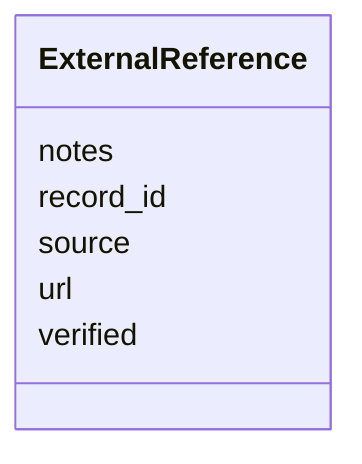

---
search:
  boost: 10.0
---

# Class: ExternalReference 


_A reference to a record in an outside database or resource, such as a page of testimony at Yad Vashem._


<div data-search-exclude markdown="1">


URI: [pc:ExternalReference](https://pruzhany.org/ns/sourced-entities#ExternalReference)





<!-- no inheritance hierarchy -->

## Slots

| Name | Cardinality and Range | Description | Inheritance |
| ---  | --- | --- | --- |
| [source](source.md) | 1 <br/> [String](String.md) | The database or resource, by name, such as yad_vashem or jri_poland. | direct |
| [url](url.md) | 0..1 <br/> [String](String.md) | The record's address; null for a citation of evidence that was looked for and not found. | direct |
| [record_id](record_id.md) | 0..1 <br/> [String](String.md) | The record's identifier in that database. | direct |
| [notes](notes.md) | 0..1 <br/> [String](String.md) | Notes on the record. | direct |
| [verified](verified.md) | 0..1 <br/> [Boolean](Boolean.md) | True when a person has reviewed and confirmed the reference. | direct |


## Identifier and Mapping Information


### Schema Source


* from schema: https://pruzhany.org/ns/shared


## Mappings

| Mapping Type | Mapped Value |
| ---  | ---  |
| self | pc:ExternalReference |
| native | pc:ExternalReference |


## LinkML Source

<!-- TODO: investigate https://stackoverflow.com/questions/37606292/how-to-create-tabbed-code-blocks-in-mkdocs-or-sphinx -->

### Direct

<details>
```yaml
name: ExternalReference
description: A reference to a record in an outside database or resource, such as a
  page of testimony at Yad Vashem.
from_schema: https://pruzhany.org/ns/shared
rank: 1000
attributes:
  source:
    name: source
    description: The database or resource, by name, such as yad_vashem or jri_poland.
    from_schema: https://pruzhany.org/ns/shared
    rank: 1000
    domain_of:
    - ExternalReference
    range: string
    required: true
  url:
    name: url
    description: The record's address; null for a citation of evidence that was looked
      for and not found.
    from_schema: https://pruzhany.org/ns/shared
    rank: 1000
    domain_of:
    - ExternalReference
    range: string
  record_id:
    name: record_id
    description: The record's identifier in that database.
    from_schema: https://pruzhany.org/ns/shared
    rank: 1000
    domain_of:
    - ExternalReference
    range: string
  notes:
    name: notes
    description: Notes on the record.
    from_schema: https://pruzhany.org/ns/shared
    rank: 1000
    domain_of:
    - ExternalReference
    range: string
  verified:
    name: verified
    description: True when a person has reviewed and confirmed the reference.
    from_schema: https://pruzhany.org/ns/shared
    rank: 1000
    domain_of:
    - ExternalReference
    range: boolean

```
</details>

### Induced

<details>
```yaml
name: ExternalReference
description: A reference to a record in an outside database or resource, such as a
  page of testimony at Yad Vashem.
from_schema: https://pruzhany.org/ns/shared
rank: 1000
attributes:
  source:
    name: source
    description: The database or resource, by name, such as yad_vashem or jri_poland.
    from_schema: https://pruzhany.org/ns/shared
    rank: 1000
    owner: ExternalReference
    domain_of:
    - ExternalReference
    range: string
    required: true
  url:
    name: url
    description: The record's address; null for a citation of evidence that was looked
      for and not found.
    from_schema: https://pruzhany.org/ns/shared
    rank: 1000
    owner: ExternalReference
    domain_of:
    - ExternalReference
    range: string
  record_id:
    name: record_id
    description: The record's identifier in that database.
    from_schema: https://pruzhany.org/ns/shared
    rank: 1000
    owner: ExternalReference
    domain_of:
    - ExternalReference
    range: string
  notes:
    name: notes
    description: Notes on the record.
    from_schema: https://pruzhany.org/ns/shared
    rank: 1000
    owner: ExternalReference
    domain_of:
    - ExternalReference
    range: string
  verified:
    name: verified
    description: True when a person has reviewed and confirmed the reference.
    from_schema: https://pruzhany.org/ns/shared
    rank: 1000
    owner: ExternalReference
    domain_of:
    - ExternalReference
    range: boolean

```
</details></div>
