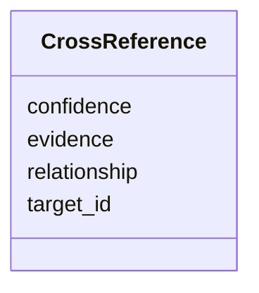

---
search:
  boost: 10.0
---

# Class: CrossReference 


_A link from one content item to another in the same issue, with how sure it is and why._


<div data-search-exclude markdown="1">


URI: [pc:CrossReference](https://pruzhany.org/ns/sourced-entities#CrossReference)





<!-- no inheritance hierarchy -->

## Slots

| Name | Cardinality and Range | Description | Inheritance |
| ---  | --- | --- | --- |
| [target_id](target_id.md) | 1 <br/> [String](String.md) | The id of the content item linked to. | direct |
| [confidence](confidence.md) | 1 <br/> [Float](Float.md) | How sure the link is, from 0 to 1. | direct |
| [relationship](relationship.md) | 1 <br/> [String](String.md) | What kind of link it is, in words. | direct |
| [evidence](evidence.md) | 1 <br/> [String](String.md) | What shows the link, in words. | direct |


## Identifier and Mapping Information


### Schema Source


* from schema: https://pruzhany.org/ns/shared_record


## Mappings

| Mapping Type | Mapped Value |
| ---  | ---  |
| self | pc:CrossReference |
| native | pc:CrossReference |


## LinkML Source

<!-- TODO: investigate https://stackoverflow.com/questions/37606292/how-to-create-tabbed-code-blocks-in-mkdocs-or-sphinx -->

### Direct

<details>
```yaml
name: CrossReference
description: A link from one content item to another in the same issue, with how sure
  it is and why.
from_schema: https://pruzhany.org/ns/shared_record
rank: 1000
attributes:
  target_id:
    name: target_id
    description: The id of the content item linked to.
    from_schema: https://pruzhany.org/ns/site_common
    rank: 1000
    domain_of:
    - CrossReference
    required: true
  confidence:
    name: confidence
    description: How sure the link is, from 0 to 1.
    from_schema: https://pruzhany.org/ns/site_common
    domain_of:
    - Fate
    - CrossReference
    range: float
    required: true
  relationship:
    name: relationship
    description: What kind of link it is, in words.
    from_schema: https://pruzhany.org/ns/site_common
    rank: 1000
    domain_of:
    - CrossReference
    required: true
  evidence:
    name: evidence
    description: What shows the link, in words.
    from_schema: https://pruzhany.org/ns/site_common
    rank: 1000
    domain_of:
    - CrossReference
    required: true

```
</details>

### Induced

<details>
```yaml
name: CrossReference
description: A link from one content item to another in the same issue, with how sure
  it is and why.
from_schema: https://pruzhany.org/ns/shared_record
rank: 1000
attributes:
  target_id:
    name: target_id
    description: The id of the content item linked to.
    from_schema: https://pruzhany.org/ns/site_common
    rank: 1000
    owner: CrossReference
    domain_of:
    - CrossReference
    range: string
    required: true
  confidence:
    name: confidence
    description: How sure the link is, from 0 to 1.
    from_schema: https://pruzhany.org/ns/site_common
    owner: CrossReference
    domain_of:
    - Fate
    - CrossReference
    range: float
    required: true
  relationship:
    name: relationship
    description: What kind of link it is, in words.
    from_schema: https://pruzhany.org/ns/site_common
    rank: 1000
    owner: CrossReference
    domain_of:
    - CrossReference
    range: string
    required: true
  evidence:
    name: evidence
    description: What shows the link, in words.
    from_schema: https://pruzhany.org/ns/site_common
    rank: 1000
    owner: CrossReference
    domain_of:
    - CrossReference
    range: string
    required: true

```
</details></div>
