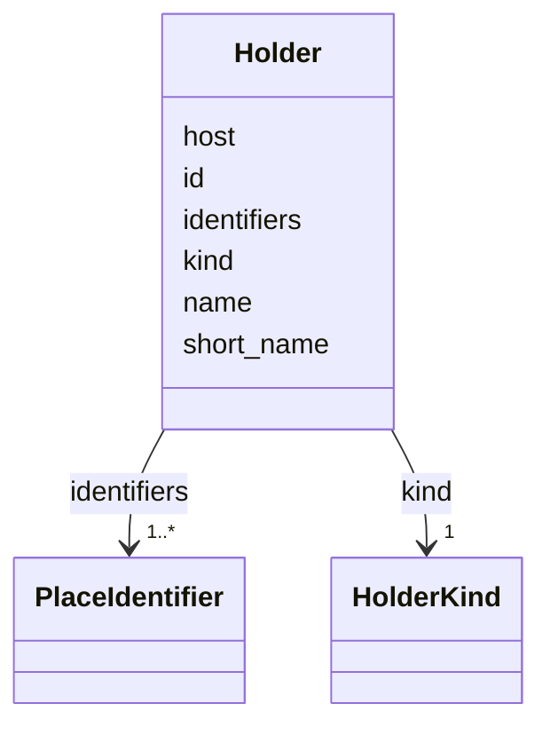

---
search:
  boost: 10.0
---

# Class: Holder 


_Who holds a source: an institution, a family or a private person, with its outside identifiers and its web host. A private holder's name is never published._


<div data-search-exclude markdown="1">


URI: [pc:Holder](https://pruzhany.org/ns/sourced-entities#Holder)





<!-- no inheritance hierarchy -->

## Slots

| Name | Cardinality and Range | Description | Inheritance |
| ---  | --- | --- | --- |
| [id](id.md) | 1 <br/> [NonBlankText](NonBlankText.md) | The holder's id, which sources name. | direct |
| [name](name.md) | 1 <br/> [NonBlankText](NonBlankText.md) | The holder's name. | direct |
| [short_name](short_name.md) | 0..1 <br/> [NonBlankText](NonBlankText.md) | The name the site shows. | direct |
| [kind](kind.md) | 1 <br/> [HolderKind](HolderKind.md) | An institution, a family or a private person. | direct |
| [identifiers](identifiers.md) | 1..* <br/> [PlaceIdentifier](PlaceIdentifier.md) | The holder's outside identifiers, each with its evidence: EHRI's institution id first. | direct |
| [host](host.md) | 0..1 <br/> [HostName](HostName.md) | The holder's web host, without www. | direct |


## Usages

| used by | used in | type | used |
| ---  | --- | --- | --- |
| [SharedRecord](SharedRecord.md) | [holders](holders.md) | range | [Holder](Holder.md) |


## Rules


### 

| Rule Applied | Preconditions | Postconditions | Elseconditions |
|--------------|---------------|----------------|----------------|
| slot_conditions |```{'host': {'value_presence': 'PRESENT'}}``` |```{'host': {'pattern': '^(?!www\\.)'}}``` | |


## Identifier and Mapping Information


### Schema Source


* from schema: https://pruzhany.org/ns/shared_record


## Mappings

| Mapping Type | Mapped Value |
| ---  | ---  |
| self | pc:Holder |
| native | pc:Holder |


## LinkML Source

<!-- TODO: investigate https://stackoverflow.com/questions/37606292/how-to-create-tabbed-code-blocks-in-mkdocs-or-sphinx -->

### Direct

<details>
```yaml
name: Holder
description: 'Who holds a source: an institution, a family or a private person, with
  its outside identifiers and its web host. A private holder''s name is never published.'
from_schema: https://pruzhany.org/ns/shared_record
rank: 1000
attributes:
  id:
    name: id
    description: The holder's id, which sources name.
    from_schema: https://pruzhany.org/ns/shared_record
    domain_of:
    - SharedPerson
    - SharedFamily
    - Holder
    - SharedPlace
    - SharedOrganization
    - SharedEvent
    - Source
    - Fact
    - Mention
    - PublicMedia
    range: NonBlankText
    required: true
  name:
    name: name
    description: The holder's name.
    from_schema: https://pruzhany.org/ns/shared_record
    slot_uri: rico:hasOrHadName
    domain_of:
    - SharedPerson
    - SharedFamily
    - Holder
    - SharedPlace
    - SharedOrganization
    - SharedEvent
    range: NonBlankText
    required: true
  short_name:
    name: short_name
    description: The name the site shows.
    from_schema: https://pruzhany.org/ns/shared_record
    rank: 1000
    slot_uri: rico:hasOrHadName
    domain_of:
    - Holder
    - Source
    range: NonBlankText
  kind:
    name: kind
    description: An institution, a family or a private person.
    from_schema: https://pruzhany.org/ns/shared_record
    rank: 1000
    domain_of:
    - Holder
    - Source
    - Name
    - PublicMedia
    - Authorship
    range: HolderKind
    required: true
  identifiers:
    name: identifiers
    description: 'The holder''s outside identifiers, each with its evidence: EHRI''s
      institution id first.'
    from_schema: https://pruzhany.org/ns/shared_record
    rank: 1000
    slot_uri: rico:hasOrHadIdentifier
    domain_of:
    - Holder
    - SharedPlace
    range: PlaceIdentifier
    multivalued: true
    inlined_as_list: true
    minimum_cardinality: 1
  host:
    name: host
    description: The holder's web host, without www.
    from_schema: https://pruzhany.org/ns/shared_record
    rank: 1000
    domain_of:
    - Holder
    - Source
    range: HostName
rules:
- preconditions:
    slot_conditions:
      host:
        name: host
        value_presence: PRESENT
  postconditions:
    slot_conditions:
      host:
        name: host
        pattern: ^(?!www\.)
  description: A holder's host is written without www.

```
</details>

### Induced

<details>
```yaml
name: Holder
description: 'Who holds a source: an institution, a family or a private person, with
  its outside identifiers and its web host. A private holder''s name is never published.'
from_schema: https://pruzhany.org/ns/shared_record
rank: 1000
attributes:
  id:
    name: id
    description: The holder's id, which sources name.
    from_schema: https://pruzhany.org/ns/shared_record
    owner: Holder
    domain_of:
    - SharedPerson
    - SharedFamily
    - Holder
    - SharedPlace
    - SharedOrganization
    - SharedEvent
    - Source
    - Fact
    - Mention
    - PublicMedia
    range: NonBlankText
    required: true
  name:
    name: name
    description: The holder's name.
    from_schema: https://pruzhany.org/ns/shared_record
    slot_uri: rico:hasOrHadName
    owner: Holder
    domain_of:
    - SharedPerson
    - SharedFamily
    - Holder
    - SharedPlace
    - SharedOrganization
    - SharedEvent
    range: NonBlankText
    required: true
  short_name:
    name: short_name
    description: The name the site shows.
    from_schema: https://pruzhany.org/ns/shared_record
    rank: 1000
    slot_uri: rico:hasOrHadName
    owner: Holder
    domain_of:
    - Holder
    - Source
    range: NonBlankText
  kind:
    name: kind
    description: An institution, a family or a private person.
    from_schema: https://pruzhany.org/ns/shared_record
    rank: 1000
    owner: Holder
    domain_of:
    - Holder
    - Source
    - Name
    - PublicMedia
    - Authorship
    range: HolderKind
    required: true
  identifiers:
    name: identifiers
    description: 'The holder''s outside identifiers, each with its evidence: EHRI''s
      institution id first.'
    from_schema: https://pruzhany.org/ns/shared_record
    rank: 1000
    slot_uri: rico:hasOrHadIdentifier
    owner: Holder
    domain_of:
    - Holder
    - SharedPlace
    range: PlaceIdentifier
    multivalued: true
    inlined: true
    inlined_as_list: true
    minimum_cardinality: 1
  host:
    name: host
    description: The holder's web host, without www.
    from_schema: https://pruzhany.org/ns/shared_record
    rank: 1000
    owner: Holder
    domain_of:
    - Holder
    - Source
    range: HostName
rules:
- preconditions:
    slot_conditions:
      host:
        name: host
        value_presence: PRESENT
  postconditions:
    slot_conditions:
      host:
        name: host
        pattern: ^(?!www\.)
  description: A holder's host is written without www.

```
</details></div>
