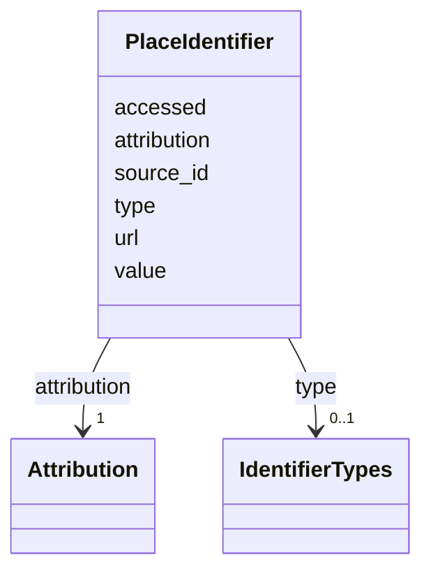

---
search:
  boost: 10.0
---

# Class: PlaceIdentifier 


_One identifier of a person, organisation, place or holder, carried only on evidence, never from a match of names. Outside ids are read on their authority's own pages; merged local ids cite the registered source of the adjudicated merge._


<div data-search-exclude markdown="1">


URI: [rico:Identifier](https://www.ica.org/standards/RiC/ontology#Identifier)





<!-- no inheritance hierarchy -->

## Class Properties

| Property | Value |
| --- | --- |
| Class URI | [rico:Identifier](https://www.ica.org/standards/RiC/ontology#Identifier) |


## Slots

| Name | Cardinality and Range | Description | Inheritance |
| ---  | --- | --- | --- |
| [source_id](source_id.md) | 1 <br/> [NonBlankText](NonBlankText.md) | The authority the identifier comes from, a registered source, by its id. | direct |
| [value](value.md) | 1 <br/> [NonBlankText](NonBlankText.md) | The identifier as its authority writes it. | direct |
| [url](url.md) | 0..1 <br/> [HttpsUri](HttpsUri.md) | The identifier's page on the authority's host. | direct |
| [accessed](accessed.md) | 1 <br/> [IsoDay](IsoDay.md) | The day it was read on its authority's own pages. | direct |
| [attribution](attribution.md) | 1 <br/> [Attribution](Attribution.md) | Who added it, and on what day. | direct |
| [type](type.md) | 0..1 <br/> [IdentifierTypes](IdentifierTypes.md) | old_identifier marks a merged id retained permanently on the surviving record. Absent for an ordinary authority identifier; source_id still names its authority. | direct |


## Usages

| used by | used in | type | used |
| ---  | --- | --- | --- |
| [SharedPerson](SharedPerson.md) | [identifiers](identifiers.md) | range | [PlaceIdentifier](PlaceIdentifier.md) |
| [Holder](Holder.md) | [identifiers](identifiers.md) | range | [PlaceIdentifier](PlaceIdentifier.md) |
| [SharedPlace](SharedPlace.md) | [identifiers](identifiers.md) | range | [PlaceIdentifier](PlaceIdentifier.md) |
| [SharedOrganization](SharedOrganization.md) | [identifiers](identifiers.md) | range | [PlaceIdentifier](PlaceIdentifier.md) |


## Identifier and Mapping Information


### Schema Source


* from schema: https://pruzhany.org/ns/shared_record


## Mappings

| Mapping Type | Mapped Value |
| ---  | ---  |
| self | rico:Identifier |
| native | pc:PlaceIdentifier |


## LinkML Source

<!-- TODO: investigate https://stackoverflow.com/questions/37606292/how-to-create-tabbed-code-blocks-in-mkdocs-or-sphinx -->

### Direct

<details>
```yaml
name: PlaceIdentifier
description: One identifier of a person, organisation, place or holder, carried only
  on evidence, never from a match of names. Outside ids are read on their authority's
  own pages; merged local ids cite the registered source of the adjudicated merge.
from_schema: https://pruzhany.org/ns/shared_record
rank: 1000
attributes:
  source_id:
    name: source_id
    description: The authority the identifier comes from, a registered source, by
      its id.
    from_schema: https://pruzhany.org/ns/shared_record
    rank: 1000
    slot_uri: rico:hasIdentifierType
    domain_of:
    - PlaceIdentifier
    - SourceDerivation
    - Citation
    - MediaFamilyWords
    - PublicMedia
    range: NonBlankText
    required: true
  value:
    name: value
    description: The identifier as its authority writes it.
    from_schema: https://pruzhany.org/ns/shared_record
    rank: 1000
    slot_uri: rico:textualValue
    domain_of:
    - PlaceIdentifier
    - Fact
    - Name
    range: NonBlankText
    required: true
  url:
    name: url
    description: The identifier's page on the authority's host.
    from_schema: https://pruzhany.org/ns/shared_record
    rank: 1000
    domain_of:
    - PlaceIdentifier
    - Citation
    - MediaDerivative
    range: HttpsUri
  accessed:
    name: accessed
    description: The day it was read on its authority's own pages.
    from_schema: https://pruzhany.org/ns/shared_record
    related_mappings:
    - pc:site_identifier_reading
    rank: 1000
    domain_of:
    - PlaceIdentifier
    - Citation
    range: IsoDay
    required: true
  attribution:
    name: attribution
    description: Who added it, and on what day.
    from_schema: https://pruzhany.org/ns/shared_record
    related_mappings:
    - pc:site_identifier_reading
    rank: 1000
    domain_of:
    - PlaceIdentifier
    - Fact
    - Name
    - EnglishCheck
    - SuppliedTitle
    - Translation
    range: Attribution
    required: true
    inlined: true
  type:
    name: type
    description: old_identifier marks a merged id retained permanently on the surviving
      record. Absent for an ordinary authority identifier; source_id still names its
      authority.
    from_schema: https://pruzhany.org/ns/shared_record
    slot_uri: rico:hasIdentifierType
    domain_of:
    - SourcedRelation
    - PlaceIdentifier
    - SharedPlace
    - SharedEvent
    - Fact
    range: IdentifierTypes
class_uri: rico:Identifier

```
</details>

### Induced

<details>
```yaml
name: PlaceIdentifier
description: One identifier of a person, organisation, place or holder, carried only
  on evidence, never from a match of names. Outside ids are read on their authority's
  own pages; merged local ids cite the registered source of the adjudicated merge.
from_schema: https://pruzhany.org/ns/shared_record
rank: 1000
attributes:
  source_id:
    name: source_id
    description: The authority the identifier comes from, a registered source, by
      its id.
    from_schema: https://pruzhany.org/ns/shared_record
    rank: 1000
    slot_uri: rico:hasIdentifierType
    owner: PlaceIdentifier
    domain_of:
    - PlaceIdentifier
    - SourceDerivation
    - Citation
    - MediaFamilyWords
    - PublicMedia
    range: NonBlankText
    required: true
  value:
    name: value
    description: The identifier as its authority writes it.
    from_schema: https://pruzhany.org/ns/shared_record
    rank: 1000
    slot_uri: rico:textualValue
    owner: PlaceIdentifier
    domain_of:
    - PlaceIdentifier
    - Fact
    - Name
    range: NonBlankText
    required: true
  url:
    name: url
    description: The identifier's page on the authority's host.
    from_schema: https://pruzhany.org/ns/shared_record
    rank: 1000
    owner: PlaceIdentifier
    domain_of:
    - PlaceIdentifier
    - Citation
    - MediaDerivative
    range: HttpsUri
  accessed:
    name: accessed
    description: The day it was read on its authority's own pages.
    from_schema: https://pruzhany.org/ns/shared_record
    related_mappings:
    - pc:site_identifier_reading
    rank: 1000
    owner: PlaceIdentifier
    domain_of:
    - PlaceIdentifier
    - Citation
    range: IsoDay
    required: true
  attribution:
    name: attribution
    description: Who added it, and on what day.
    from_schema: https://pruzhany.org/ns/shared_record
    related_mappings:
    - pc:site_identifier_reading
    rank: 1000
    owner: PlaceIdentifier
    domain_of:
    - PlaceIdentifier
    - Fact
    - Name
    - EnglishCheck
    - SuppliedTitle
    - Translation
    range: Attribution
    required: true
    inlined: true
  type:
    name: type
    description: old_identifier marks a merged id retained permanently on the surviving
      record. Absent for an ordinary authority identifier; source_id still names its
      authority.
    from_schema: https://pruzhany.org/ns/shared_record
    slot_uri: rico:hasIdentifierType
    owner: PlaceIdentifier
    domain_of:
    - SourcedRelation
    - PlaceIdentifier
    - SharedPlace
    - SharedEvent
    - Fact
    range: IdentifierTypes
class_uri: rico:Identifier

```
</details></div>
