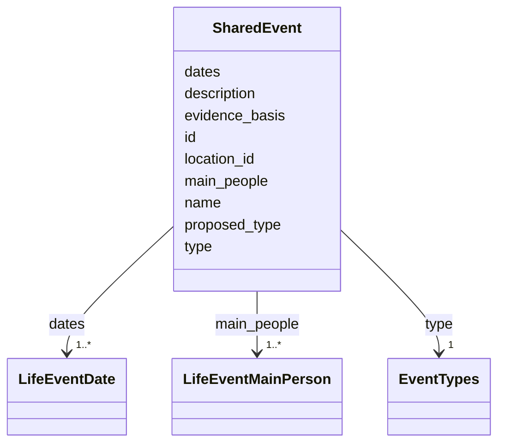

---
search:
  boost: 10.0
---

# Class: SharedEvent 


_One life event, once for each happening across every issue (a birth, a wedding, a death, a memorial and so on): its kind, its main people and their parts, its dates and its place._


<div data-search-exclude markdown="1">


URI: [rico:Event](https://www.ica.org/standards/RiC/ontology#Event)





<!-- no inheritance hierarchy -->

## Class Properties

| Property | Value |
| --- | --- |
| Class URI | [rico:Event](https://www.ica.org/standards/RiC/ontology#Event) |


## Slots

| Name | Cardinality and Range | Description | Inheritance |
| ---  | --- | --- | --- |
| [id](id.md) | 1 <br/> [NonBlankText](NonBlankText.md) | The event's id, which each issue's life events name. | direct |
| [name](name.md) | 1 <br/> [NonBlankText](NonBlankText.md) | The event's name. | direct |
| [type](type.md) | 1 <br/> [EventTypes](EventTypes.md) | The one kind of the event. | direct |
| [proposed_type](proposed_type.md) | 0..1 <br/> [NonBlankText](NonBlankText.md) | For an event of kind other: the kind proposed for it, awaiting the owner's approval. | direct |
| [main_people](main_people.md) | 1..* <br/> [LifeEventMainPerson](LifeEventMainPerson.md) | The people the event is about, each with their part; empty while unresolved. | direct |
| [evidence_basis](evidence_basis.md) | 0..1 <br/> [String](String.md) | records_only: a death known from records alone, which no issue prints. | direct |
| [dates](dates.md) | 1..* <br/> [LifeEventDate](LifeEventDate.md) | The event's dates: as printed (in either calendar), or the first report's day, or the preferred record statement's. | direct |
| [location_id](location_id.md) | 0..1 <br/> [NonBlankText](NonBlankText.md) | Where the event happened, by the place's id. | direct |
| [description](description.md) | 0..1 <br/> [String](String.md) | A short description in words. | direct |

<details>
<summary>Expressions & Logic</summary>
#### None Of

The class must not satisfy any of:
- AnonymousClassExpression({
  'description': "An event's proposed kind is never a released kind.",
  'slot_conditions': {'proposed_type': SlotDefinition({
      'name': 'proposed_type',
      'equals_string_in': ['engagement', 'wedding', 'birth', 'death', 'bar_mitzvah', 'celebration',
        'community_event', 'holocaust_event', 'other', 'memorial']
    })}
})

</details>


## Usages

| used by | used in | type | used |
| ---  | --- | --- | --- |
| [SharedRecord](SharedRecord.md) | [events](events.md) | range | [SharedEvent](SharedEvent.md) |


## Rules


### 

| Rule Applied | Preconditions | Postconditions | Elseconditions |
|--------------|---------------|----------------|----------------|
| slot_conditions |```{'type': {'equals_string': 'other'}}``` |```{'proposed_type': {'required': True}}``` |```{'proposed_type': {'value_presence': 'ABSENT'}}``` |


## Identifier and Mapping Information


### Schema Source


* from schema: https://pruzhany.org/ns/shared_record


## Mappings

| Mapping Type | Mapped Value |
| ---  | ---  |
| self | rico:Event |
| native | pc:SharedEvent |


## LinkML Source

<!-- TODO: investigate https://stackoverflow.com/questions/37606292/how-to-create-tabbed-code-blocks-in-mkdocs-or-sphinx -->

### Direct

<details>
```yaml
name: SharedEvent
description: 'One life event, once for each happening across every issue (a birth,
  a wedding, a death, a memorial and so on): its kind, its main people and their parts,
  its dates and its place.'
from_schema: https://pruzhany.org/ns/shared_record
rank: 1000
attributes:
  id:
    name: id
    description: The event's id, which each issue's life events name.
    from_schema: https://pruzhany.org/ns/shared_record
    domain_of:
    - SharedPerson
    - SharedFamily
    - Holder
    - SharedPlace
    - SharedOrganization
    - SharedEvent
    - Source
    - Fact
    - Mention
    - PublicMedia
    range: NonBlankText
    required: true
  name:
    name: name
    description: The event's name.
    from_schema: https://pruzhany.org/ns/shared_record
    domain_of:
    - SharedPerson
    - SharedFamily
    - Holder
    - SharedPlace
    - SharedOrganization
    - SharedEvent
    range: NonBlankText
    required: true
  type:
    name: type
    description: The one kind of the event.
    from_schema: https://pruzhany.org/ns/shared_record
    slot_uri: rico:hasEventType
    domain_of:
    - SourcedRelation
    - PlaceIdentifier
    - SharedPlace
    - SharedEvent
    - Fact
    range: EventTypes
    required: true
  proposed_type:
    name: proposed_type
    description: 'For an event of kind other: the kind proposed for it, awaiting the
      owner''s approval.'
    from_schema: https://pruzhany.org/ns/shared_record
    rank: 1000
    domain_of:
    - SharedEvent
    - Fact
    range: NonBlankText
  main_people:
    name: main_people
    description: The people the event is about, each with their part; empty while
      unresolved.
    from_schema: https://pruzhany.org/ns/shared_record
    rank: 1000
    slot_uri: rico:hasOrHadParticipant
    domain_of:
    - SharedEvent
    range: LifeEventMainPerson
    required: true
    multivalued: true
    inlined_as_list: true
  evidence_basis:
    name: evidence_basis
    description: 'records_only: a death known from records alone, which no issue prints.'
    from_schema: https://pruzhany.org/ns/shared_record
    rank: 1000
    slot_uri: pc:site_event_evidence_basis
    domain_of:
    - SharedEvent
    range: string
    equals_string: records_only
  dates:
    name: dates
    description: 'The event''s dates: as printed (in either calendar), or the first
      report''s day, or the preferred record statement''s.'
    from_schema: https://pruzhany.org/ns/shared_record
    rank: 1000
    domain_of:
    - SharedEvent
    range: LifeEventDate
    required: true
    multivalued: true
    inlined_as_list: true
    minimum_cardinality: 1
  location_id:
    name: location_id
    description: Where the event happened, by the place's id.
    from_schema: https://pruzhany.org/ns/shared_record
    rank: 1000
    domain_of:
    - SharedEvent
    range: NonBlankText
  description:
    name: description
    description: A short description in words.
    from_schema: https://pruzhany.org/ns/shared_record
    rank: 1000
    domain_of:
    - SharedEvent
    range: string
class_uri: rico:Event
rules:
- preconditions:
    slot_conditions:
      type:
        name: type
        equals_string: other
  postconditions:
    slot_conditions:
      proposed_type:
        name: proposed_type
        required: true
  elseconditions:
    slot_conditions:
      proposed_type:
        name: proposed_type
        value_presence: ABSENT
  description: An event of kind other has a proposed kind, and only such an event
    has one.
none_of:
- description: An event's proposed kind is never a released kind.
  slot_conditions:
    proposed_type:
      name: proposed_type
      equals_string_in:
      - engagement
      - wedding
      - birth
      - death
      - bar_mitzvah
      - celebration
      - community_event
      - holocaust_event
      - other
      - memorial

```
</details>

### Induced

<details>
```yaml
name: SharedEvent
description: 'One life event, once for each happening across every issue (a birth,
  a wedding, a death, a memorial and so on): its kind, its main people and their parts,
  its dates and its place.'
from_schema: https://pruzhany.org/ns/shared_record
rank: 1000
attributes:
  id:
    name: id
    description: The event's id, which each issue's life events name.
    from_schema: https://pruzhany.org/ns/shared_record
    owner: SharedEvent
    domain_of:
    - SharedPerson
    - SharedFamily
    - Holder
    - SharedPlace
    - SharedOrganization
    - SharedEvent
    - Source
    - Fact
    - Mention
    - PublicMedia
    range: NonBlankText
    required: true
  name:
    name: name
    description: The event's name.
    from_schema: https://pruzhany.org/ns/shared_record
    owner: SharedEvent
    domain_of:
    - SharedPerson
    - SharedFamily
    - Holder
    - SharedPlace
    - SharedOrganization
    - SharedEvent
    range: NonBlankText
    required: true
  type:
    name: type
    description: The one kind of the event.
    from_schema: https://pruzhany.org/ns/shared_record
    slot_uri: rico:hasEventType
    owner: SharedEvent
    domain_of:
    - SourcedRelation
    - PlaceIdentifier
    - SharedPlace
    - SharedEvent
    - Fact
    range: EventTypes
    required: true
  proposed_type:
    name: proposed_type
    description: 'For an event of kind other: the kind proposed for it, awaiting the
      owner''s approval.'
    from_schema: https://pruzhany.org/ns/shared_record
    rank: 1000
    owner: SharedEvent
    domain_of:
    - SharedEvent
    - Fact
    range: NonBlankText
  main_people:
    name: main_people
    description: The people the event is about, each with their part; empty while
      unresolved.
    from_schema: https://pruzhany.org/ns/shared_record
    rank: 1000
    slot_uri: rico:hasOrHadParticipant
    owner: SharedEvent
    domain_of:
    - SharedEvent
    range: LifeEventMainPerson
    required: true
    multivalued: true
    inlined: true
    inlined_as_list: true
  evidence_basis:
    name: evidence_basis
    description: 'records_only: a death known from records alone, which no issue prints.'
    from_schema: https://pruzhany.org/ns/shared_record
    rank: 1000
    slot_uri: pc:site_event_evidence_basis
    owner: SharedEvent
    domain_of:
    - SharedEvent
    range: string
    equals_string: records_only
  dates:
    name: dates
    description: 'The event''s dates: as printed (in either calendar), or the first
      report''s day, or the preferred record statement''s.'
    from_schema: https://pruzhany.org/ns/shared_record
    rank: 1000
    owner: SharedEvent
    domain_of:
    - SharedEvent
    range: LifeEventDate
    required: true
    multivalued: true
    inlined: true
    inlined_as_list: true
    minimum_cardinality: 1
  location_id:
    name: location_id
    description: Where the event happened, by the place's id.
    from_schema: https://pruzhany.org/ns/shared_record
    rank: 1000
    owner: SharedEvent
    domain_of:
    - SharedEvent
    range: NonBlankText
  description:
    name: description
    description: A short description in words.
    from_schema: https://pruzhany.org/ns/shared_record
    rank: 1000
    owner: SharedEvent
    domain_of:
    - SharedEvent
    range: string
class_uri: rico:Event
rules:
- preconditions:
    slot_conditions:
      type:
        name: type
        equals_string: other
  postconditions:
    slot_conditions:
      proposed_type:
        name: proposed_type
        required: true
  elseconditions:
    slot_conditions:
      proposed_type:
        name: proposed_type
        value_presence: ABSENT
  description: An event of kind other has a proposed kind, and only such an event
    has one.
none_of:
- description: An event's proposed kind is never a released kind.
  slot_conditions:
    proposed_type:
      name: proposed_type
      equals_string_in:
      - engagement
      - wedding
      - birth
      - death
      - bar_mitzvah
      - celebration
      - community_event
      - holocaust_event
      - other
      - memorial

```
</details></div>
