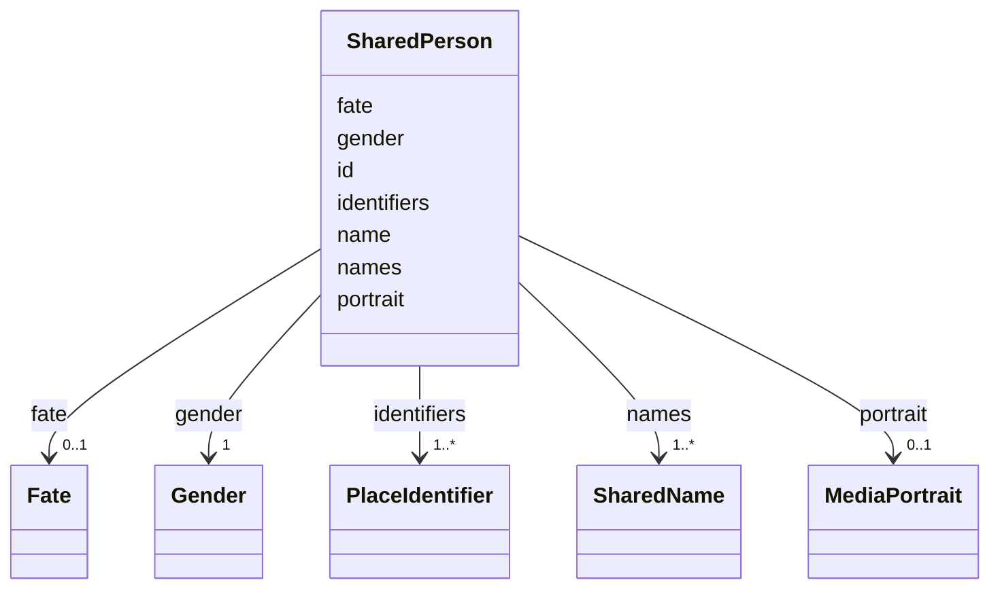

---
search:
  boost: 10.0
---

# Class: SharedPerson 


_One person of the record, across every issue: their id, the name shown, every name they are known by, their gender, what became of them, their portrait and evidenced identifiers._


<div data-search-exclude markdown="1">


URI: [ehri:Person](http://lod.ehri-project-test.eu/ontology#Person)





<!-- no inheritance hierarchy -->

## Class Properties

| Property | Value |
| --- | --- |
| Class URI | [ehri:Person](http://lod.ehri-project-test.eu/ontology#Person) |


## Slots

| Name | Cardinality and Range | Description | Inheritance |
| ---  | --- | --- | --- |
| [portrait](portrait.md) | 0..1 <br/> [MediaPortrait](MediaPortrait.md) | The reviewed picture and region the person's page shows. | direct |
| [id](id.md) | 1 <br/> [NonBlankText](NonBlankText.md) | The person's id, kept for ever: never renamed, reused or deleted. | direct |
| [name](name.md) | 1 <br/> [NonBlankText](NonBlankText.md) | The name the site shows. | direct |
| [names](names.md) | 1..* <br/> [SharedName](SharedName.md) | Every name the person is known by, printed or supplied, with where it is found. | direct |
| [gender](gender.md) | 1 <br/> [Gender](Gender.md) | The person's gender, or unknown. | direct |
| [fate](fate.md) | 0..1 <br/> [Fate](Fate.md) | What became of the person in the Holocaust, as far as the record shows. | direct |
| [identifiers](identifiers.md) | 1..* <br/> [PlaceIdentifier](PlaceIdentifier.md) | Evidenced identifiers of this person, never inferred from a name match. A merged local id is kept here as an old_identifier on the surviving record. | direct |


## Usages

| used by | used in | type | used |
| ---  | --- | --- | --- |
| [SharedRecord](SharedRecord.md) | [persons](persons.md) | range | [SharedPerson](SharedPerson.md) |


## Identifier and Mapping Information


### Schema Source


* from schema: https://pruzhany.org/ns/shared_record


## Mappings

| Mapping Type | Mapped Value |
| ---  | ---  |
| self | ehri:Person |
| native | pc:SharedPerson |


## LinkML Source

<!-- TODO: investigate https://stackoverflow.com/questions/37606292/how-to-create-tabbed-code-blocks-in-mkdocs-or-sphinx -->

### Direct

<details>
```yaml
name: SharedPerson
description: 'One person of the record, across every issue: their id, the name shown,
  every name they are known by, their gender, what became of them, their portrait
  and evidenced identifiers.'
from_schema: https://pruzhany.org/ns/shared_record
rank: 1000
attributes:
  portrait:
    name: portrait
    description: The reviewed picture and region the person's page shows.
    from_schema: https://pruzhany.org/ns/shared_record
    rank: 1000
    slot_uri: pc:media_portrait
    domain_of:
    - SharedPerson
    range: MediaPortrait
    inlined: true
  id:
    name: id
    description: 'The person''s id, kept for ever: never renamed, reused or deleted.'
    from_schema: https://pruzhany.org/ns/shared_record
    rank: 1000
    domain_of:
    - SharedPerson
    - SharedFamily
    - Holder
    - SharedPlace
    - SharedOrganization
    - SharedEvent
    - Source
    - Fact
    - Mention
    - PublicMedia
    range: NonBlankText
    required: true
  name:
    name: name
    description: The name the site shows.
    from_schema: https://pruzhany.org/ns/shared_record
    rank: 1000
    domain_of:
    - SharedPerson
    - SharedFamily
    - Holder
    - SharedPlace
    - SharedOrganization
    - SharedEvent
    range: NonBlankText
    required: true
  names:
    name: names
    description: Every name the person is known by, printed or supplied, with where
      it is found.
    from_schema: https://pruzhany.org/ns/shared_record
    rank: 1000
    slot_uri: rico:hasOrHadAgentName
    domain_of:
    - SharedPerson
    - SharedFamily
    - SharedPlace
    - SharedOrganization
    range: SharedName
    required: true
    multivalued: true
    inlined_as_list: true
  gender:
    name: gender
    description: The person's gender, or unknown.
    from_schema: https://pruzhany.org/ns/shared_record
    rank: 1000
    domain_of:
    - SharedPerson
    range: Gender
    required: true
  fate:
    name: fate
    description: What became of the person in the Holocaust, as far as the record
      shows.
    from_schema: https://pruzhany.org/ns/shared_record
    rank: 1000
    domain_of:
    - SharedPerson
    range: Fate
    inlined: true
  identifiers:
    name: identifiers
    description: Evidenced identifiers of this person, never inferred from a name
      match. A merged local id is kept here as an old_identifier on the surviving
      record.
    from_schema: https://pruzhany.org/ns/shared_record
    rank: 1000
    slot_uri: rico:hasOrHadIdentifier
    domain_of:
    - SharedPerson
    - Holder
    - SharedPlace
    - SharedOrganization
    range: PlaceIdentifier
    multivalued: true
    inlined_as_list: true
    minimum_cardinality: 1
class_uri: ehri:Person

```
</details>

### Induced

<details>
```yaml
name: SharedPerson
description: 'One person of the record, across every issue: their id, the name shown,
  every name they are known by, their gender, what became of them, their portrait
  and evidenced identifiers.'
from_schema: https://pruzhany.org/ns/shared_record
rank: 1000
attributes:
  portrait:
    name: portrait
    description: The reviewed picture and region the person's page shows.
    from_schema: https://pruzhany.org/ns/shared_record
    rank: 1000
    slot_uri: pc:media_portrait
    owner: SharedPerson
    domain_of:
    - SharedPerson
    range: MediaPortrait
    inlined: true
  id:
    name: id
    description: 'The person''s id, kept for ever: never renamed, reused or deleted.'
    from_schema: https://pruzhany.org/ns/shared_record
    rank: 1000
    owner: SharedPerson
    domain_of:
    - SharedPerson
    - SharedFamily
    - Holder
    - SharedPlace
    - SharedOrganization
    - SharedEvent
    - Source
    - Fact
    - Mention
    - PublicMedia
    range: NonBlankText
    required: true
  name:
    name: name
    description: The name the site shows.
    from_schema: https://pruzhany.org/ns/shared_record
    rank: 1000
    owner: SharedPerson
    domain_of:
    - SharedPerson
    - SharedFamily
    - Holder
    - SharedPlace
    - SharedOrganization
    - SharedEvent
    range: NonBlankText
    required: true
  names:
    name: names
    description: Every name the person is known by, printed or supplied, with where
      it is found.
    from_schema: https://pruzhany.org/ns/shared_record
    rank: 1000
    slot_uri: rico:hasOrHadAgentName
    owner: SharedPerson
    domain_of:
    - SharedPerson
    - SharedFamily
    - SharedPlace
    - SharedOrganization
    range: SharedName
    required: true
    multivalued: true
    inlined: true
    inlined_as_list: true
  gender:
    name: gender
    description: The person's gender, or unknown.
    from_schema: https://pruzhany.org/ns/shared_record
    rank: 1000
    owner: SharedPerson
    domain_of:
    - SharedPerson
    range: Gender
    required: true
  fate:
    name: fate
    description: What became of the person in the Holocaust, as far as the record
      shows.
    from_schema: https://pruzhany.org/ns/shared_record
    rank: 1000
    owner: SharedPerson
    domain_of:
    - SharedPerson
    range: Fate
    inlined: true
  identifiers:
    name: identifiers
    description: Evidenced identifiers of this person, never inferred from a name
      match. A merged local id is kept here as an old_identifier on the surviving
      record.
    from_schema: https://pruzhany.org/ns/shared_record
    rank: 1000
    slot_uri: rico:hasOrHadIdentifier
    owner: SharedPerson
    domain_of:
    - SharedPerson
    - Holder
    - SharedPlace
    - SharedOrganization
    range: PlaceIdentifier
    multivalued: true
    inlined: true
    inlined_as_list: true
    minimum_cardinality: 1
class_uri: ehri:Person

```
</details></div>
