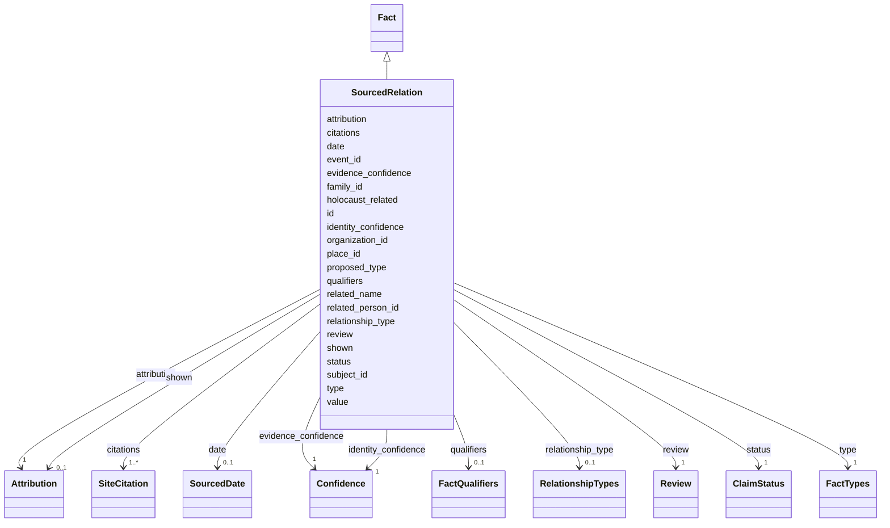

---
search:
  boost: 10.0
---

# Class: SourcedRelation 


_One source's statement that a person is related to another, from the subject to the relative, of a released kinship type, or of type other with a proposed type._


<div data-search-exclude markdown="1">


URI: [rico:Relation](https://www.ica.org/standards/RiC/ontology#Relation)





## Inheritance
* [Fact](Fact.md)
    * **SourcedRelation**


## Class Properties

| Property | Value |
| --- | --- |
| Class URI | [rico:Relation](https://www.ica.org/standards/RiC/ontology#Relation) |


## Slots

| Name | Cardinality and Range | Description | Inheritance |
| ---  | --- | --- | --- |
| [type](type.md) | 1 <br/> [FactTypes](FactTypes.md) | kinship for a released relationship type; other, with a proposed type, for one not yet released. | direct |
| [citations](citations.md) | 1..* <br/> [SiteCitation](SiteCitation.md) | The evidence: where in which sources the relation is found. | direct |
| [subject_id](subject_id.md) | 1 <br/> [NonBlankText](NonBlankText.md) | The person the relation goes from, by the person's id. | direct |
| [family_id](family_id.md) | 0..1 <br/> [NonBlankText](NonBlankText.md) | The family the relation concerns, by its id. | direct |
| [shown](shown.md) | 0..1 <br/> [Attribution](Attribution.md) | Who allowed the relative to be shown on the person's page, and on what day; never evidence of a death. | direct |
| [id](id.md) | 1 <br/> [NonBlankText](NonBlankText.md) | The fact's id in the record. | [Fact](Fact.md) |
| [proposed_type](proposed_type.md) | 0..1 <br/> [NonBlankText](NonBlankText.md) | For a statement of type other: the type proposed for it, awaiting the owner's approval. | [Fact](Fact.md) |
| [value](value.md) | 0..1 <br/> [NonBlankText](NonBlankText.md) | The statement's words or value, such as an occupation. | [Fact](Fact.md) |
| [date](date.md) | 0..1 <br/> [SourcedDate](SourcedDate.md) | When, as the source gives it. | [Fact](Fact.md) |
| [place_id](place_id.md) | 0..1 <br/> [NonBlankText](NonBlankText.md) | Where, by the place's id in the record. | [Fact](Fact.md) |
| [organization_id](organization_id.md) | 0..1 <br/> [NonBlankText](NonBlankText.md) | The organisation the statement concerns, by its id in the record. | [Fact](Fact.md) |
| [event_id](event_id.md) | 0..1 <br/> [NonBlankText](NonBlankText.md) | The life event the statement concerns, by its id in the record. | [Fact](Fact.md) |
| [related_person_id](related_person_id.md) | 0..1 <br/> [NonBlankText](NonBlankText.md) | For kinship: the relative, by the person's id in the record. | [Fact](Fact.md) |
| [relationship_type](relationship_type.md) | 0..1 <br/> [RelationshipTypes](RelationshipTypes.md) | For kinship: how the relative is related, from the subject to the relative. | [Fact](Fact.md) |
| [related_name](related_name.md) | 0..1 <br/> [NonBlankText](NonBlankText.md) | For kinship: the relative's name, where the relative has no person of their own. | [Fact](Fact.md) |
| [qualifiers](qualifiers.md) | 0..1 <br/> [FactQualifiers](FactQualifiers.md) | More about the statement, as named texts. | [Fact](Fact.md) |
| [holocaust_related](holocaust_related.md) | 0..1 <br/> [Boolean](Boolean.md) | True when the statement concerns the Holocaust. | [Fact](Fact.md) |
| [evidence_confidence](evidence_confidence.md) | 1 <br/> [Confidence](Confidence.md) | How sure the evidence makes the statement. | [Fact](Fact.md) |
| [identity_confidence](identity_confidence.md) | 1 <br/> [Confidence](Confidence.md) | How sure it is that the statement is about this person. | [Fact](Fact.md) |
| [status](status.md) | 1 <br/> [ClaimStatus](ClaimStatus.md) | The statement's standing: proposed, accepted, disputed or rejected. | [Fact](Fact.md) |
| [review](review.md) | 1 <br/> [Review](Review.md) | Whether a person has reviewed the statement. | [Fact](Fact.md) |
| [attribution](attribution.md) | 1 <br/> [Attribution](Attribution.md) | Who recorded the statement, and on what day. | [Fact](Fact.md) |

<details>
<summary>Expressions & Logic</summary>
#### Any Of

The class must satisfy at least one of:
- AnonymousClassExpression({
  'description': 'A relation names the relative as a person or by an unresolved name.',
  'slot_conditions': {'related_person_id': SlotDefinition({'name': 'related_person_id', 'required': True})}
})
- AnonymousClassExpression({
  'slot_conditions': {'related_name': SlotDefinition({'name': 'related_name', 'required': True})}
})

</details>


## Usages

| used by | used in | type | used |
| ---  | --- | --- | --- |
| [SharedRecord](SharedRecord.md) | [relations](relations.md) | range | [SourcedRelation](SourcedRelation.md) |


## Rules


### 

| Rule Applied | Preconditions | Postconditions | Elseconditions |
|--------------|---------------|----------------|----------------|
| slot_conditions |```{'type': {'equals_string': 'other'}}``` |```{'relationship_type': {'value_presence': 'ABSENT'}}``` | |


## Identifier and Mapping Information


### Schema Source


* from schema: https://pruzhany.org/ns/shared_record


## Mappings

| Mapping Type | Mapped Value |
| ---  | ---  |
| self | rico:Relation |
| native | pc:SourcedRelation |


## LinkML Source

<!-- TODO: investigate https://stackoverflow.com/questions/37606292/how-to-create-tabbed-code-blocks-in-mkdocs-or-sphinx -->

### Direct

<details>
```yaml
name: SourcedRelation
description: One source's statement that a person is related to another, from the
  subject to the relative, of a released kinship type, or of type other with a proposed
  type.
from_schema: https://pruzhany.org/ns/shared_record
rank: 1000
is_a: Fact
attributes:
  type:
    name: type
    description: kinship for a released relationship type; other, with a proposed
      type, for one not yet released.
    from_schema: https://pruzhany.org/ns/shared_record
    rank: 1000
    domain_of:
    - SourcedRelation
    - PlaceIdentifier
    - SharedPlace
    - SharedEvent
    - Fact
    range: FactTypes
    required: true
    equals_string_in:
    - kinship
    - other
  citations:
    name: citations
    description: 'The evidence: where in which sources the relation is found.'
    from_schema: https://pruzhany.org/ns/shared_record
    domain_of:
    - SharedName
    - SharedFact
    - SourcedRelation
    - Fact
    - Name
    range: SiteCitation
    required: true
    multivalued: true
    inlined_as_list: true
    minimum_cardinality: 1
  subject_id:
    name: subject_id
    description: The person the relation goes from, by the person's id.
    from_schema: https://pruzhany.org/ns/shared_record
    slot_uri: pc:site_fact_subject
    domain_of:
    - SharedFact
    - SourcedRelation
    range: NonBlankText
    required: true
  family_id:
    name: family_id
    description: The family the relation concerns, by its id.
    from_schema: https://pruzhany.org/ns/shared_record
    domain_of:
    - SharedFact
    - SourcedRelation
    range: NonBlankText
  shown:
    name: shown
    description: Who allowed the relative to be shown on the person's page, and on
      what day; never evidence of a death.
    from_schema: https://pruzhany.org/ns/shared_record
    rank: 1000
    slot_uri: pc:site_display_permission
    domain_of:
    - SourcedRelation
    range: Attribution
    inlined: true
class_uri: rico:Relation
rules:
- preconditions:
    slot_conditions:
      type:
        name: type
        equals_string: other
  postconditions:
    slot_conditions:
      relationship_type:
        name: relationship_type
        value_presence: ABSENT
  description: A relation of type other has no released relationship type.
any_of:
- description: A relation names the relative as a person or by an unresolved name.
  slot_conditions:
    related_person_id:
      name: related_person_id
      required: true
- slot_conditions:
    related_name:
      name: related_name
      required: true

```
</details>

### Induced

<details>
```yaml
name: SourcedRelation
description: One source's statement that a person is related to another, from the
  subject to the relative, of a released kinship type, or of type other with a proposed
  type.
from_schema: https://pruzhany.org/ns/shared_record
rank: 1000
is_a: Fact
attributes:
  type:
    name: type
    description: kinship for a released relationship type; other, with a proposed
      type, for one not yet released.
    from_schema: https://pruzhany.org/ns/shared_record
    rank: 1000
    owner: SourcedRelation
    domain_of:
    - SourcedRelation
    - PlaceIdentifier
    - SharedPlace
    - SharedEvent
    - Fact
    range: FactTypes
    required: true
    equals_string_in:
    - kinship
    - other
  citations:
    name: citations
    description: 'The evidence: where in which sources the relation is found.'
    from_schema: https://pruzhany.org/ns/shared_record
    owner: SourcedRelation
    domain_of:
    - SharedName
    - SharedFact
    - SourcedRelation
    - Fact
    - Name
    range: SiteCitation
    required: true
    multivalued: true
    inlined: true
    inlined_as_list: true
    minimum_cardinality: 1
  subject_id:
    name: subject_id
    description: The person the relation goes from, by the person's id.
    from_schema: https://pruzhany.org/ns/shared_record
    slot_uri: pc:site_fact_subject
    owner: SourcedRelation
    domain_of:
    - SharedFact
    - SourcedRelation
    range: NonBlankText
    required: true
  family_id:
    name: family_id
    description: The family the relation concerns, by its id.
    from_schema: https://pruzhany.org/ns/shared_record
    owner: SourcedRelation
    domain_of:
    - SharedFact
    - SourcedRelation
    range: NonBlankText
  shown:
    name: shown
    description: Who allowed the relative to be shown on the person's page, and on
      what day; never evidence of a death.
    from_schema: https://pruzhany.org/ns/shared_record
    rank: 1000
    slot_uri: pc:site_display_permission
    owner: SourcedRelation
    domain_of:
    - SourcedRelation
    range: Attribution
    inlined: true
  id:
    name: id
    description: The fact's id in the record.
    from_schema: https://pruzhany.org/ns/sourced_entities
    owner: SourcedRelation
    domain_of:
    - SharedPerson
    - SharedFamily
    - Holder
    - SharedPlace
    - SharedOrganization
    - SharedEvent
    - Source
    - Fact
    - Mention
    - PublicMedia
    range: NonBlankText
    required: true
  proposed_type:
    name: proposed_type
    description: 'For a statement of type other: the type proposed for it, awaiting
      the owner''s approval.'
    from_schema: https://pruzhany.org/ns/sourced_entities
    owner: SourcedRelation
    domain_of:
    - SharedEvent
    - Fact
    range: NonBlankText
  value:
    name: value
    description: The statement's words or value, such as an occupation.
    from_schema: https://pruzhany.org/ns/sourced_entities
    owner: SourcedRelation
    domain_of:
    - PlaceIdentifier
    - Fact
    - Name
    range: NonBlankText
  date:
    name: date
    description: When, as the source gives it.
    from_schema: https://pruzhany.org/ns/sourced_entities
    rank: 1000
    owner: SourcedRelation
    domain_of:
    - Fact
    range: SourcedDate
    inlined: true
  place_id:
    name: place_id
    description: Where, by the place's id in the record.
    from_schema: https://pruzhany.org/ns/sourced_entities
    rank: 1000
    owner: SourcedRelation
    domain_of:
    - Fact
    range: NonBlankText
  organization_id:
    name: organization_id
    description: The organisation the statement concerns, by its id in the record.
    from_schema: https://pruzhany.org/ns/sourced_entities
    rank: 1000
    owner: SourcedRelation
    domain_of:
    - Fact
    range: NonBlankText
  event_id:
    name: event_id
    annotations:
      references:
        tag: references
        value: SharedEvent.id
    description: The life event the statement concerns, by its id in the record.
    from_schema: https://pruzhany.org/ns/sourced_entities
    rank: 1000
    owner: SourcedRelation
    domain_of:
    - Fact
    range: NonBlankText
  related_person_id:
    name: related_person_id
    description: 'For kinship: the relative, by the person''s id in the record.'
    from_schema: https://pruzhany.org/ns/sourced_entities
    rank: 1000
    owner: SourcedRelation
    domain_of:
    - Fact
    range: NonBlankText
  relationship_type:
    name: relationship_type
    description: 'For kinship: how the relative is related, from the subject to the
      relative.'
    from_schema: https://pruzhany.org/ns/sourced_entities
    rank: 1000
    owner: SourcedRelation
    domain_of:
    - Fact
    range: RelationshipTypes
  related_name:
    name: related_name
    description: 'For kinship: the relative''s name, where the relative has no person
      of their own.'
    from_schema: https://pruzhany.org/ns/sourced_entities
    rank: 1000
    owner: SourcedRelation
    domain_of:
    - Fact
    range: NonBlankText
  qualifiers:
    name: qualifiers
    description: More about the statement, as named texts.
    from_schema: https://pruzhany.org/ns/sourced_entities
    rank: 1000
    owner: SourcedRelation
    domain_of:
    - Fact
    range: FactQualifiers
    inlined: true
  holocaust_related:
    name: holocaust_related
    description: True when the statement concerns the Holocaust.
    from_schema: https://pruzhany.org/ns/sourced_entities
    rank: 1000
    owner: SourcedRelation
    domain_of:
    - Fact
    range: boolean
  evidence_confidence:
    name: evidence_confidence
    description: How sure the evidence makes the statement.
    from_schema: https://pruzhany.org/ns/sourced_entities
    rank: 1000
    slot_uri: rico:relationCertainty
    owner: SourcedRelation
    domain_of:
    - Fact
    range: Confidence
    required: true
  identity_confidence:
    name: identity_confidence
    description: How sure it is that the statement is about this person.
    from_schema: https://pruzhany.org/ns/sourced_entities
    rank: 1000
    owner: SourcedRelation
    domain_of:
    - Fact
    range: Confidence
    required: true
  status:
    name: status
    description: 'The statement''s standing: proposed, accepted, disputed or rejected.'
    from_schema: https://pruzhany.org/ns/sourced_entities
    related_mappings:
    - pc:site_standing
    rank: 1000
    owner: SourcedRelation
    domain_of:
    - Fact
    range: ClaimStatus
    required: true
  review:
    name: review
    description: Whether a person has reviewed the statement.
    from_schema: https://pruzhany.org/ns/sourced_entities
    related_mappings:
    - pc:site_standing
    rank: 1000
    owner: SourcedRelation
    domain_of:
    - Fact
    - Fate
    range: Review
    required: true
    inlined: true
  attribution:
    name: attribution
    description: Who recorded the statement, and on what day.
    from_schema: https://pruzhany.org/ns/sourced_entities
    owner: SourcedRelation
    domain_of:
    - PlaceIdentifier
    - EnglishCheck
    - SuppliedTitle
    - Translation
    - Fact
    - Name
    range: Attribution
    required: true
    inlined: true
class_uri: rico:Relation
rules:
- preconditions:
    slot_conditions:
      type:
        name: type
        equals_string: other
  postconditions:
    slot_conditions:
      relationship_type:
        name: relationship_type
        value_presence: ABSENT
  description: A relation of type other has no released relationship type.
any_of:
- description: A relation names the relative as a person or by an unresolved name.
  slot_conditions:
    related_person_id:
      name: related_person_id
      required: true
- slot_conditions:
    related_name:
      name: related_name
      required: true

```
</details></div>
