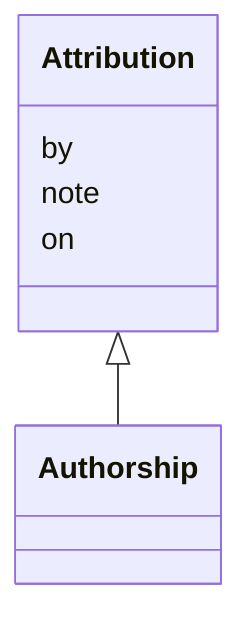

---
search:
  boost: 10.0
---

# Class: Attribution 


_Who wrote or decided something, and on which day._


<div data-search-exclude markdown="1">


URI: [pc:Attribution](https://pruzhany.org/ns/sourced-entities#Attribution)





## Inheritance
* **Attribution**
    * [Authorship](Authorship.md)


## Slots

| Name | Cardinality and Range | Description | Inheritance |
| ---  | --- | --- | --- |
| [by](by.md) | 1 <br/> [NonBlankText](NonBlankText.md) | Who it was: a person's name or the name of the program or model that did it. | direct |
| [on](on.md) | 1 <br/> [IsoDay](IsoDay.md) | The day it was done, written YYYY-MM-DD. | direct |
| [note](note.md) | 0..1 <br/> [String](String.md) | A remark in words about how it was done, where one was kept. | direct |


## Identifier and Mapping Information


### Schema Source


* from schema: https://pruzhany.org/ns/site_common


## Mappings

| Mapping Type | Mapped Value |
| ---  | ---  |
| self | pc:Attribution |
| native | pc:Attribution |


## LinkML Source

<!-- TODO: investigate https://stackoverflow.com/questions/37606292/how-to-create-tabbed-code-blocks-in-mkdocs-or-sphinx -->

### Direct

<details>
```yaml
name: Attribution
description: Who wrote or decided something, and on which day.
from_schema: https://pruzhany.org/ns/site_common
rank: 1000
attributes:
  by:
    name: by
    description: 'Who it was: a person''s name or the name of the program or model
      that did it.'
    from_schema: https://pruzhany.org/ns/sourced_entities_attribution
    rank: 1000
    domain_of:
    - Attribution
    range: NonBlankText
    required: true
  'on':
    name: 'on'
    description: The day it was done, written YYYY-MM-DD.
    from_schema: https://pruzhany.org/ns/sourced_entities_attribution
    rank: 1000
    domain_of:
    - Attribution
    range: IsoDay
    required: true
  note:
    name: note
    description: A remark in words about how it was done, where one was kept.
    from_schema: https://pruzhany.org/ns/sourced_entities_attribution
    rank: 1000
    domain_of:
    - Attribution

```
</details>

### Induced

<details>
```yaml
name: Attribution
description: Who wrote or decided something, and on which day.
from_schema: https://pruzhany.org/ns/site_common
rank: 1000
attributes:
  by:
    name: by
    description: 'Who it was: a person''s name or the name of the program or model
      that did it.'
    from_schema: https://pruzhany.org/ns/sourced_entities_attribution
    rank: 1000
    owner: Attribution
    domain_of:
    - Attribution
    range: NonBlankText
    required: true
  'on':
    name: 'on'
    description: The day it was done, written YYYY-MM-DD.
    from_schema: https://pruzhany.org/ns/sourced_entities_attribution
    rank: 1000
    owner: Attribution
    domain_of:
    - Attribution
    range: IsoDay
    required: true
  note:
    name: note
    description: A remark in words about how it was done, where one was kept.
    from_schema: https://pruzhany.org/ns/sourced_entities_attribution
    rank: 1000
    owner: Attribution
    domain_of:
    - Attribution
    range: string

```
</details></div>
