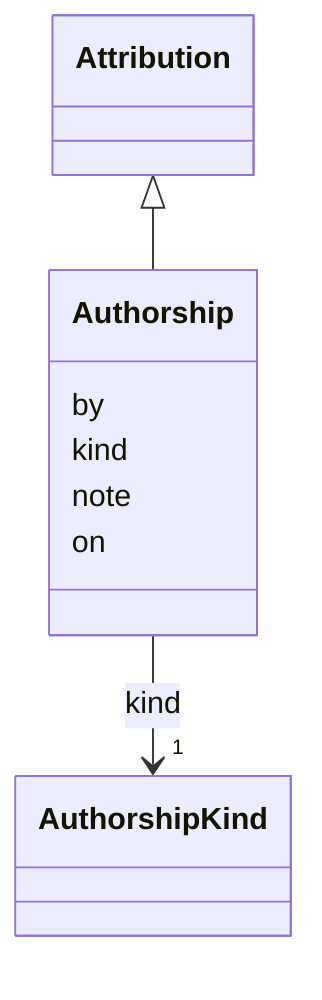

---
search:
  boost: 10.0
---

# Class: Authorship 


_Who wrote a supplied title, a translation or a check of one, a person or a model, and on which day._


<div data-search-exclude markdown="1">


URI: [pc:Authorship](https://pruzhany.org/ns/sourced-entities#Authorship)





## Inheritance
* [Attribution](Attribution.md)
    * **Authorship**


## Slots

| Name | Cardinality and Range | Description | Inheritance |
| ---  | --- | --- | --- |
| [kind](kind.md) | 1 <br/> [AuthorshipKind](AuthorshipKind.md) | Whether a person or a model wrote it. | direct |
| [by](by.md) | 1 <br/> [NonBlankText](NonBlankText.md) | Who it was: a person's name or the name of the program or model that did it. | [Attribution](Attribution.md) |
| [on](on.md) | 1 <br/> [IsoDay](IsoDay.md) | The day it was done, written YYYY-MM-DD. | [Attribution](Attribution.md) |
| [note](note.md) | 0..1 <br/> [String](String.md) | A remark in words about how it was done, where one was kept. | [Attribution](Attribution.md) |


## Usages

| used by | used in | type | used |
| ---  | --- | --- | --- |
| [EnglishCheck](EnglishCheck.md) | [attribution](attribution.md) | range | [Authorship](Authorship.md) |
| [TitleCheck](TitleCheck.md) | [attribution](attribution.md) | range | [Authorship](Authorship.md) |
| [TranslationCheck](TranslationCheck.md) | [attribution](attribution.md) | range | [Authorship](Authorship.md) |
| [SuppliedTitle](SuppliedTitle.md) | [attribution](attribution.md) | range | [Authorship](Authorship.md) |
| [Translation](Translation.md) | [attribution](attribution.md) | range | [Authorship](Authorship.md) |


## Identifier and Mapping Information


### Schema Source


* from schema: https://pruzhany.org/ns/site_common


## Mappings

| Mapping Type | Mapped Value |
| ---  | ---  |
| self | pc:Authorship |
| native | pc:Authorship |
| exact | pc:site_authorship |


## LinkML Source

<!-- TODO: investigate https://stackoverflow.com/questions/37606292/how-to-create-tabbed-code-blocks-in-mkdocs-or-sphinx -->

### Direct

<details>
```yaml
name: Authorship
description: Who wrote a supplied title, a translation or a check of one, a person
  or a model, and on which day.
from_schema: https://pruzhany.org/ns/site_common
exact_mappings:
- pc:site_authorship
rank: 1000
is_a: Attribution
attributes:
  kind:
    name: kind
    description: Whether a person or a model wrote it.
    from_schema: https://pruzhany.org/ns/site_common
    rank: 1000
    domain_of:
    - Authorship
    range: AuthorshipKind
    required: true

```
</details>

### Induced

<details>
```yaml
name: Authorship
description: Who wrote a supplied title, a translation or a check of one, a person
  or a model, and on which day.
from_schema: https://pruzhany.org/ns/site_common
exact_mappings:
- pc:site_authorship
rank: 1000
is_a: Attribution
attributes:
  kind:
    name: kind
    description: Whether a person or a model wrote it.
    from_schema: https://pruzhany.org/ns/site_common
    rank: 1000
    owner: Authorship
    domain_of:
    - Authorship
    range: AuthorshipKind
    required: true
  by:
    name: by
    description: 'Who it was: a person''s name or the name of the program or model
      that did it.'
    from_schema: https://pruzhany.org/ns/sourced_entities_attribution
    rank: 1000
    owner: Authorship
    domain_of:
    - Attribution
    range: NonBlankText
    required: true
  'on':
    name: 'on'
    description: The day it was done, written YYYY-MM-DD.
    from_schema: https://pruzhany.org/ns/sourced_entities_attribution
    rank: 1000
    owner: Authorship
    domain_of:
    - Attribution
    range: IsoDay
    required: true
  note:
    name: note
    description: A remark in words about how it was done, where one was kept.
    from_schema: https://pruzhany.org/ns/sourced_entities_attribution
    rank: 1000
    owner: Authorship
    domain_of:
    - Attribution
    range: string

```
</details></div>
