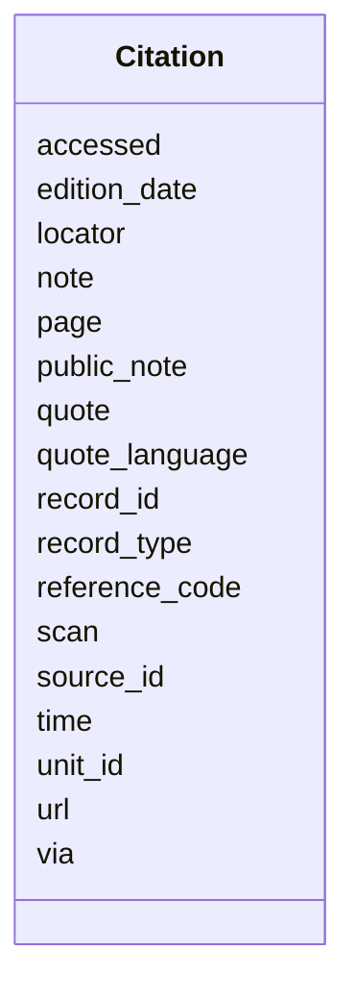

---
search:
  boost: 10.0
---

# Class: Citation 


_Where in one source a statement's evidence lies: the source, and the record, page, scan, time, piece of the paper, address or pointer within it, with the quoted words._


<div data-search-exclude markdown="1">


URI: [pc:Citation](https://pruzhany.org/ns/sourced-entities#Citation)





<!-- no inheritance hierarchy -->

## Slots

| Name | Cardinality and Range | Description | Inheritance |
| ---  | --- | --- | --- |
| [source_id](source_id.md) | 1 <br/> [NonBlankText](NonBlankText.md) | The record the statement rests on (the original where it is known), by its id in the record's sources. | direct |
| [via](via.md) | 0..1 <br/> [NonBlankText](NonBlankText.md) | The one source actually read, a copy or a transcription of the original, by its id. | direct |
| [reference_code](reference_code.md) | 0..1 <br/> [NonBlankText](NonBlankText.md) | The holder's reference of the document cited, where the source is a set of many. | direct |
| [record_type](record_type.md) | 0..1 <br/> [NonBlankText](NonBlankText.md) | The holder's own type of the record, such as Page of Testimony. | direct |
| [quote_language](quote_language.md) | 0..1 <br/> [LanguageTag](LanguageTag.md) | The quote's language, where it is not the source's (a translation). | direct |
| [public_note](public_note.md) | 0..1 <br/> [NonBlankText](NonBlankText.md) | Our reviewed words for the page about this evidence, apart from the record's quote. | direct |
| [locator](locator.md) | 0..1 <br/> [NonBlankText](NonBlankText.md) | An internal pointer into the project's files; never published and never a holder's record number. | direct |
| [record_id](record_id.md) | 0..1 <br/> [String](String.md) | The holder's own number for the record, such as a Yad Vashem record number. | direct |
| [page](page.md) | 0..1 <br/> [String](String.md) | The page, folio or entry cited. | direct |
| [scan](scan.md) | 0..1 <br/> [String](String.md) | The scan or image cited. | direct |
| [time](time.md) | 0..1 <br/> [String](String.md) | The time in a recording. | direct |
| [edition_date](edition_date.md) | 0..1 <br/> [String](String.md) | The day of the paper's issue cited, written YYYY-MM-DD. | direct |
| [unit_id](unit_id.md) | 0..1 <br/> [String](String.md) | The piece of the paper cited, by its content item id. | direct |
| [url](url.md) | 0..1 <br/> [HttpsUri](HttpsUri.md) | The record's web address. | direct |
| [quote](quote.md) | 0..1 <br/> [String](String.md) | The record's own words, exactly. | direct |
| [note](note.md) | 0..1 <br/> [String](String.md) | Our private note on the evidence; never published. | direct |
| [accessed](accessed.md) | 0..1 <br/> [IsoDay](IsoDay.md) | The day a person read the record. | direct |

<details>
<summary>Expressions & Logic</summary>
#### Any Of

The class must satisfy at least one of:
- AnonymousClassExpression({
  'description': 'A citation names where in its source the evidence is.',
  'slot_conditions': {'record_id': SlotDefinition({'name': 'record_id', 'required': True, 'pattern': '\\S'})}
})
- AnonymousClassExpression({
  'slot_conditions': {'page': SlotDefinition({'name': 'page', 'required': True, 'pattern': '\\S'})}
})
- AnonymousClassExpression({
  'slot_conditions': {'scan': SlotDefinition({'name': 'scan', 'required': True, 'pattern': '\\S'})}
})
- AnonymousClassExpression({
  'slot_conditions': {'time': SlotDefinition({'name': 'time', 'required': True, 'pattern': '\\S'})}
})
- AnonymousClassExpression({
  'slot_conditions': {'unit_id': SlotDefinition({'name': 'unit_id', 'required': True, 'pattern': '\\S'})}
})
- AnonymousClassExpression({'slot_conditions': {'url': SlotDefinition({'name': 'url', 'required': True})}})
- AnonymousClassExpression({
  'slot_conditions': {'locator': SlotDefinition({'name': 'locator', 'required': True})}
})
- AnonymousClassExpression({
  'slot_conditions': {'reference_code': SlotDefinition({'name': 'reference_code', 'required': True})}
})

</details>


## Usages

| used by | used in | type | used |
| ---  | --- | --- | --- |
| [Fact](Fact.md) | [citations](citations.md) | range | [Citation](Citation.md) |
| [Name](Name.md) | [citations](citations.md) | range | [Citation](Citation.md) |


## Identifier and Mapping Information


### Schema Source


* from schema: https://pruzhany.org/ns/site_common


## Mappings

| Mapping Type | Mapped Value |
| ---  | ---  |
| self | pc:Citation |
| native | pc:Citation |


## LinkML Source

<!-- TODO: investigate https://stackoverflow.com/questions/37606292/how-to-create-tabbed-code-blocks-in-mkdocs-or-sphinx -->

### Direct

<details>
```yaml
name: Citation
description: 'Where in one source a statement''s evidence lies: the source, and the
  record, page, scan, time, piece of the paper, address or pointer within it, with
  the quoted words.'
from_schema: https://pruzhany.org/ns/site_common
rank: 1000
attributes:
  source_id:
    name: source_id
    description: The record the statement rests on (the original where it is known),
      by its id in the record's sources.
    from_schema: https://pruzhany.org/ns/sourced_entities
    slot_uri: rico:isEvidencedBy
    domain_of:
    - SourceDerivation
    - Citation
    range: NonBlankText
    required: true
  via:
    name: via
    description: The one source actually read, a copy or a transcription of the original,
      by its id.
    from_schema: https://pruzhany.org/ns/sourced_entities
    rank: 1000
    domain_of:
    - Citation
    range: NonBlankText
  reference_code:
    name: reference_code
    description: The holder's reference of the document cited, where the source is
      a set of many.
    from_schema: https://pruzhany.org/ns/sourced_entities
    slot_uri: rico:hasOrHadIdentifier
    domain_of:
    - Source
    - Citation
    range: NonBlankText
  record_type:
    name: record_type
    description: The holder's own type of the record, such as Page of Testimony.
    from_schema: https://pruzhany.org/ns/sourced_entities
    rank: 1000
    slot_uri: rico:hasDocumentaryFormType
    domain_of:
    - Citation
    range: NonBlankText
  quote_language:
    name: quote_language
    description: The quote's language, where it is not the source's (a translation).
    from_schema: https://pruzhany.org/ns/sourced_entities
    rank: 1000
    slot_uri: rico:hasOrHadLanguage
    domain_of:
    - Citation
    range: LanguageTag
  public_note:
    name: public_note
    description: Our reviewed words for the page about this evidence, apart from the
      record's quote.
    from_schema: https://pruzhany.org/ns/sourced_entities
    rank: 1000
    slot_uri: pc:site_citation_public_note
    domain_of:
    - Citation
    range: NonBlankText
  locator:
    name: locator
    description: An internal pointer into the project's files; never published and
      never a holder's record number.
    from_schema: https://pruzhany.org/ns/sourced_entities
    rank: 1000
    slot_uri: pc:site_citation_locator
    domain_of:
    - Citation
    range: NonBlankText
  record_id:
    name: record_id
    description: The holder's own number for the record, such as a Yad Vashem record
      number.
    from_schema: https://pruzhany.org/ns/sourced_entities
    rank: 1000
    slot_uri: rico:hasOrHadIdentifier
    domain_of:
    - Citation
    range: string
  page:
    name: page
    description: The page, folio or entry cited.
    from_schema: https://pruzhany.org/ns/sourced_entities
    rank: 1000
    domain_of:
    - Citation
    range: string
  scan:
    name: scan
    description: The scan or image cited.
    from_schema: https://pruzhany.org/ns/sourced_entities
    rank: 1000
    domain_of:
    - Citation
    range: string
  time:
    name: time
    description: The time in a recording.
    from_schema: https://pruzhany.org/ns/sourced_entities
    rank: 1000
    domain_of:
    - Citation
    range: string
  edition_date:
    name: edition_date
    description: The day of the paper's issue cited, written YYYY-MM-DD.
    from_schema: https://pruzhany.org/ns/sourced_entities
    rank: 1000
    domain_of:
    - Citation
    range: string
  unit_id:
    name: unit_id
    description: The piece of the paper cited, by its content item id.
    from_schema: https://pruzhany.org/ns/sourced_entities
    rank: 1000
    domain_of:
    - Citation
    - Mention
    range: string
  url:
    name: url
    description: The record's web address.
    from_schema: https://pruzhany.org/ns/sourced_entities
    rank: 1000
    domain_of:
    - Citation
    range: HttpsUri
  quote:
    name: quote
    description: The record's own words, exactly.
    from_schema: https://pruzhany.org/ns/sourced_entities
    rank: 1000
    domain_of:
    - Citation
    range: string
  note:
    name: note
    description: Our private note on the evidence; never published.
    from_schema: https://pruzhany.org/ns/sourced_entities
    domain_of:
    - Attribution
    - Citation
    range: string
  accessed:
    name: accessed
    description: The day a person read the record.
    from_schema: https://pruzhany.org/ns/sourced_entities
    rank: 1000
    domain_of:
    - Citation
    range: IsoDay
any_of:
- description: A citation names where in its source the evidence is.
  slot_conditions:
    record_id:
      name: record_id
      required: true
      pattern: \S
- slot_conditions:
    page:
      name: page
      required: true
      pattern: \S
- slot_conditions:
    scan:
      name: scan
      required: true
      pattern: \S
- slot_conditions:
    time:
      name: time
      required: true
      pattern: \S
- slot_conditions:
    unit_id:
      name: unit_id
      required: true
      pattern: \S
- slot_conditions:
    url:
      name: url
      required: true
- slot_conditions:
    locator:
      name: locator
      required: true
- slot_conditions:
    reference_code:
      name: reference_code
      required: true

```
</details>

### Induced

<details>
```yaml
name: Citation
description: 'Where in one source a statement''s evidence lies: the source, and the
  record, page, scan, time, piece of the paper, address or pointer within it, with
  the quoted words.'
from_schema: https://pruzhany.org/ns/site_common
rank: 1000
attributes:
  source_id:
    name: source_id
    description: The record the statement rests on (the original where it is known),
      by its id in the record's sources.
    from_schema: https://pruzhany.org/ns/sourced_entities
    slot_uri: rico:isEvidencedBy
    owner: Citation
    domain_of:
    - SourceDerivation
    - Citation
    range: NonBlankText
    required: true
  via:
    name: via
    description: The one source actually read, a copy or a transcription of the original,
      by its id.
    from_schema: https://pruzhany.org/ns/sourced_entities
    rank: 1000
    owner: Citation
    domain_of:
    - Citation
    range: NonBlankText
  reference_code:
    name: reference_code
    description: The holder's reference of the document cited, where the source is
      a set of many.
    from_schema: https://pruzhany.org/ns/sourced_entities
    slot_uri: rico:hasOrHadIdentifier
    owner: Citation
    domain_of:
    - Source
    - Citation
    range: NonBlankText
  record_type:
    name: record_type
    description: The holder's own type of the record, such as Page of Testimony.
    from_schema: https://pruzhany.org/ns/sourced_entities
    rank: 1000
    slot_uri: rico:hasDocumentaryFormType
    owner: Citation
    domain_of:
    - Citation
    range: NonBlankText
  quote_language:
    name: quote_language
    description: The quote's language, where it is not the source's (a translation).
    from_schema: https://pruzhany.org/ns/sourced_entities
    rank: 1000
    slot_uri: rico:hasOrHadLanguage
    owner: Citation
    domain_of:
    - Citation
    range: LanguageTag
  public_note:
    name: public_note
    description: Our reviewed words for the page about this evidence, apart from the
      record's quote.
    from_schema: https://pruzhany.org/ns/sourced_entities
    rank: 1000
    slot_uri: pc:site_citation_public_note
    owner: Citation
    domain_of:
    - Citation
    range: NonBlankText
  locator:
    name: locator
    description: An internal pointer into the project's files; never published and
      never a holder's record number.
    from_schema: https://pruzhany.org/ns/sourced_entities
    rank: 1000
    slot_uri: pc:site_citation_locator
    owner: Citation
    domain_of:
    - Citation
    range: NonBlankText
  record_id:
    name: record_id
    description: The holder's own number for the record, such as a Yad Vashem record
      number.
    from_schema: https://pruzhany.org/ns/sourced_entities
    rank: 1000
    slot_uri: rico:hasOrHadIdentifier
    owner: Citation
    domain_of:
    - Citation
    range: string
  page:
    name: page
    description: The page, folio or entry cited.
    from_schema: https://pruzhany.org/ns/sourced_entities
    rank: 1000
    owner: Citation
    domain_of:
    - Citation
    range: string
  scan:
    name: scan
    description: The scan or image cited.
    from_schema: https://pruzhany.org/ns/sourced_entities
    rank: 1000
    owner: Citation
    domain_of:
    - Citation
    range: string
  time:
    name: time
    description: The time in a recording.
    from_schema: https://pruzhany.org/ns/sourced_entities
    rank: 1000
    owner: Citation
    domain_of:
    - Citation
    range: string
  edition_date:
    name: edition_date
    description: The day of the paper's issue cited, written YYYY-MM-DD.
    from_schema: https://pruzhany.org/ns/sourced_entities
    rank: 1000
    owner: Citation
    domain_of:
    - Citation
    range: string
  unit_id:
    name: unit_id
    description: The piece of the paper cited, by its content item id.
    from_schema: https://pruzhany.org/ns/sourced_entities
    rank: 1000
    owner: Citation
    domain_of:
    - Citation
    - Mention
    range: string
  url:
    name: url
    description: The record's web address.
    from_schema: https://pruzhany.org/ns/sourced_entities
    rank: 1000
    owner: Citation
    domain_of:
    - Citation
    range: HttpsUri
  quote:
    name: quote
    description: The record's own words, exactly.
    from_schema: https://pruzhany.org/ns/sourced_entities
    rank: 1000
    owner: Citation
    domain_of:
    - Citation
    range: string
  note:
    name: note
    description: Our private note on the evidence; never published.
    from_schema: https://pruzhany.org/ns/sourced_entities
    owner: Citation
    domain_of:
    - Attribution
    - Citation
    range: string
  accessed:
    name: accessed
    description: The day a person read the record.
    from_schema: https://pruzhany.org/ns/sourced_entities
    rank: 1000
    owner: Citation
    domain_of:
    - Citation
    range: IsoDay
any_of:
- description: A citation names where in its source the evidence is.
  slot_conditions:
    record_id:
      name: record_id
      required: true
      pattern: \S
- slot_conditions:
    page:
      name: page
      required: true
      pattern: \S
- slot_conditions:
    scan:
      name: scan
      required: true
      pattern: \S
- slot_conditions:
    time:
      name: time
      required: true
      pattern: \S
- slot_conditions:
    unit_id:
      name: unit_id
      required: true
      pattern: \S
- slot_conditions:
    url:
      name: url
      required: true
- slot_conditions:
    locator:
      name: locator
      required: true
- slot_conditions:
    reference_code:
      name: reference_code
      required: true

```
</details></div>
