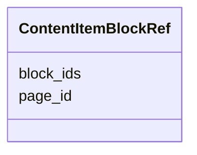

---
search:
  boost: 10.0
---

# Class: ContentItemBlockRef 


_The regions of one page that a content item or a section heading covers, in reading order._


<div data-search-exclude markdown="1">


URI: [pc:ContentItemBlockRef](https://pruzhany.org/ns/sourced-entities#ContentItemBlockRef)





<!-- no inheritance hierarchy -->

## Slots

| Name | Cardinality and Range | Description | Inheritance |
| ---  | --- | --- | --- |
| [page_id](page_id.md) | 1 <br/> [NonBlankText](NonBlankText.md) | The page, by its id in the pages document. | direct |
| [block_ids](block_ids.md) | 1..* <br/> [NonBlankText](NonBlankText.md) | The regions on that page, by their ids in the pages document, in reading order. | direct |


## Identifier and Mapping Information


### Schema Source


* from schema: https://pruzhany.org/ns/site_common


## Mappings

| Mapping Type | Mapped Value |
| ---  | ---  |
| self | pc:ContentItemBlockRef |
| native | pc:ContentItemBlockRef |


## LinkML Source

<!-- TODO: investigate https://stackoverflow.com/questions/37606292/how-to-create-tabbed-code-blocks-in-mkdocs-or-sphinx -->

### Direct

<details>
```yaml
name: ContentItemBlockRef
description: The regions of one page that a content item or a section heading covers,
  in reading order.
from_schema: https://pruzhany.org/ns/site_common
rank: 1000
attributes:
  page_id:
    name: page_id
    description: The page, by its id in the pages document.
    from_schema: https://pruzhany.org/ns/site_common
    rank: 1000
    domain_of:
    - ContentItemBlockRef
    range: NonBlankText
    required: true
  block_ids:
    name: block_ids
    description: The regions on that page, by their ids in the pages document, in
      reading order.
    from_schema: https://pruzhany.org/ns/site_common
    rank: 1000
    domain_of:
    - ContentItemBlockRef
    range: NonBlankText
    required: true
    multivalued: true
    minimum_cardinality: 1

```
</details>

### Induced

<details>
```yaml
name: ContentItemBlockRef
description: The regions of one page that a content item or a section heading covers,
  in reading order.
from_schema: https://pruzhany.org/ns/site_common
rank: 1000
attributes:
  page_id:
    name: page_id
    description: The page, by its id in the pages document.
    from_schema: https://pruzhany.org/ns/site_common
    rank: 1000
    owner: ContentItemBlockRef
    domain_of:
    - ContentItemBlockRef
    range: NonBlankText
    required: true
  block_ids:
    name: block_ids
    description: The regions on that page, by their ids in the pages document, in
      reading order.
    from_schema: https://pruzhany.org/ns/site_common
    rank: 1000
    owner: ContentItemBlockRef
    domain_of:
    - ContentItemBlockRef
    range: NonBlankText
    required: true
    multivalued: true
    minimum_cardinality: 1

```
</details></div>
