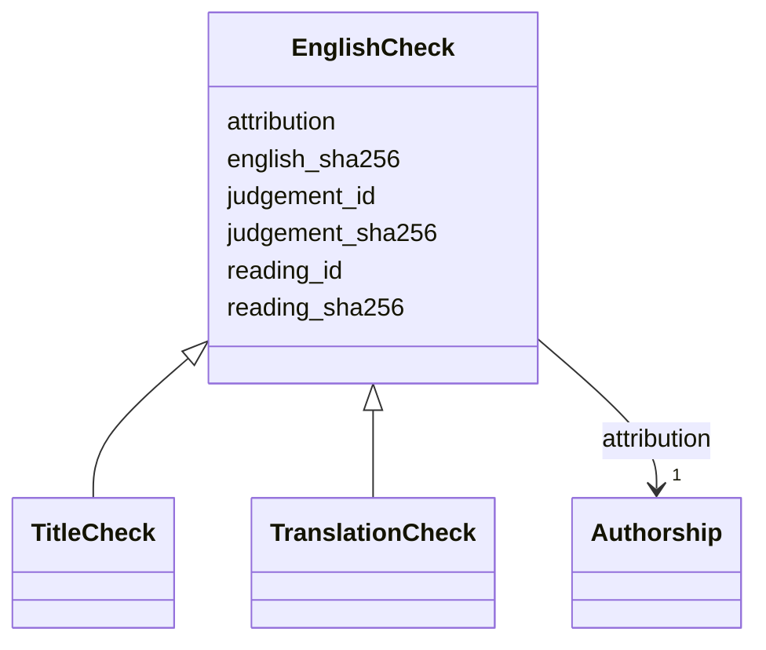

---
search:
  boost: 10.0
---

# Class: EnglishCheck 


_A later, separate check of one English field against one exact reading of the printed text, bound to both and to the judgement kept by their digests._


<div data-search-exclude markdown="1">


URI: [rico:Activity](https://www.ica.org/standards/RiC/ontology#Activity)





## Inheritance
* **EnglishCheck**
    * [TitleCheck](TitleCheck.md)
    * [TranslationCheck](TranslationCheck.md)


## Class Properties

| Property | Value |
| --- | --- |
| Class URI | [rico:Activity](https://www.ica.org/standards/RiC/ontology#Activity) |


## Slots

| Name | Cardinality and Range | Description | Inheritance |
| ---  | --- | --- | --- |
| [reading_id](reading_id.md) | 1 <br/> [NonBlankText](NonBlankText.md) | The reading of the printed text that the English was checked against. | direct |
| [reading_sha256](reading_sha256.md) | 1 <br/> [Sha256Hex](Sha256Hex.md) | The SHA-256 digest of that reading's exact UTF-8 bytes. | direct |
| [english_sha256](english_sha256.md) | 1 <br/> [Sha256Hex](Sha256Hex.md) | The SHA-256 digest of the checked English field's exact UTF-8 bytes. | direct |
| [judgement_id](judgement_id.md) | 1 <br/> [String](String.md) | The kept judgement, by an id without spaces followed by the field it judged, :title or :text. | direct |
| [judgement_sha256](judgement_sha256.md) | 1 <br/> [Sha256Hex](Sha256Hex.md) | The SHA-256 digest of the kept judgement file's exact bytes. | direct |
| [attribution](attribution.md) | 1 <br/> [Authorship](Authorship.md) | Who checked it, and on which day. | direct |


## Identifier and Mapping Information


### Schema Source


* from schema: https://pruzhany.org/ns/site_common


## Mappings

| Mapping Type | Mapped Value |
| ---  | ---  |
| self | rico:Activity |
| native | pc:EnglishCheck |


## LinkML Source

<!-- TODO: investigate https://stackoverflow.com/questions/37606292/how-to-create-tabbed-code-blocks-in-mkdocs-or-sphinx -->

### Direct

<details>
```yaml
name: EnglishCheck
description: A later, separate check of one English field against one exact reading
  of the printed text, bound to both and to the judgement kept by their digests.
from_schema: https://pruzhany.org/ns/site_common
rank: 1000
attributes:
  reading_id:
    name: reading_id
    description: The reading of the printed text that the English was checked against.
    from_schema: https://pruzhany.org/ns/site_common
    rank: 1000
    domain_of:
    - EnglishCheck
    range: NonBlankText
    required: true
  reading_sha256:
    name: reading_sha256
    description: The SHA-256 digest of that reading's exact UTF-8 bytes.
    from_schema: https://pruzhany.org/ns/site_common
    rank: 1000
    slot_uri: pc:site_reading_sha256
    domain_of:
    - EnglishCheck
    range: Sha256Hex
    required: true
  english_sha256:
    name: english_sha256
    description: The SHA-256 digest of the checked English field's exact UTF-8 bytes.
    from_schema: https://pruzhany.org/ns/site_common
    rank: 1000
    slot_uri: pc:site_english_sha256
    domain_of:
    - EnglishCheck
    range: Sha256Hex
    required: true
  judgement_id:
    name: judgement_id
    description: The kept judgement, by an id without spaces followed by the field
      it judged, :title or :text.
    from_schema: https://pruzhany.org/ns/site_common
    rank: 1000
    domain_of:
    - EnglishCheck
    required: true
    pattern: ^[^\s\u0085\uFEFF]+:(title|text)$(?![\s\S])
  judgement_sha256:
    name: judgement_sha256
    description: The SHA-256 digest of the kept judgement file's exact bytes.
    from_schema: https://pruzhany.org/ns/site_common
    rank: 1000
    slot_uri: pc:site_judgement_sha256
    domain_of:
    - EnglishCheck
    range: Sha256Hex
    required: true
  attribution:
    name: attribution
    description: Who checked it, and on which day.
    from_schema: https://pruzhany.org/ns/site_common
    rank: 1000
    domain_of:
    - EnglishCheck
    - SuppliedTitle
    - Translation
    range: Authorship
    required: true
    inlined: true
class_uri: rico:Activity

```
</details>

### Induced

<details>
```yaml
name: EnglishCheck
description: A later, separate check of one English field against one exact reading
  of the printed text, bound to both and to the judgement kept by their digests.
from_schema: https://pruzhany.org/ns/site_common
rank: 1000
attributes:
  reading_id:
    name: reading_id
    description: The reading of the printed text that the English was checked against.
    from_schema: https://pruzhany.org/ns/site_common
    rank: 1000
    owner: EnglishCheck
    domain_of:
    - EnglishCheck
    range: NonBlankText
    required: true
  reading_sha256:
    name: reading_sha256
    description: The SHA-256 digest of that reading's exact UTF-8 bytes.
    from_schema: https://pruzhany.org/ns/site_common
    rank: 1000
    slot_uri: pc:site_reading_sha256
    owner: EnglishCheck
    domain_of:
    - EnglishCheck
    range: Sha256Hex
    required: true
  english_sha256:
    name: english_sha256
    description: The SHA-256 digest of the checked English field's exact UTF-8 bytes.
    from_schema: https://pruzhany.org/ns/site_common
    rank: 1000
    slot_uri: pc:site_english_sha256
    owner: EnglishCheck
    domain_of:
    - EnglishCheck
    range: Sha256Hex
    required: true
  judgement_id:
    name: judgement_id
    description: The kept judgement, by an id without spaces followed by the field
      it judged, :title or :text.
    from_schema: https://pruzhany.org/ns/site_common
    rank: 1000
    owner: EnglishCheck
    domain_of:
    - EnglishCheck
    range: string
    required: true
    pattern: ^[^\s\u0085\uFEFF]+:(title|text)$(?![\s\S])
  judgement_sha256:
    name: judgement_sha256
    description: The SHA-256 digest of the kept judgement file's exact bytes.
    from_schema: https://pruzhany.org/ns/site_common
    rank: 1000
    slot_uri: pc:site_judgement_sha256
    owner: EnglishCheck
    domain_of:
    - EnglishCheck
    range: Sha256Hex
    required: true
  attribution:
    name: attribution
    description: Who checked it, and on which day.
    from_schema: https://pruzhany.org/ns/site_common
    rank: 1000
    owner: EnglishCheck
    domain_of:
    - EnglishCheck
    - SuppliedTitle
    - Translation
    range: Authorship
    required: true
    inlined: true
class_uri: rico:Activity

```
</details></div>
